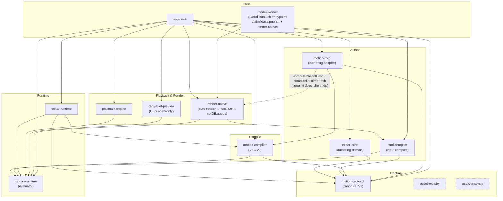

# Bức tranh toàn cảnh Neonix

## Phạm vi của tài liệu này

Đây là bản đồ kiến trúc cấp hệ thống của Neonix. Tài liệu này chỉ dùng để
thảo luận và thống nhất:

- các tầng và luồng dữ liệu;
- ranh giới trách nhiệm giữa các thành phần;
- các nguyên tắc bất biến của hệ thống;
- các quyết định giúp kiến trúc đơn giản và nhất quán.

Tài liệu này không mô tả code, API cụ thể, câu lệnh chạy, cấu hình deploy,
chi tiết database, test implementation, tối ưu hiệu năng hoặc kế hoạch thực
thi. Những nội dung đó chỉ được viết sau khi bản đồ kiến trúc đã được thống
nhất.

Neonix là một hệ thống tạo, chỉnh sửa và render video. Neonix có **hai kiến
trúc render độc lập**, tách nhau ngay từ bước Author và không chia sẻ render
core hay backend cho nhau. Xem mục "Hai kiến trúc render độc lập" ngay dưới
đây trước khi đọc phần còn lại của tài liệu — phần lớn nội dung phía sau (từ
"Render core and backend boundary" đến hết) mô tả **Kiến trúc A: JSON Native
Render** duy nhất; **Kiến trúc B: HTML Frame Render** được mô tả riêng và có
ranh giới của chính nó.

### Kiến trúc A — JSON Native Render (đường sản phẩm hiện tại)

Toàn bộ đường đi của một project JSON được rút gọn thành:

> **Author → Protocol → Compile → Runtime → Render**

```text
                    ┌─────────────────────┐
                    │       USER / AI     │
                    └──────────┬──────────┘
                               │
                 tạo / sửa / điều khiển video
                               │
              ┌────────────────┼────────────────┐
              │                │                 │
              ▼                ▼                 ▼
           Editor             MCP             AI Agent
              │                │                 │
              └────────────────┼─────────────────┘
                               ▼
                    ┌─────────────────────┐
                    │ MotionProtocolV2    │
                    │   Project JSON      │
                    └──────────┬──────────┘
                               │
                               ▼
                    ┌─────────────────────┐
                    │      COMPILER       │
                    │      V2 → V3        │
                    └──────────┬──────────┘
                               │
                               ▼
                    ┌─────────────────────┐
                    │   RuntimeProjectV3  │
                    └──────────┬──────────┘
                               │
                    Runtime outputs
                    ┌──────────┴──────────┐
                    │                     │
                    ▼                     ▼
             ┌──────────────┐      ┌──────────────┐
             │   PLAYBACK   │      │    EXPORT    │
             │              │      │   Renderer   │
             └──────┬───────┘      └──────┬───────┘
                    │                     │
                    ▼                     ▼
             ┌──────────────┐        Native
             │   CanvasKit  │        Renderer
             │    Preview   │           │
             └──────┬───────┘           ▼
                    │                 FFmpeg
               CanvasKit/              │
                  Skia                 ▼
                    │                  MP4
                    └──────────┬────────┘
                               ▼
                              USER
```

## Hai kiến trúc render độc lập

Neonix có hai kiến trúc render tách biệt hoàn toàn, chọn ngay tại thời điểm
tạo project (đường tương ứng trong UI: "Dự án mới" cho Kiến trúc A, "Nhập
HTML → render nhanh" cho Kiến trúc B). Đây **không phải** hai backend của
cùng một render core — chúng không chia sẻ Protocol, Compiler, Runtime,
`PaintCommandBuffer`, hay export worker cho nhau.

```text
                    USER / AI
                        │
              chọn kiểu tạo project
                        │
        ┌───────────────┴───────────────┐
        │                               │
        ▼                               ▼
"Dự án mới" / MCP compile         "Nhập HTML → render nhanh"
        │                               │
        ▼                               ▼
┌──────────────────────┐      ┌──────────────────────────┐
│   KIẾN TRÚC A         │      │   KIẾN TRÚC B             │
│   JSON Native Render  │      │   HTML Frame Render       │
│                       │      │                           │
│  HTML/CSS (tuỳ chọn)  │      │  HTML/CSS (bắt buộc,      │
│    → MotionProtocolV2 │      │    duy nhất input)        │
│    → Compiler V2→V3   │      │  → Headless browser thật  │
│    → RuntimeProjectV3 │      │    (Playwright/Puppeteer  │
│    → PaintCommandBuffer│     │    hoặc service riêng)    │
│    → CanvasKit preview│      │  → Chụp screenshot mỗi    │
│      hoặc native Skia │      │    frame theo fps         │
│      export           │      │  → FFmpeg ghép frame      │
│    → FFmpeg mux       │      │    (+ audio nếu có)       │
│                       │      │                           │
│  Editable, persistent │      │  Không editable, không    │
│  JSON project         │      │  có JSON project          │
└──────────┬────────────┘      └────────────┬──────────────┘
           │                                │
           ▼                                ▼
          MP4                              MP4
```

| | Kiến trúc A — JSON Native Render | Kiến trúc B — HTML Frame Render |
| --- | --- | --- |
| Input | HTML/CSS (qua HTML Compiler) hoặc thao tác trực tiếp trên Protocol V2 qua Editor/MCP | Chỉ HTML/CSS, không có JSON |
| Authoring format | `MotionProtocolV2` — canonical, persistent, editable | Không có authoring format canonical; HTML là input một lần, không lưu lại thành project có thể mở lại chỉnh sửa |
| Render mechanism | Compiler → Runtime → `PaintCommandBuffer` → CanvasKit (preview) / native Skia (export) | Headless browser thật render trực tiếp DOM/CSS, chụp từng frame, không qua Runtime/PaintCommandBuffer |
| Xác định (determinism) | Deterministic theo hợp đồng `PaintCommandBuffer` — cùng JSON luôn ra cùng pixel | Không có cam kết deterministic cấp Neonix — phụ thuộc trực tiếp vào engine render của trình duyệt headless đang dùng |
| Chỉnh sửa sau khi tạo | Có — mọi layer/property độc lập trong Editor | Không — muốn đổi thì sửa HTML/CSS gốc và render lại từ đầu |
| Ai dùng | Người/agent cần một document có thể mở lại, chỉnh sửa, tái sử dụng qua Editor/MCP | Người chỉ cần "đưa HTML/CSS vào, lấy video ra", không quan tâm tới JSON hay chỉnh sửa lại |
| Package/service sở hữu | `html-compiler`, `motion-protocol`, `motion-compiler`, `motion-runtime`, `canvaskit-preview`, `render-native` (toàn bộ đã mô tả trong phần còn lại của tài liệu này) | Một service độc lập, nằm ngoài render core hiện tại (ví dụ một worker Python/script riêng chạy headless browser) — **chưa triển khai**, xem "Trạng thái triển khai Kiến trúc B" |
| Chromium/headless browser trong đường sản phẩm | **Cấm** (trừ ngoại lệ hẹp `layoutSnapshot` ở bước compile, xem quy tắc #12) | **Là cơ chế chính**, chấp nhận có chủ đích — đây là lý do kiến trúc này phải tách biệt hoàn toàn khỏi Kiến trúc A thay vì trở thành một nhánh fallback bên trong nó |

### Vì sao tách thành hai kiến trúc thay vì một kiến trúc hai backend

1. **Cam kết deterministic của Kiến trúc A không được phép bị pha loãng.**
   Toàn bộ lý do Neonix tự viết layout engine, dùng Skia/HarfBuzz trực tiếp
   thay vì mượn Chromium (xem "Công nghệ nền cho HTML Compiler và text
   runtime") là để tránh phụ thuộc cứng vào một tiến trình trình duyệt đang
   chạy lúc tạo ra kết quả cuối. Nếu Kiến trúc B trở thành một "chế độ" hay
   một fallback bên trong cùng export worker của Kiến trúc A, ranh giới đó
   sẽ vỡ ngay lập tức — export worker sẽ phải biết cả hai đường, và một lỗi
   ở đường headless-browser (font thiếu, race condition load asset, phiên
   bản Chromium khác nhau giữa các lần chạy) có thể rò rỉ giả định sai vào
   đường native.
2. **Hai đường có hợp đồng chất lượng khác nhau, không nên gộp chung một API.**
   Kiến trúc A cam kết cùng JSON luôn ra cùng pixel (xem "Quy tắc đơn giản
   hóa kiến trúc" #3). Kiến trúc B không có cam kết đó — chấp nhận đánh đổi
   deterministic lấy khả năng render bất kỳ HTML/CSS nào, kể cả phần
   `html-compiler` chưa hỗ trợ. Gộp chung nghĩa là làm yếu cam kết của Kiến
   trúc A để phục vụ một nhóm dùng khác hẳn.
3. **Không mâu thuẫn với vị trí sản phẩm hiện tại.** Trang so sánh Neonix vs
   Remotion/HyperFrames vẫn đúng cho Kiến trúc A — đó vẫn là đường sản phẩm
   chính, deterministic, không phụ thuộc Chromium lúc export. Kiến trúc B là
   một lối tắt UX riêng cho nhóm người dùng khác (xem bảng trên), không phải
   một bản thay thế cho Kiến trúc A.

### Trạng thái triển khai Kiến trúc B

Kiến trúc B **chưa được triển khai**. Quyết định đã chốt: input là HTML/CSS
thuần, cơ chế là headless browser thật (Playwright/Puppeteer hoặc một script/
service riêng, có thể viết bằng Python), output là MP4 trực tiếp — không đi
qua `MotionProtocolV2`/`html-compiler`/`motion-compiler`/`motion-runtime`.
Việc triển khai cụ thể (chọn thư viện headless browser, nơi host service,
cách đồng bộ audio, cách báo tiến trình cho Web API) sẽ được quyết định và
ghi lại khi bắt tay implement — tài liệu này chỉ khoá ranh giới kiến trúc:
Kiến trúc B không được phép nằm trong hoặc phụ thuộc vào bất kỳ package nào
liệt kê ở "Phân loại packages" của Kiến trúc A, và ngược lại.

## Render core and backend boundary

The visual render core is the `PaintCommandBuffer`. It is the backend-neutral
handoff produced after `RuntimeProjectV3` frame evaluation. The evaluator owns
timeline semantics; it must not know whether the consumer is a browser, CPU,
or GPU renderer.

```text
MotionProtocolV2
  -> Compiler
  -> RuntimeProjectV3
  -> shared frame evaluator
  -> PaintCommandBuffer
       |                         |
       v                         v
  CanvasKit / WebGL2       Native Skia CPU raster
  browser preview          export worker
                                  |
                                  v
                         libyuv -> libx264/FFmpeg
                                  |
                                  v
                                 MP4
```

This is the intended stable boundary:

- Browser preview replays the buffer through CanvasKit and its browser GPU
  surface.
- Native export replays the same buffer through Skia Native raster. The
  current production-native Cloud Run worker uses 4-vCPU CPU raster, direct
  raster surfaces, libyuv color conversion, and in-process libx264 encoding.
- Native Skia Vulkan/GPU remains a later backend behind the same command-buffer
  contract; it is not the current production export path.
- Assets and fonts are prepared by the host/worker and resolved at backend
  replay time. They must not be embedded as browser or GPU handles in
  `RuntimeProjectV3`.

### Implementation status

The native command-buffer worker and its Cloud Run render/chunk/finalizer jobs
are implemented and are the only production MP4 export path. The general
TypeScript entry point in `packages/render-native/src/render/render.ts`
hard-codes `renderer: "skia-native"` and explicitly rejects a CanvasKit/SVG
renderer selection at export time (`ExportRendererError`, code
`UNSUPPORTED_COMMAND`) - there is no CanvasKit fallback anywhere in the export
path. CanvasKit is used exclusively by `@motionvideo/canvaskit-preview` for
the browser UI preview; it never produces the exported MP4.

## HTML authoring boundary (one-way)

> Phạm vi: mục này mô tả **Kiến trúc A (JSON Native Render)**. Trong Kiến
> trúc B (HTML Frame Render), HTML/CSS không đi qua bước nào dưới đây — xem
> "Hai kiến trúc render độc lập" ở đầu tài liệu.

HTML/CSS is an optional high-level authoring format for AI agents, MCP and
developers. It is not a second canonical project format.

```text
HTML / CSS / agent intent
          |
          v
Neonix JSON V2  <-- canonical source of truth
          |
          v
compiler pipe
          |
          v
RuntimeProjectV3 / RuntimeFrameV3
          |
          +--> browser SVG
          +--> Native preview
          +--> export renderer
```

The direction is strictly one-way:

- HTML compiler lowers HTML/CSS into a validated Protocol V2 JSON document.
- Protocol V2 JSON is the only source of truth for persistence, preview,
  rendering and export.
- Runtime and renderers never read or compile HTML.
- Neonix does not provide a Protocol V2 JSON -> HTML reverse compiler.
- An HTML authoring revision is optional provenance linked to its canonical
  JSON revision; it must never replace or override that JSON revision.

For persistence, `project_revisions.document_json` is canonical. HTML source
is stored only as an authoring source and links to the JSON revision through
`project_html_revisions.protocol_revision_id`.

## Công nghệ nền cho HTML Compiler và text runtime

HTML Compiler và `@motionvideo/motion-runtime` (text shaping/layout) không tự
viết lại mọi thứ. Đây là quyết định kiến trúc có chủ đích, không phải tiện gì
dùng nấy — mỗi lựa chọn dưới đây đã được đối chiếu bằng số liệu thật (pixel
diff với Chrome thật, dung lượng bundle đo trực tiếp), không suy đoán.

### Đã mượn từ hệ sinh thái browser engine (Skia, HarfBuzz)

| Công nghệ | Dùng ở đâu | Lý do mượn thay vì tự viết |
| --- | --- | --- |
| **Skia** | `canvaskit-preview` (CanvasKit/WASM) và Export Renderer (native Skia) | Rasterization (path fill, gradient, blur, mask, filter) là bài toán tốn công tự viết lại nhất và ít giá trị khác biệt nhất để tự làm. Dùng đúng thư viện Blink dùng nghĩa là parity với Chrome đạt được bằng cách calibrate hệ số (đã làm với `cssShadowBlurRadiusToSkiaSigma`), không phải đoán mò thuật toán blur/shadow từ đầu. |
| **HarfBuzz** | `motion-runtime/visual/text-layout.ts` (`harfbuzzjs`) | Text shaping (ligature, kerning, joining chữ Ả Rập, GSUB/GPOS) là thuật toán phức tạp nhất trong toàn bộ pipeline chữ; đây cũng chính là thư viện Blink dùng trên mọi platform. |

### Cố tình KHÔNG mượn ICU — tự viết lại thuật toán, chấp nhận thiếu

Blink dùng ICU cho line-break (UAX #14) và bidi (UAX #9). Neonix **không**
dùng ICU (qua binding `icu4x`/ICU4X) mà tự thay bằng 2 thư viện độc lập, nhẹ
hơn nhiều lần:

| | ICU4X (không dùng) | Đã chọn thay thế | Đánh đổi |
| --- | --- | --- | --- |
| Line-break (UAX #14) | `icu` npm — đã đo thật: **20.5MB** wasm monolithic (gộp cả Calendar/Collator không cần) | `linebreak` (pure JS, ~228KB) — `motion-runtime/visual/line-break.ts` | Đúng cho Latin/Việt/CJK (đã verify bằng test thật); **chưa** đúng cho Thái/Lào/Khmer/Miến Điện (cần dữ liệu dictionary/LSTM ICU4X mới có) — ghi nhận ở `debt-technical.md`, không giấu |
| Bidi (UAX #9) | cùng gói `icu`, cùng chi phí 20.5MB | `bidi-js` (pure JS, ~206KB) — `motion-runtime/visual/bidi-resolve.ts` | Đúng cho Ả Rập/Hebrew (đã verify bằng pixel-diff Chrome thật + test hồi quy); rule L1 (whitespace cuối dòng) và vertical writing-mode chưa cài |

Lý do chọn nhẹ hơn thay vì đầy đủ hơn: đối tượng dùng thực tế hiện tại là
tiếng Anh/Việt (không cần cả hai thư viện) và CJK/Ả Rập/Hebrew (đã phủ đúng);
20MB cho một tính năng phần lớn người dùng không chạm tới là chi phí không
xứng đáng tại thời điểm này. Quyết định này có thể đảo ngược sau nếu nhu cầu
Thái/Lào/Khmer/Miến Điện xuất hiện thật.

### Layout (flex/grid/cascade) — tự viết, không mượn, không định mượn thêm

`packages/html-compiler/src/compiler/layout/` (flex.ts, grid.ts, geometry.ts)
và `css/cascade.ts` **không dựa trên** Blink LayoutNG, và **không dự định**
chuyển sang một layout engine ngoài (đã đánh giá và loại bỏ Taffy — xem
`sandbox/taffy-spike/README.md`). Lý do, theo thứ tự quan trọng:

1. **Kiểm soát được debug loop.** Mọi lỗi flex/grid tìm được phiên này (bug
   text-shadow sigma, line-break CJK, bidi reversal) đều sửa được bằng cách
   đọc đúng file, đúng dòng, rồi verify lại bằng Chrome thật — không phải chờ
   một binding bên thứ ba vá lỗi tầng dịch của chính nó.
2. **Giữ compile đồng bộ.** `compileDocument`/`compileHtmlCss` hiện chạy hoàn
   toàn đồng bộ, không có wasm nào trong đường compile chính (HarfBuzz chỉ
   async ở một pre-pass đo text-sizing TÙY CHỌN, tách biệt khỏi compile
   chính). Một layout engine dạng WASM sẽ ép toàn bộ compile phải học sống
   chung với async wasm-init — thay đổi kiến trúc thật, không đáng đánh đổi
   chỉ để có sẵn vài keyword CSS.
3. **Root-cause lớn nhất (intrinsic min/max-content sizing) không được giải
   quyết miễn phí dù dùng engine ngoài** — engine ngoài nào cũng cần tự nối
   vào hệ đo text thật (`measureVisualRuntimeTextIntrinsicWidths`, đã có sẵn
   trong `motion-runtime` nhưng chưa được `flex.ts`/`grid.ts` gọi tới) —
   nghĩa là phần việc khó nhất phải tự làm bất kể chọn hướng nào.

Vẫn **không dùng một layout engine ngoài** (đã loại Taffy, không đổi). Nhưng
có một ngoại lệ hẹp, khác bản chất với việc "thay engine": xem mục ngay dưới.

### Ngoại lệ hẹp: layoutSnapshot — Chrome đo geometry cuối, không thay thuật toán

Đây **không phải** đổi sang layout engine ngoài (`flex.ts`/`grid.ts`/
`cascade.ts` vẫn là thuật toán chạy mặc định, không xoá). Đây là một
đường tùy chọn: `compileDocument(doc, { layoutSnapshot })` cho phép
`resolveNodeBox()` (`compiler/layout/node-box.ts`) dùng border-box/padding/
border **đã đo từ Chrome thật** cho một node, thay vì tự chạy
`resolveGeometry`/margin-collapse/intrinsic-height cho đúng node đó.

Lý do được chấp nhận, dựa trên số liệu, không suy đoán: spike đo 107 fixture
trong catalog docs/playground qua Chrome thật (script:
`apps/web/scripts/html-compiler-layout-snapshot-{bake,diff}.mts`) cho thấy
79/107 đã khớp native tuyệt đối (≤1px) — tự viết đã đúng phần lớn. 24 fixture
lệch thật đều rơi vào đúng loại bài toán tốn công nhất để tự làm hoàn hảo:
margin-collapse cạnh sâu (collapse xuyên phần tử rỗng, margin âm) và
`height:auto` cho text (heuristic đếm ký tự lệch heuristic thật của Chrome
vài chục px). Chrome giải đúng hai loại này gần như miễn phí.

Hợp đồng bắt buộc, không có ngoại lệ:
- **Mặc định tắt** (`LAYOUT_SNAPSHOT_ENABLED=false`).
- **Một node thiếu số đo (service lỗi/timeout/không phủ) luôn fallback về
  native, không bao giờ là lỗi cứng** — cùng hợp đồng với `textSizing`.
- **Loại trừ vĩnh viễn khỏi phạm vi này**, luôn tính native bất kể snapshot
  có hay không: phần tử nằm dưới CSS `transform` (toạ độ đo được đã là
  sau-transform, dùng thẳng sẽ áp transform hai lần) và phần tử SVG (hệ
  toạ độ user-space riêng, không khớp `getBoundingClientRect`). Xem
  `layout-probe.ts`'s `runLayoutProbe()`.
- **Không mở rộng ra ngoài geometry.** Paint (màu, gradient, shadow, filter),
  cascade (chọn selector thắng), HTML/SVG parsing, và cấu trúc `@keyframes`
  vẫn tự viết 100%, đã thử và loại bỏ việc dùng Chrome cho các phần này
  (ví dụ: `getComputedStyle` không chuẩn hoá `oklch()`/`color-mix()` về
  `rgb()` như kỳ vọng, cũng không lộ ra font nào thực sự được chọn sau
  fallback — đã verify bằng Chrome thật, không phải giả định).

### Chromium/trình duyệt thật: oracle ở dev-time, và một ngoại lệ hẹp có kiểm soát ở runtime

Không có Puppeteer/Playwright/Chromium nào trong `render-native` (khác với
Remotion, vốn bật headless Chrome thật cho từng frame lúc export). Chrome
thật xuất hiện ở 3 nơi:

1. Live preview trong Editor chạy trong tab trình duyệt của chính người dùng
   — bản chất của một web app, không phải server-side render bằng Chrome.
2. Playwright mở Chrome thật làm ground-truth để pixel-diff khi debug (cách
   đã dùng để tìm và verify toàn bộ các fix trong phiên này) — công cụ
   dev-time/test-time, không đóng gói vào sản phẩm, không chạy lúc export
   thật.
3. **`infra/cloud-run/layout-probe`** — service Cloud Run chạy Chromium
   thật, được `apps/web/lib/server/layout-snapshot.ts` gọi tuỳ chọn ở bước
   compile HTML lúc lưu project (`layoutSnapshot`, xem mục ngay trên). Đây
   là ngoại lệ DUY NHẤT: một dependency runtime thật vào tiến trình
   Chromium, nhưng luôn tuỳ chọn, mặc định tắt, và fallback native khi thiếu
   — không phải một oracle dev-time, cũng không phải một dependency cứng.

## Luồng Media Ingest và Audio

Media Ingest là luồng chuẩn bị asset nằm trước authoring và chạy xuyên qua
Protocol, Compiler, Runtime đến Render. Đây không phải là một tầng semantics
mới: nó chỉ biến file upload thành resource và metadata mà các tầng sau có thể
tham chiếu ổn định.

```text
USER
  │
  │ upload MP4
  ▼
WEB APP
  │
  ├── lưu original video asset
  └── tạo media preparation job
  │
  ▼
MEDIA INGEST WORKER
  │
  ├── ffprobe
  │     └── duration, fps, dimensions, streams, codec, audio metadata
  │
  ├── video source
  │     └── dùng để đọc frame hình ảnh
  │
  └── audio derivative
        └── dùng cho audio timeline và mixing
  │
  ▼
ASSET CATALOG
  │
  │ asset đã probe và sẵn sàng
  ▼
MotionProtocolV2
  │
  │ video.payload.audio + video timing/trim
  ▼
Compiler
  │
  ├── Visual Video Layer
  └── Audio Clip / Audio Timeline
  │
  ▼
RuntimeProjectV3
  │
  ├── PaintCommandBuffer
  └── AudioMixPlanV3
  │
  ├── Skia Renderer + Audio Backend
  └── Export Renderer + FFmpeg
```

### Ranh giới của Media Ingest

1. Web API nhận upload, xác thực quyền sở hữu và lưu original asset.
2. Media Ingest Worker dùng `ffprobe` để đọc metadata thực tế của file.
3. Nếu video có audio, Worker tạo một audio-only derivative có thể seek và
   ghi nhận derivative đó vào asset catalog.
4. Original MP4 không cần bị ghi đè hoặc tách thành các ảnh PNG.
5. Preview và Export dùng video source cho hình ảnh; audio derivative là nguồn
   audio riêng.
6. Nếu audio derivative chưa sẵn sàng, asset chưa được coi là sẵn sàng cho
   audio render.

### Audio đi qua các tầng

```text
video.payload.audio
  → authoring audio controls
  → Compiler tạo audio clip độc lập
  → Runtime tạo AudioMixPlanV3
  → Audio Backend / FFmpeg decode và mix
  → MP4 mux audio + video
```

`video.payload.audio` mô tả ý định audio của video layer: bật/tắt, gain,
pan và fade. Timing và trim mặc định lấy từ video layer; Compiler chuyển các
giá trị đó thành timing/trim của audio clip runtime. Vì vậy video và audio
được tách để xử lý, nhưng vẫn giữ cùng một timeline authoring.

Chi tiết về upload và R2 orchestration nằm trong `apps/web/lib/server/r2.ts`.
Chi tiết về probe, derivative và media worker nằm trong
[`render-native README`](packages/render-native/README.md). Chi tiết về
audio contract nằm trong [`motion-protocol README`](packages/motion-protocol/README.md).

## Các tầng cốt lõi

> Phạm vi: toàn bộ mục này (sơ đồ phụ thuộc, bảng phân loại package, và các
> tầng Author/Protocol/Compiler/Runtime/Playback & Render) mô tả **Kiến trúc
> A** duy nhất. Kiến trúc B không có package nào trong sơ đồ dưới đây — xem
> "Hai kiến trúc render độc lập".

### Sơ đồ phụ thuộc package

Bức tranh tổng quan về phụ thuộc thật giữa các package (`workspace:*` trong
`package.json`, không phải suy đoán từ tài liệu). Verify lại bằng cách đọc
từng `package.json` và grep import thật khi bảng "Phân loại packages" bên
dưới thay đổi — hai phần này phải luôn khớp nhau.



Đường nét đứt từ `motion-mcp` tới `render-native` là ngoại lệ **duy nhất**
được cho phép (xem mục `@motionvideo/motion-mcp` trong bảng bên dưới) —
không phải layering violation. `asset-registry` và `audio-analysis` (viền
chấm) hiện **chưa có package hay `apps/web` nào import** — khai báo trách
nhiệm trong bảng dưới nhưng chưa thật sự được dùng trong code; kiểm tra lại
trước khi coi chúng là load-bearing.

`preview-renderer` và `skia-renderer` từng tồn tại nhưng đã bị xoá hoàn
toàn (`preview-renderer` bị "retire" ở commit xoá `render-native`'s
`canvaskit-preview` dependency) — không xuất hiện trong `pnpm-workspace`
hay bất kỳ `package.json` nào nữa; chỉ còn `node_modules` rác trên đĩa.

`@motionvideo/render-worker` (mới tách ra khỏi `render-native`) là entrypoint
Cloud Run **Job** thật (`render-job.ts`, build/deploy qua
`infra/cloud-run/export-renderer`) — nó sở hữu toàn bộ phần "orchestration"
trước đây nằm lẫn trong `render-native`: claim/lease job qua Postgres/Neon
(CAS trên `render_jobs`), ghi progress, publish artifact lên R2. `render-native`
sau khi tách chỉ còn đúng một việc: nhận `RuntimeProjectV3` + output path, chạy
Skia/FFmpeg native, verify kết quả (`verifyRenderOutput`, ffprobe), trả về —
không biết gì về Postgres, BullMQ hay vòng đời job. Lý do tách: trước đây
`render-job.ts` (nằm trong `render-native`) tự query/update `render_jobs` bằng
`pg.Pool` thô, trong khi `apps/api` cũng có `RenderJobsService`/BullMQ quản lý
CHÍNH bảng đó — hai nơi độc lập cùng ghi một bảng là nguồn sinh race
condition/bug khó soi. `render-chunk-job.ts`/`render-finalizer-job.ts`/
`api/server.ts` (control-plane dispatcher) **chưa** được tách theo cùng cách —
đây là việc còn lại (`render-chunk-job`/`render-finalizer-job` còn dùng
Supabase cũ và tính năng chunk-render vẫn tắt bằng feature flag
`RENDER_CHUNK_EXECUTION_ENABLED=false` ở mọi môi trường).

## Phân loại packages

| Package | Phân loại | Trách nhiệm chính | Không sở hữu |
| --- | --- | --- | --- |
| `@motionvideo/motion-protocol` | Contract | Schema, migration và canonical Protocol V2 | Runtime timing, rendering, transport |
| `@motionvideo/editor-core` | Authoring domain | Document commands, inverse commands, selection, timeline projection/geometry và pure interactions | Compile/evaluate runtime, playhead clock, DOM, React, persistence |
| `@motionvideo/html-compiler` | Input compiler | HTML/CSS subset → Protocol V2 (tái dùng text-shaping utilities của `@motionvideo/motion-runtime` — `measureVisualRuntimeText` qua `prepareHtmlTextSizing()` — làm nguồn đo `height:auto` text box chính xác, thay heuristic đếm ký tự) | Runtime model và rendering |
| `@motionvideo/asset-registry` | Asset contract | Font/SVG safety, asset identity và manifest/storage boundary | GPU textures, decoded media, Protocol semantics |
| `@motionvideo/audio-analysis` | Offline media analysis | PCM decode, waveform/beat/energy/section analysis và clip mapping | Realtime audio clock, playback mixing |
| `@motionvideo/motion-mcp` | Authoring adapter | MCP tool contracts, Protocol V2 project operations, và project/runtime identity hash (tái dùng `computeProjectHash`/`computeRuntimeHash` từ `@motionvideo/render-native/contracts`) | UI state, transport, renderer state, native rendering |
| `@motionvideo/motion-compiler` | Semantic compiler | Protocol V2 → RuntimeProjectV3, capability checks và lowering | UI, clock, media device, pixels |
| `@motionvideo/motion-runtime` | Runtime semantics | Duration, timing, hierarchy, compiler-baked visual frame deltas, frame evaluation, paint/audio/video plans | Authoring mutation, clock, canvas, audio device |
| `@motionvideo/editor-runtime` | Editor runtime session | Cache compile theo document generation, canonical layer sampling và frame evaluation cho editor | React, DOM, transport clock, renderer |
| `@motionvideo/playback-engine` | Realtime transport | Clock, play/pause/seek/rate, readiness, scheduling và backend plan delivery | Document editing, timeline UI, pixels |
| `@motionvideo/canvaskit-preview` | Browser preview backend | Replay PaintCommandBuffer bằng CanvasKit/Skia lên Canvas (UI preview only, không phải export) | Protocol parsing, compiler, timeline, playback clock |
| `@motionvideo/render-native` | Offline renderer (pure) | Runtime frame/audio → native output, FFmpeg MP4, verify chính output của mình (ffprobe) | Postgres/queue/job-lifecycle, R2 publish, Authoring semantics, Playback |
| `@motionvideo/render-worker` | Cloud Run Job orchestration | Claim/lease `render_jobs` (Neon), progress, publish artifact lên R2, gọi `render-native` để render | Rendering thật (Skia/FFmpeg), UI, authoring semantics |
| `apps/web` | Host/adapters | React, DOM, Canvas, stores, persistence, resource lifecycle và API bridge | Reimplementing command, compile/evaluate, duration, transport, renderer semantics |
| `apps/web` `/docs/preview/skia` | Deterministic debug host | Gọi trực tiếp Compiler → Runtime → Skia với frame/time cố định | Realtime transport/playhead |

### 1. Author

#### Vai trò

Editor, MCP và AI Agent tạo hoặc thay đổi authoring intent của người dùng.

#### Luồng dữ liệu

```text
USER / AI
    │
    │ authoring intent
    ▼
┌─────────────────────────┐
│          AUTHOR         │
│                         │
│  Create project         │
│  Edit project           │
│  Control project        │
└────────────┬────────────┘
             │
             ▼
          Protocol
```

#### Trách nhiệm

1. Tiếp nhận ý định tạo video từ người dùng hoặc AI.
2. Tạo và chỉnh sửa project theo ý định đó.
3. Chuyển authoring intent vào Protocol.

#### Điểm bàn giao

Author bàn giao authoring intent cho Protocol.

### 2. Protocol

#### Vai trò

Protocol chuẩn hóa authoring intent thành một project hợp lệ và canonical.

#### Luồng dữ liệu

```text
                 USER / AI / EDITOR / MCP
                           │
                           │ authoring intent
                           ▼
                 ┌─────────────────────────┐
                 │      PROTOCOL GATE      │
                 │                         │
                 │  Parse                  │
                 │  Migrate → V2           │
                 │  Validate               │
                 └────────────┬────────────┘
                              │
                              ▼
                    MotionProtocolV2
```

#### Trách nhiệm

Protocol cung cấp một JSON project canonical duy nhất. Với video có audio,
Protocol lưu cả liên kết audio của video layer và audio derivative metadata
trong asset; Protocol không chứa decoded audio hoặc frame data.

```text
MotionProtocolV2
├── format
├── formatVersion
├── id
├── composition
├── assets[]
├── layers[]
└── audio
```

JSON tối thiểu:

```json
{
  "format": "motion-protocol",
  "formatVersion": 2,
  "id": "project-001",
  "composition": {
    "width": 1080,
    "height": 1920,
    "fps": 30,
    "background": "#000000",
    "colorSpace": "srgb",
    "view": {
      "projection": {
        "kind": "orthographic",
        "zoom": 1,
        "near": 0.1,
        "far": 1000
      },
      "transform": {
        "translate": { "x": 0, "y": 0, "z": 0 },
        "rotate": { "x": 0, "y": 0, "z": 0 }
      }
    }
  },
  "assets": [],
  "layers": [],
  "audio": {
    "sampleRate": 48000,
    "tracks": []
  }
}
```

#### Điểm bàn giao

Protocol bàn giao `MotionProtocolV2` canonical cho Compiler. Chi tiết JSON
được mô tả trong [`motion-protocol README`](packages/motion-protocol/README.md).

### 3. Compiler

#### Vai trò

Compiler là điểm chuyển đổi duy nhất từ authoring model sang runtime model.

#### Luồng dữ liệu

```text
                    MotionProtocolV2
                    canonical project
                            │
                            ▼
                 ┌────────────────────────┐
                 │        COMPILER        │
                 │                        │
                 │  Check supported       │
                 │  features              │
                 │  Normalize data        │
                 │  Lower composition     │
                 │  Lower layers          │
                 │  Lower media           │
                 │  Lower audio           │
                 │  Build runtime         │
                 └───────────┬────────────┘
                             │
                             ▼
                         Runtime
```

#### Trách nhiệm

1. Kiểm tra feature trong project có được Compiler hỗ trợ hay không.
2. Chuẩn hóa các giá trị mặc định và semantics cần thiết cho runtime.
3. Hạ composition, layers, media và audio thành runtime model.
4. Phân loại descriptor semantic có thể tái sử dụng và state cần evaluate theo
   frame/time; không tạo GPU/CPU resource thật.
5. Tạo `RuntimeProjectV3` deterministic.
6. Trả diagnostic rõ ràng khi project chưa thể compile.

#### Điểm bàn giao

Compiler bàn giao `RuntimeProjectV3` cho Runtime. Embedded audio của video
layer trở thành một audio clip độc lập trong audio timeline.

Chi tiết trách nhiệm, luồng compile và capability được mô tả trong
[`motion-compiler README`](packages/motion-compiler/README.md).

### 4. Runtime

#### Vai trò

Runtime là nguồn semantics chung cho Preview và Export.

#### Luồng dữ liệu

```text
RuntimeProjectV3
        │
        │ evaluate(frame, time)
        ▼
┌──────────────────────────┐
│          RUNTIME         │
│                          │
│  Timeline evaluation     │
│  Hierarchy resolution    │
│  Matrix calculation      │
│  Opacity/compositing     │
│  Media-time resolution   │
│  Paint command creation  │
│  Audio mix plan creation │
└────────────┬─────────────┘
             │
             ├── PaintCommandBuffer
             └── AudioMixPlanV3
```

#### Trách nhiệm

Runtime thực hiện sáu công việc cốt lõi cho visual frame:

1. Evaluate timeline theo `frame` hoặc `time`.
2. Resolve hierarchy và thứ tự layer.
3. Tính matrix transform từ local space đến composition space.
4. Resolve opacity và compositing/isolation của layer hoặc group.
5. Resolve media time cho video và media đang hiển thị tại thời điểm đó.
6. Tạo `PaintCommandBuffer` backend-neutral cho Preview và Export.

Song song với visual evaluation, Runtime tạo `AudioMixPlanV3` cho khoảng
sample được yêu cầu để audio pipeline có thể mix đúng timeline.

Audio plan giữ các đặc tính đã được Compiler hạ xuống: source derivative,
composition range, source trim, playback rate, enabled/mute, gain, pan và fade
envelope. Runtime không decode audio và không tạo audio device.

#### Điểm bàn giao

Runtime bàn giao `PaintCommandBuffer` và `AudioMixPlanV3` cho Playback & Render.

Chi tiết trách nhiệm, boundary và output contract được mô tả trong
[`motion-runtime README`](packages/motion-runtime/README.md).

### 5. Playback & Render

Playback và Render là các lớp tiêu thụ output của Runtime. Chúng không tạo
semantics mới cho project; Playback điều phối realtime còn Renderer biến output
của Runtime thành pixels hoặc media cuối cùng.

Playback chỉ tồn tại trong Editor để phục vụ thao tác realtime của người dùng.
`/docs/preview/skia` và Export Renderer không đi qua Playback; chúng gọi Runtime với
`frame/time` xác định để kiểm chứng hoặc render deterministically.

#### 5.1 Playback

##### Vai trò

Playback điều phối việc phát lại project trong Editor. Web playback adapter
đọc snapshot/clock từ Playback, yêu cầu Runtime đánh giá và chuyển kết quả cho
Skia Renderer.

##### Luồng dữ liệu

```text
USER / EDITOR CONTROLS
        │
        │ play / pause / seek / loop / speed
        ▼
┌─────────────────────────┐
│        PLAYBACK         │
│                         │
│  Playback state         │
│  Playback clock         │
│  Playhead position      │
│  Frame/time mapping     │
│  Seek / loop control    │
│  Buffer / resource load │
└────────────┬────────────┘
             │
             ├── current frame/time
             ▼
      Web Playback Adapter
             │
             ├── evaluate(frame/time) → PaintCommandBuffer
             │                              ▼
             │                       Skia Renderer
             │                              ▼
             │                           Canvas
             │
             └── AudioMixPlanV3
                       ▼
                Audio Playback Backend
                       ▼
                    Speakers
```

##### Trách nhiệm

1. Quản lý trạng thái phát lại: `idle`, `playing`, `paused`, `seeking` và
   `ended`.
2. Duy trì playback clock realtime và tiến playhead theo tốc độ phát.
3. Quản lý vị trí playhead theo cả composition seconds và frame number.
4. Xử lý play, pause, stop, seek, loop, in/out range và playback speed.
5. Chuẩn hóa current time thành `frame/time` contract cho web adapter.
6. Phát snapshot và frame/time cho web adapter; adapter mới yêu cầu Runtime đánh
   giá `RuntimeProjectV3`.
7. Cung cấp frame/time và Runtime output cho Web Playback Adapter; Skia Renderer
   chịu trách nhiệm replay `PaintCommandBuffer` lên Canvas.
8. Chuyển `AudioMixPlanV3` tới Audio Playback Backend để phát qua Speakers.
9. Điều phối tải, seek, readiness, buffering và cache các media resource cần
   cho realtime playback.
10. Phát sự kiện trạng thái, xử lý lỗi và điều chỉnh việc request frame khi
    realtime bị trễ; không thay đổi semantics của Runtime.

##### Điểm bàn giao

Playback bàn giao transport snapshot, frame/time và các plan cần realtime cho
web adapter; Skia Renderer nhận `PaintCommandBuffer`, còn Audio Backend nhận
`AudioMixPlanV3`.

Playback chỉ quản lý transport và realtime delivery. Timeline semantics,
layer timing, video trim, audio gain/fade/pan và media-time mapping vẫn thuộc
Protocol, Compiler và Runtime tương ứng.

Playback không phải là một bước trong visual test của `/docs/preview/skia` và không
được cung cấp frame hoặc audio cho Export Renderer.

#### 5.2 CanvasKit Preview Renderer

##### Vai trò

CanvasKit Preview vẽ trạng thái do Runtime trả về trong Editor và trong debug
preview với CanvasKit/Skia. Đây chỉ là backend preview cho UI - không liên
quan tới export; MP4 export luôn đi qua native Skia worker (§5.3), không bao
giờ qua CanvasKit.

##### Luồng dữ liệu

```text
RuntimeProjectV3
        │
        │ evaluate(frame/time)
        ▼
PaintCommandBuffer
        │
        ▼
┌─────────────────────────┐
│   CANVASKIT PREVIEW     │
│                         │
│  Khởi tạo CanvasKit      │
│  Quản lý Skia surface    │
│  Quản lý Canvas/context  │
│  Replay paint commands   │
│  Render media            │
│  Resize / device scale   │
│  Diagnostic / lifecycle  │
└────────────┬────────────┘
             │
             └── CanvasKit/Skia → Canvas
```

##### Trách nhiệm

1. Nhận `PaintCommandBuffer` từ Runtime.
2. Khởi tạo CanvasKit/Skia và quản lý canvas, surface, textures cùng renderer
   resources.
3. Replay command theo đúng thứ tự layer, transform, opacity và compositing.
4. Upload và vẽ image, video frame, path, text hoặc shape.
5. Quản lý resize, pixel ratio, canvas lifecycle và resource disposal.
6. Trả diagnostic khi capability chưa được hỗ trợ.
7. Vẽ kết quả thật lên Canvas để Editor hoặc `/docs/preview/skia` quan sát, chụp ảnh
   và so sánh parity.

CanvasKit Preview không tự đánh giá timeline, không compile Protocol và không
tạo semantics thay Runtime. CanvasKit/Skia chỉ thực thi `PaintCommandBuffer`.

##### Điểm bàn giao

CanvasKit Preview bàn giao hình ảnh cho User trong Editor hoặc debug preview.

Chi tiết về CanvasKit/Skia resources và lifecycle được mô tả trong
[`canvaskit-preview README`](packages/canvaskit-preview/README.md).

#### 5.3 Export Renderer

##### Vai trò

Export Renderer render project offline bằng native backend và tạo output video.

Về mặt package: "Export Renderer" trong mục này là một **vai trò logic**, chia
làm hai package từ khi tách (xem "Phân loại packages"): `@motionvideo/render-native`
sở hữu mọi bước ở dưới TRỪ bước 11 (preflight, scheduler, native rendering,
audio pipeline, verify output) — nó nhận `RuntimeProjectV3` + output path, trả
về file MP4 đã verify, không tự claim job hay ghi gì vào `render_jobs`.
`@motionvideo/render-worker` là Cloud Run Job entrypoint thật sự chạy trong
production: claim/lease job (Neon), gọi `render-native`, rồi publish artifact
lên R2 và ghi progress/metrics ngược lại `render_jobs` (bước 11) — đây là ranh
giới duy nhất giữa hai package.

##### Luồng dữ liệu

```text
RuntimeProjectV3
        │
        ├── static semantic descriptors
        └── dynamic frame state
        │
        ▼
┌────────────────────────────────┐
│       EXPORT RENDERER WORKER   │
│                                │
│  Preflight / capability check  │
│  Export session                │
│  Render scheduler              │
│  Resource and render cache     │
│  Native rendering              │
│  Audio pipeline                │
│  Progress / metrics            │
└───────────────┬────────────────┘
                │
                ├── evaluate(frame/time) → PaintCommandBuffer
                │         │
                │         ▼
                │   Static cache / Dynamic pass / Media pass
                │         │
                │         ▼
                │     Compositor → RGBA frame buffer
                │
                └── resolve audio → AudioMixPlanV3
                          │
                          ▼
                   Offline Audio Backend
                │
                ▼
              FFmpeg encode / mux
                │
                ▼
              MP4 artifact
```

##### Trách nhiệm

1. Nhận export job và `RuntimeProjectV3` đã được Compiler tạo.
2. Kiểm tra preset, capability, media resource và fail rõ ràng khi chưa thể
   export đúng semantics.
3. Tạo export session cố định theo resolution, FPS, duration và quality.
4. Nhận static semantic descriptors và dynamic frame state từ Runtime; không
   parse Protocol JSON hoặc dựng lại scene/DOM ở từng frame.
5. Sở hữu Render Scheduler, resource cache và render cache; GPU texture,
   tessellation, glyph atlas hoặc decoded media frame không thuộc Runtime.
6. Duyệt toàn bộ frame deterministically theo composition FPS và duration.
7. Replay `PaintCommandBuffer` bằng native renderer, điều phối static cache,
   dynamic pass, media pass và compositing để tạo RGBA frame buffer.
8. Đọc video/image/font resources khi cần và đồng bộ đúng media time Runtime
   đã resolve.
9. Đọc audio derivative, xử lý `AudioMixPlanV3` và đồng bộ audio với video.
10. Gửi RGBA frame buffer và mixed audio cho FFmpeg để encode/mux MP4.
11. Ghi progress, thời gian, diagnostics, artifact metadata và render metrics
    cho Web API.

Export Renderer không sử dụng clock, frame buffer hoặc audio playback state của
Playback.

Compiler có thể phân loại dữ liệu static và dynamic, nhưng chỉ Renderer được
phép biến static descriptor thành GPU/CPU resource thật. Cache chỉ tái sử dụng
công việc không đổi; nó không được chứa hoặc thay đổi timeline semantics.

Trong luồng export, audio nhúng trong original MP4 bị vô hiệu hóa ở đầu vào
video. Audio được decode từ derivative, mix theo `AudioMixPlanV3`, sau đó
FFmpeg mux video stream và audio stream thành MP4 cuối cùng.

FFmpeg là media backend: nhận RGBA frame buffer và mixed audio để encode/mux.
Nó không sở hữu Matrix4, hierarchy, timing, compositing, mask, effects hay
quy tắc render của Neonix.

##### Điểm bàn giao

Export Renderer bàn giao MP4, artifact metadata và render metrics cho Web API.

Chi tiết pipeline native, audio separation và ranh giới FFmpeg được mô tả
trong [`render-native README`](packages/render-native/README.md).

## Quy tắc đơn giản hóa kiến trúc

> Quy tắc 1-12 dưới đây áp dụng cho **Kiến trúc A (JSON Native Render)**.
> Kiến trúc B (HTML Frame Render) có quy tắc riêng — xem #13.

1. Một project chỉ có một Protocol authoring format.
2. Một compiler là nguồn chuyển đổi duy nhất từ V2 sang V3.
3. Một RuntimeProjectV3 là nguồn semantics duy nhất cho preview và export.
4. Preview và export chỉ khác backend render, không khác logic timeline.
   Animation từ Protocol V2 được Compiler bake thành `visualTimeline` theo FPS;
   Runtime áp delta của frame trước khi tạo PaintCommandBuffer. Export worker
   không nhận Protocol V2 và không compile lại authoring document theo frame.
5. Native VPS export là đường export chính; không có adapter bên thứ ba trong
   đường chính.
6. FFmpeg chỉ encode media; không được trở thành nơi chứa semantics của Neonix.
7. Web API quản lý authentication, ownership, job lifecycle và artifact
   metadata; export worker chỉ nhận runtime project, render và trả artifact.
8. Unsupported capability phải fail closed và trả diagnostic rõ ràng.
9. Tối ưu chỉ được thêm sau khi có test chứng minh output vẫn đúng hình ảnh.
10. Playback chỉ phục vụ Editor và không phải là nguồn frame/audio cho export.
11. `/docs/preview/skia` phải kiểm tra trực tiếp Runtime và Skia Renderer bằng
    frame/time xác định, không phụ thuộc clock realtime của Playback.
12. Không package nào trong đường sản phẩm (compile, runtime, preview, export)
    được phụ thuộc **cứng** vào một tiến trình Chromium/trình duyệt đang chạy
    để tạo ra kết quả cuối — **trừ một ngoại lệ hẹp, có kiểm soát**: layout
    geometry (border-box/padding/border) ở bước compile HTML, tuỳ chọn qua
    `layoutSnapshot`/`LAYOUT_SNAPSHOT_ENABLED` (mặc định tắt, luôn fallback
    native khi thiếu/lỗi, không áp dụng cho phần tử dưới transform hoặc SVG).
    Ngoài phạm vi này, Chrome thật chỉ được dùng làm oracle kiểm chứng ở
    dev-time (xem "Công nghệ nền cho HTML Compiler và text runtime"). Paint,
    cascade, HTML/SVG parsing và cấu trúc animation không nằm trong ngoại lệ
    này và vẫn cấm tuyệt đối. Quy tắc này áp dụng cho toàn bộ package của
    Kiến trúc A; nó **không** áp dụng cho Kiến trúc B, vốn dùng headless
    browser làm cơ chế chính có chủ đích (xem #13).
13. Kiến trúc B (HTML Frame Render) không bị ràng buộc bởi quy tắc #1-12 vì
    nó không dùng Protocol/Compiler/Runtime/`PaintCommandBuffer` — nó có quy
    tắc riêng của mình: input chỉ là HTML/CSS (không có JSON authoring
    format), cơ chế render là headless browser thật cho từng frame, output
    là MP4 trực tiếp, và project tạo qua đường này không editable/không mở
    lại được trong Editor. Điều duy nhất bị cấm: package/service của Kiến
    trúc B không được chia sẻ code render, export worker, hay Protocol V2
    với bất kỳ package nào của Kiến trúc A — xem "Hai kiến trúc render độc
    lập" ở đầu tài liệu.

## Luồng dữ liệu chuẩn

```text
User / AI input
      ↓
Upload MP4 → Web App R2 orchestration → Media Ingest → Asset Catalog
      ↓
MotionProtocolV2
      ↓
Compiler
      ↓
RuntimeProjectV3
      └── Runtime evaluator
            ├── Editor Playback → Web Adapter → Runtime → Skia Renderer → user preview
            ├── /docs/preview/skia → Runtime → Skia Renderer → visual test output
            └── Export Renderer → Skia/native frames + audio mix → FFmpeg → MP4 → user download
```

## Ranh giới trách nhiệm

| Thành phần              | Trách nhiệm chính                             |
| ----------------------- | --------------------------------------------- |
| Motion Protocol         | Canonical Protocol V2 contract                |
| Editor Core             | Authoring commands, timeline và interactions  |
| HTML Compiler           | HTML/CSS subset → Protocol V2                |
| Motion Compiler         | Protocol V2 → RuntimeProjectV3               |
| Motion Runtime          | Duration, evaluate frame/time và plans        |
| Playback Engine         | Realtime clock, transport và delivery        |
| CanvasKit Preview       | Replay PaintCommandBuffer lên CanvasKit/Skia (UI preview only) |
| Export Renderer         | Offline render, audio mix và export job      |
| Web App                 | UI, adapters, stores và orchestration        |
| Web API / Storage       | Auth, ownership, R2 và artifact metadata     |
| Media Ingest Worker     | Probe media và tạo audio derivative           |

## Tiêu chuẩn quyết định

Checklist dưới đây áp dụng khi thêm capability cho **Kiến trúc A**. Kiến trúc
B không có capability pipeline này — thêm hỗ trợ CSS/HTML mới cho nó nghĩa
là dựa vào khả năng của headless browser đang dùng, không cần đi qua
Protocol/Compiler/Runtime.

Khi thêm một capability mới, kiểm tra theo thứ tự:

```text
Protocol
  → Compiler
  → Runtime evaluator
  → CanvasKit Preview
  → Native export
  → parity test
```

Nếu capability chưa được hỗ trợ ở native export, export phải báo lỗi rõ ràng;
không được âm thầm tạo một video sai semantics.

## Kết luận ngắn gọn

Kiến trúc A (JSON Native Render — toàn bộ nội dung phía trên, trừ mục "Hai
kiến trúc render độc lập"):

- Editor/MCP/AI Agent trả lời: **người dùng muốn tạo hoặc thay đổi project như thế nào?**
- Protocol trả lời: **ý định đó được biểu diễn thành project canonical nào?**
- Compiler trả lời: **project này có thể chạy như thế nào?**
- Runtime trả lời: **ở frame/time này, project đang ở trạng thái nào?**
- CanvasKit Preview trả lời: **replay `PaintCommandBuffer` lên CanvasKit/Skia như thế nào?**
- FFmpeg trả lời: **đóng các frame/audio thành MP4 như thế nào?**

Kiến trúc B (HTML Frame Render — xem "Hai kiến trúc render độc lập"):

- Headless browser trả lời câu hỏi duy nhất: **HTML/CSS này trông như thế
  nào ở mỗi frame, chụp lại y hệt như một trình duyệt thật sẽ vẽ nó?**
- Không có Protocol, không có Compiler, không có Runtime, không có
  `PaintCommandBuffer` — vì vậy không có câu hỏi "project đang ở trạng thái
  nào" hay "chỉnh sửa lại thế nào": kết quả của Kiến trúc B là một MP4 dùng
  một lần, không phải một document.
