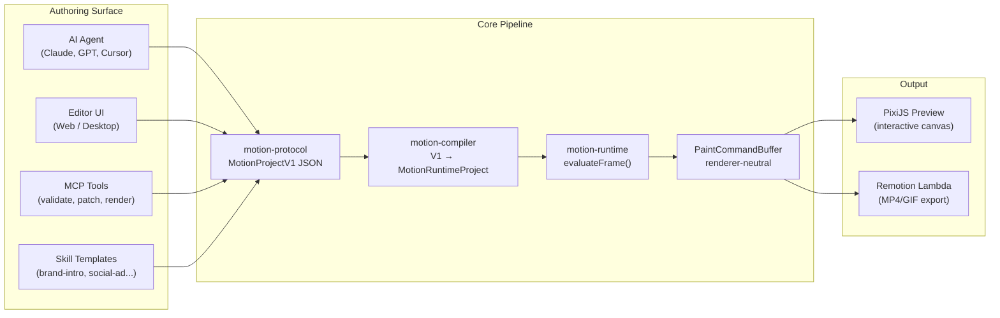

# MotionVideo

> **NeonVideo** — AI-first motion graphics studio for Vietnamese TVC.

MotionVideo là studio tạo motion graphic 2D, kết hợp giữa AI generation và editor
trực quan. Hệ thống nhận brief từ người dùng hoặc AI agent, sinh project có cấu
trúc, cho phép chỉnh sửa nội dung, brand, scene, node và timing, rồi xuất MP4 qua
render pipeline thống nhất — PixiJS cho preview tương tác, Remotion Lambda cho
export cloud.

**Phạm vi:** limited/cut-out character animation từ SVG rig (chuẩn bị trong Figma),
text animation, brand templates, và social-media video. Không nhằm trở thành công
cụ vẽ frame-by-frame hay 3D animation.

---

## Core Architecture



**Nguyên tắc cốt lõi**:

- **Một format duy nhất** — `MotionProjectV1` (`.mt`) là canonical authoring contract. Tất cả
  surface (AI, editor, MCP, Skills) đọc/ghi cùng một format. Không có V2 fallback.
- **Compiler tách biệt** — Từ authoring JSON sang `MotionRuntimeProject` (literal, flat).
  Variables, components, presets, bindings, layout được resolve hoàn toàn ở compile time.
- **Runtime dùng chung** — `motion-runtime` là nơi duy nhất evaluate frame. Pixi và Remotion
  không tự tính easing, timing, transform hay layout.
- **Editor UI state nằm ngoài project JSON** — Scroll, selection, undo stack, panel layout
  là local state; không ảnh hưởng project hash hay render output.
- **AI-first** — AI agent tạo project qua `ai-planner` (brief → CommandBatch → MotionProjectV1)
  hoặc qua Skills (parameterized templates). MCP tools cung cấp automation surface cho validate,
  patch, compile, preview.

---

## Package Map

### Core Pipeline

| Package           | Vai trò                                                                   |
| ----------------- | ------------------------------------------------------------------------- |
| `motion-protocol` | Zod schema, parse/validate, reference check, capability registry, hashing |
| `motion-compiler` | Authoring V1 → Runtime IR (resolve, expand, layout, emit)                 |
| `motion-runtime`  | Timeline resolve, evaluateFrame, PaintCommandBuffer, audio plan           |

### Renderers

| Package             | Input              | Output           | Use Case                    |
| ------------------- | ------------------ | ---------------- | --------------------------- |
| `pixi-renderer`     | PaintCommandBuffer | WebGL draw calls | Editor preview, MCP preview |
| `remotion-renderer` | PaintCommandBuffer | MP4, GIF, still  | Cloud export                |

### Editor (dùng chung Web & Desktop)

| Package               | Vai trò                                                     |
| --------------------- | ----------------------------------------------------------- |
| `editor-core`         | Commands, selection, history, document ops, timeline layout |
| `editor-interactions` | Gesture state machines, transform math, timeline math       |
| `editor-react`        | DOM measurement, pointer capture, reusable React hooks      |

### AI & Automation

| Package           | Vai trò                                                        |
| ----------------- | -------------------------------------------------------------- |
| `ai-planner`      | Brief → CreativePlan → typed CommandBatch → project generation |
| `playback-engine` | Headless frame server cho MCP preview/render                   |

### Infrastructure

| Package            | Vai trò                                                         |
| ------------------ | --------------------------------------------------------------- |
| `asset-registry`   | Asset contract, hash, MIME, SVG safety, font/license metadata   |
| `render-contracts` | Render manifest, job types, webhook payloads (provider-neutral) |

### Apps

| App                  | Tech Stack               | Vai trò                                            |
| -------------------- | ------------------------ | -------------------------------------------------- |
| `apps/web`           | Next.js + PixiJS         | Editor web, AI chat, project storage, export API   |
| `apps/desktop`       | Electron + Vite + PixiJS | Desktop editor (dùng chung toàn bộ core packages)  |
| `apps/render-worker` | Node.js + FFmpeg         | Headless render worker (local dev, golden testing) |
| `apps/remotion-site` | Remotion + React         | Deployable Remotion bundle lên Lambda              |

---

## Bắt đầu

```bash
# Cài đặt
pnpm install

# Chạy test toàn bộ core packages
pnpm --filter @motionvideo/motion-protocol test
pnpm --filter @motionvideo/motion-compiler test
pnpm --filter @motionvideo/motion-runtime test

# Validate kiến trúc (không được phép có V2 patterns)
pnpm validate:v1-source-of-truth

# Web editor dev
pnpm --filter @motionvideo/web dev

# Desktop editor dev
pnpm --filter @motionvideo/desktop dev
```

---

## Tài liệu

| Tài liệu                                                             | Nội dung                                            |
| -------------------------------------------------------------------- | --------------------------------------------------- |
| [Motion Format V1](docs/guide/v1-format-guide.md)                    | Canonical authoring JSON (`zIndex`, timing, frame, group) |
| [Timeline](docs/guide/v1-timeline-guide.md)                          | Clock vs lanes; required layer timing                     |
| [Group](docs/guide/v1-group-guide.md)                                | Visual container; children ≥1; no default clip            |
| [Components](docs/guide/v1-component-guide.md)                       | Sealed instance + public props                            |
| [AI-First Editor Architecture](docs/ai-first-editor-architecture.md) | Kiến trúc AI agent, MCP, Skills, editor             |
| [Web Architecture](web-architechture.md)                             | Kiến trúc Web, Pixi preview, Remotion Lambda export |

---

## License

Xem [LICENSE](./LICENSE) và [`clipkit/`](./clipkit/) cho các điều khoản liên quan.

---

## Quy tắc phát triển

- **Không thêm fallback cho format cũ** — dữ liệu sai `formatVersion` phải báo lỗi rõ ràng.
- **Renderer không tự ý suy diễn** — không đọc preset, variable, binding, repeater hay component definition.
- **Mọi thay đổi schema** phải cập nhật docs, fixtures, và gate script (`validate:v1-source-of-truth`) cùng lúc.
- **Codegen** — JSON Schema (`schema/v1.json`) được generate tự động từ Zod schema. Không sửa bằng tay.
