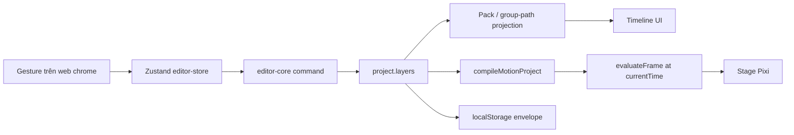

# MotiClip Web (`apps/web`)

Next.js host cho MotiClip trên trình duyệt: landing, docs protocol, workspace, editor, và API xuất video.

Web **không** có format riêng. Document duy nhất là `MotionProjectV1`. Editor, AI, docs, preview và export đều đọc/ghi cùng JSON đó.

Gói repo: [README gốc](../../README.md) · Protocol: [`docs/guide`](../../docs/guide/README.md) · Kiến trúc web: [`web-architechture.md`](../../web-architechture.md)

---

## 1. Bản chất của web

`apps/web` là **bề mặt sản phẩm**, không phải engine animation.

| Việc web làm | Việc web không làm |
| --- | --- |
| Host UI (marketing, docs, hub, editor) | Định nghĩa schema V1 |
| Giữ session: selection, playhead, zoom, undo | Tự tính easing / transform / layout |
| Chiếu `project.layers` ra timeline / inspector | Lưu `laneId`, `visualTracks`, playhead vào JSON |
| Gọi compiler + Pixi để preview | Paint frame theo cách riêng so với export |
| BFF: AI generation, Remotion Lambda | Thay thế `motion-runtime` |

Pipeline dùng chung với desktop:

```text
MotionProjectV1  →  motion-compiler  →  motion-runtime.evaluateFrame()
                                              ↓
                                    PaintCommandBuffer
                                      ↙            ↘
                              Pixi preview      Remotion export
```

Editor crash rồi mở lại: JSON phải còn nguyên, không kèm artifact UI.

---

## 2. Bản chất của editor

Editor là **IDE trên JSON**, không phải timeline-as-document.

- Gesture (kéo clip, trim, inspector, drop library) **ghi** `project.layers` theo luật protocol: sibling `zIndex` unique, visual `≥ 0`, audio root `zIndex < 0`, group children ≥ 1.
- Timeline **chiếu** layers ra hàng. Packing vài root không chồng thời gian lên một lane là view-only — không ghi `laneId` vào V1.
- `zIndex` unique, một chiều kiểu Canva: Main rồi overlay; **trong một hàng tăng sang trái** (clip phải = số nhỏ hơn), rồi lên hàng trên. Không reset mỗi lane — ví dụ `2|1|0` trên Main rồi `4|3` overlay.
- Preview **không** đọc lane đã pack. Stage compile JSON, evaluate tại playhead, Pixi paint. Playhead chỉ là session.
- Tab **JSON** trong sidebar là `serializeMotionProjectV1(project)` — không phải envelope clips.

Hai bề mặt timeline:

| Scope | `groupPath` | Hàng trên timeline | DnD |
| --- | --- | --- | --- |
| Main | `[]` | Pack root visual không chồng thời gian (nhiều clip / lane). Audio chỉ ở đây. | Kéo ngang đổi `timing.start`; thả lane khác rồi write-back `zIndex`. Visual không xuống audio. |
| Trong group | ids tổ tiên | 1 child = 1 hàng. Không pack, không audio. Thời gian clip = global (`timeOffset` + `child.timing.start`). | Kéo ngang đổi thời gian; thả hàng khác = swap; thả khe giữa hàng = insert. |

Double-click strip **group** (`type === "group"`) → vào `group.children`. Primitive (text/shape/video/image) không drill-in. Nút Quay lại / Escape → ra Main. Chi tiết: [`/docs/editor`](http://localhost:3000/docs/editor) (khi `pnpm dev`).

Envelope `timelineClips` / `timelineLanes` trong localStorage chỉ nhớ packing để reload UI. Nguồn sự thật vẫn `MotionProjectV1`.

---

## 3. Bốn bề mặt sản phẩm

```text
/                      Landing (NeonVideo)
/docs/*                Luật authoring V1 — cùng contract AI dùng
/app                   Workspace: list / tạo project (localStorage)
/app/editor/[id]       Editor 5 panel
/api/ai/generations    Brief → ai-planner → project
/api/renders           Export cloud (Remotion Lambda)
/api/export            Export job (dev / mock)
```

Chrome editor (`EditorShell`): 5 panel nổi trên `--bg-site`.

```text
┌─────────────────────────────────────────────────────────┐
│ header                                                  │
├──────────┬────────────────────────────┬─────────────────┤
│ sidebar  │ stage (Pixi)               │ inspector       │
│ Layers   │                            │ Properties / AI │
│ Assets   ├────────────────────────────┤                 │
│ JSON     │ timeline (projection)      │                 │
└──────────┴────────────────────────────┴─────────────────┘
```

| Panel | Hiện | Ghi vào JSON | Chỉ session |
| --- | --- | --- | --- |
| Header | Tên, undo/redo, export | metadata khi đổi tên | dirty, job export |
| Sidebar · Layers | Cây `project.layers` | chọn / drill group | `groupPath` |
| Sidebar · JSON | Serialize V1 | không (read-only) | — |
| Stage | Frame tại playhead | drop layer mới | hit-test, drag overlay |
| Timeline | Projection lanes | timing, thứ tự, zIndex | zoom, marquee, playhead |
| Inspector | Property của node đang chọn | prop / keyframe | tab AI vs Properties |

---

## 4. Luồng một thao tác



1. UI gọi `executeTimelineCommand` (hoặc action store tương đương).
2. `editor-core` sửa document theo protocol; history undo/redo nằm store, không nằm JSON.
3. Timeline lấy clips đã pack (Main) hoặc derive 1-1 (group).
4. Stage luôn `project → compile → evaluateFrame(playhead) → Pixi`.
5. Autosave ghi snapshot: V1 + packing sidecar.

---

## 5. Ranh giới package

Logic thuần không ở `apps/web`. Web chỉ chrome, store, persistence, BFF.

| Package | Web dùng để |
| --- | --- |
| `motion-protocol` | Parse / serialize / validate V1 |
| `motion-compiler` + `motion-runtime` | Preview + export cùng IR |
| `pixi-renderer` | Paint `PaintCommandBuffer` trên stage |
| `editor-core` | Command, pack/write-back zIndex, selection |
| `editor-interactions` | Toán gesture / playhead / snap |
| `editor-react` | Hook đo DOM, marquee, trim/move |
| `ai-planner` | `POST /api/ai/generations` |
| `render-contracts` | Manifest job Lambda |

Desktop (`apps/desktop`) dùng cùng core; **không** import `apps/web`. Theme, Zustand, layout panel là việc của từng app.

Timeline chrome: [components/editor/timeline/README.md](./components/editor/timeline/README.md).

---

## 6. Chạy local

Từ root monorepo:

```bash
pnpm install
pnpm --filter @motionvideo/web dev
```

| URL | Việc |
| --- | --- |
| http://localhost:3000 | Landing |
| http://localhost:3000/docs | Protocol docs |
| http://localhost:3000/app | Hub — tạo project, mở editor |

```bash
pnpm --filter @motionvideo/web test        # vitest
pnpm --filter @motionvideo/web typecheck
pnpm --filter @motionvideo/web lint
pnpm --filter @motionvideo/web e2e         # Playwright; một số spec timeline đang ignore
```

Project editor lưu trên **trình duyệt này** (localStorage). Đổi máy / xóa site data là mất, trừ khi đã export.

Export cloud cần env Remotion Lambda (xem [`web-architechture.md`](../../web-architechture.md)). Dev có thể `NEXT_PUBLIC_EXPORT_MOCK=1`.

---

## 7. Cây thư mục

```text
apps/web/
  app/                    Routes + API (App Router)
  components/
    editor/               Chrome 5 panel (không chứa luật V1)
    hub/                  Workspace
    docs/                 UI trang /docs
    site/                 Landing
  lib/
    editor/               Store, persistence, preview host, library drop
    docs/                 Nội dung /docs (luật chiếu editor, không sửa protocol)
    runtime/              Glue compile/preview phía web
    server/               BFF render / ownership
  e2e/                    Playwright
```

Sửa luật JSON → `packages/motion-protocol` + `docs/guide`. Sửa cách web **chiếu** JSON → `components/editor` + `lib/docs/content/editor`. Không thêm field editor vào V1.

---

## 8. Không nhầm lẫn

- **Packing ≠ grouping.** Cùng hàng trên Main không phải cùng `group`. Group là node `type: "group"` trong JSON.
- **zIndex ≠ lane.** zIndex là thứ tự sơn giữa sibling. Lane là chỗ vẽ strip.
- **Docs `/docs` ≠ README này.** `/docs` là luật format cho người viết JSON (kể cả AI). README này là bản đồ app web.
- **Web ≠ desktop.** Cùng protocol và editor-core; UI store và panel là hai host riêng.
