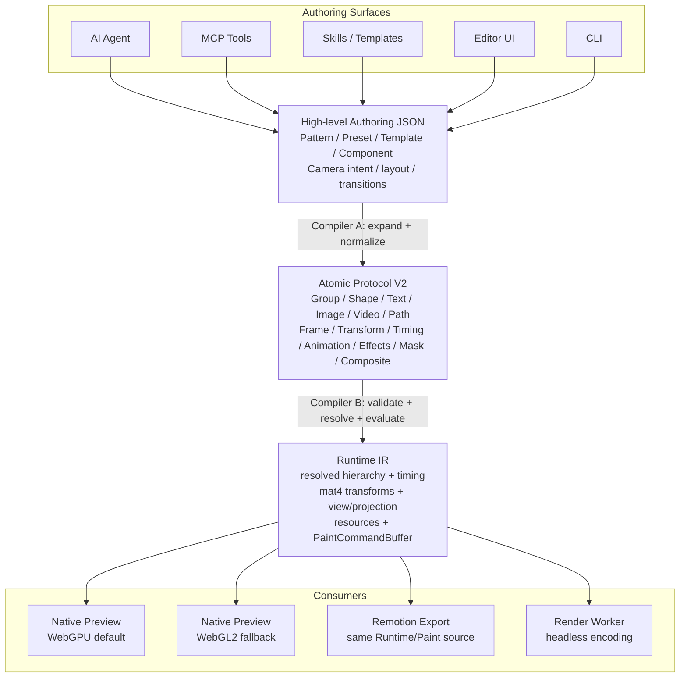
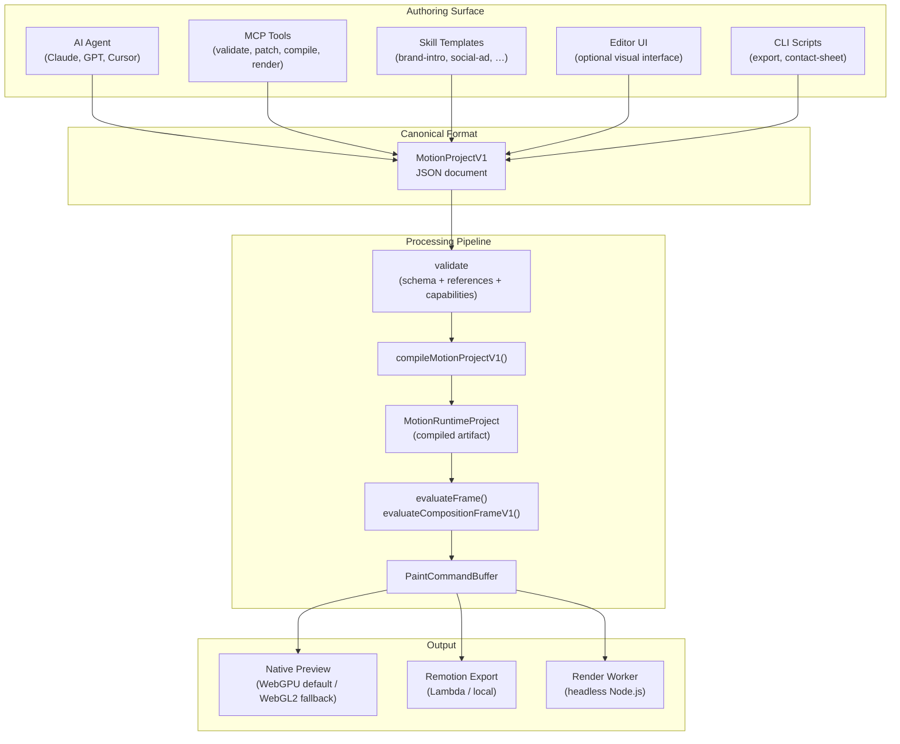

# AI-First Editor Architecture

> **Status**: Canonical target architecture — High-level + Atomic Protocol V2 + 3D foundation
>
> **Goal**: Define how AI agents, MCP tools, Skills, the editor UI, preview, and
> export share one deterministic pipeline built on a 3D-ready Atomic Protocol V2.

---

## 0. Canonical Target: High-level Intent to Atomic 3D

This document defines the target architecture for NeonVideo. The application is
still in development, so the existing V1 path remains available as a
compatibility layer. New features, however, should follow the V2 pipeline
below rather than adding more concepts to V1.

The editor is an authoring surface, not the renderer and not the protocol. The
system has three deliberately different representations:

1. **High-level Authoring JSON** expresses intent for users, AI agents,
   templates, and Skills.
2. **Atomic Protocol V2** is the small, explicit, serializable render contract.
   Compiler A expands high-level constructs into this protocol.
3. **Runtime IR** is the computed representation consumed by renderers and
   exporters. Compiler B resolves timing, hierarchy, assets, and all matrices.

The key boundary is that high-level vocabulary does not leak into the atomic
protocol, and GPU implementation details do not leak into either JSON format.



**Invariant**: Different authoring surfaces may use different high-level
inputs, but the same intent must lower to the same Atomic Protocol V2. Preview
and export consume the same runtime meaning; only their backend adapters differ.

### 0.1 High-level Authoring Vocabulary

High-level JSON is where semantic convenience belongs. It can grow quickly
without making the renderer or atomic protocol grow with it:

| High-level concept | Compiler A responsibility |
| ------------------ | ------------------------- |
| `Pattern`, `Preset`, `Template`, `Component` | Expand reusable structure into explicit atomic layers |
| `2.5D`, `Parallax`, `Depth effect` | Resolve depth and camera intent into 3D transforms or view state |
| `Camera movement`, `Perspective intent` | Produce camera/projection parameters and animation |
| `Ken Burns`, `Zoom`, `Pan`, `Orbit` | Produce deterministic transform/camera keyframes |
| `Card tilt`, `Page flip` | Produce rotate X/Y/Z, anchor, depth, and optional perspective |
| `Auto layout`, `Responsive behavior` | Resolve layout against the target composition |
| `Text animation preset` | Expand to animation tracks targeting atomic properties |
| `Transition`, `Scene preset` | Expand into timing, animation, mask, and composite atoms |

These concepts are authoring vocabulary, not renderer primitives. For example,
`ken-burns` must disappear after Compiler A; Atomic V2 contains only the
resolved transform and animation tracks that implement it.

### 0.2 Atomic Protocol V2 Vocabulary

Atomic V2 stays intentionally small and semantic. It describes what must be
rendered, not how a particular GPU API stores it:

| Atomic | Responsibility |
| ------ | -------------- |
| `Group` | Parent-child hierarchy and shared local space |
| `Text` | Text content, font reference, size, alignment, and text style |
| `Shape` | Rect, ellipse, polygon, and future certified primitives |
| `Image` | Asset reference and image presentation settings |
| `Video` | Asset reference, frame selection, and media presentation |
| `Path` | Vector path data and fill/stroke intent |
| `Frame` | Local width and height of an atom |
| `Transform` | Translate, scale, rotate, skew, and `anchor` |
| `Timing` | Start, duration, offset, and active-window behavior |
| `Animation` | Keyframes and the target atomic property |
| `Effects` | Blur, brightness, LUT, and other certified effects |
| `Mask` | Mask source and relationship to a target |
| `Composite` | Opacity, blend mode, and compositing behavior |
| `Camera` / `Projection` | Composition-level view state when runtime needs it |

`mat4`, GPU buffers, texture handles, bind groups, shader modules, and draw
commands are not Atomic Protocol fields. They belong to Runtime IR and renderer
adapters.

### 0.3 Compiler A: High-level JSON to Atomic V2

Compiler A is a pure and deterministic lowering step:

```text
High-level document
  -> resolve pattern/preset/component
  -> expand transitions and animation presets
  -> resolve layout and responsive values
  -> resolve camera/depth intent
  -> normalize ids, defaults, timing, and references
  -> validate Atomic Protocol V2
```

The output is still inspectable JSON. It should be useful for AI diagnostics,
diffs, caching, and test fixtures. Compiler A must never depend on a WebGPU or
WebGL context.

Illustrative lowering:

```json
{
  "type": "pattern",
  "pattern": "ken-burns",
  "layers": [{ "type": "image", "assetId": "product" }],
  "camera": { "movement": "zoom-pan", "duration": 3 }
}
```

becomes Atomic V2 containing an explicit image atom, a frame, semantic
`transform` values, and animation keyframes. The words `pattern`, `ken-burns`,
and `zoom-pan` are not present in the lowered atomic document.

### 0.4 Compiler B: Atomic V2 to Runtime IR

Compiler B is the only place that turns semantic atom data into render-ready
math and resource descriptions:

```text
Atomic V2
  -> validate references and capability requirements
  -> resolve timing at frame N
  -> resolve parent-child hierarchy
  -> calculate local/world mat4 transforms
  -> calculate view, projection, and viewProjection matrices
  -> resolve text/path/media resources
  -> emit backend-neutral RenderItems / PaintCommandBuffer
```

Runtime IR may contain `Float32Array(16)` matrices, glyph runs, path meshes,
texture descriptors, clip regions, opacity, blend mode, z ordering, and draw
metadata. It must not contain WebGPU handles or WebGL objects so both preview
backends and Remotion can consume the same meaning.

### 0.5 3D Foundation From Day One

The MVP is 2D, but the atomic and runtime contracts are 3D-ready from the
start. Positions, scales, rotations, anchors, and depth values use three
components where appropriate. Runtime transforms are column-major `mat4`
(`Float32Array(16)`).

Coordinate contract:

- Origin is the composition top-left.
- `+X` points right and `+Y` points down.
- `+Z` points toward the viewer; depth ordering is explicit and deterministic.
- Atomic JSON stores semantic values, never a precomputed matrix.
- Runtime owns matrix calculation; renderers only consume the result.
- Model composition is fixed and shared by both backends:
  `Translate(position) * Translate(anchor) * RotateZ * RotateY * RotateX * SkewXY * Scale * Translate(-anchor)`.
- Matrices use one documented multiplication order and one documented
  column-major layout across the entire pipeline.

The model matrix can be shared by WebGPU and WebGL2. Projection is a
backend-aware boundary: WebGL2 uses normalized device-coordinate depth `-1..+1`,
while WebGPU uses `0..+1`. A shared logical camera produces backend-specific
projection/depth adaptation so both previews show the same scene.

### 0.6 Preview and Export Ownership

`packages/preview-renderer` is a native renderer owned by NeonVideo. WebGPU is
the default backend; WebGL2 is selected when WebGPU is unavailable or when a
developer explicitly toggles it for comparison. There is no Pixi dependency in
this architecture.

Preview responsibilities are limited to acquiring a device/context, uploading
runtime resources, executing draw commands, presenting frames, and reporting
backend diagnostics. It does not calculate semantic transforms, expand
patterns, or interpret high-level authoring concepts.

Remotion may remain the export implementation. Preview and export should share
the same Compiler A/Compiler B output and frame evaluation contract. They do
not need to share GPU code: preview is interactive WebGPU/WebGL2, while
Remotion can rasterize the same runtime frame and encode it with the existing
export pipeline.

---

## 1. Legacy Reference: V1 Compatibility Path

The following sections document the existing V1 interfaces that are still
useful for migration, integrations, and current tooling. They are not the
place to add new high-level concepts or renderer-specific behavior.

---

### 1.1 Legacy V1 Source-of-truth Model

The NeonVideo system has exactly one source of truth: **`MotionProjectV1`** JSON.
Everything else — the editor UI, AI planner, MCP tools, Skill templates,
CLI scripts — reads and writes this single format.



**Key invariant**: All five authoring surfaces produce identical V1 JSON. The
pipeline doesn't know or care which surface created the project — it only
validates `format: "motion-project"`, `formatVersion: 1`.

---

## 2. Canonical Boundaries: What Lives Where

The following boundaries are normative for new work:

| Layer | Owns | Must not own |
| ----- | ---- | ------------ |
| High-level Authoring JSON | User/AI intent, reusable patterns, presets, layout intent, camera intent | GPU state, raw matrices, backend-specific commands |
| Compiler A | Expansion, normalization, semantic resolution, Atomic V2 validation | WebGPU/WebGL context, resource handles |
| Atomic Protocol V2 | Serializable groups, primitives, semantic transforms, timing, animation, effects, masks, composites | `mat4`, shader modules, buffers, textures, draw calls |
| Compiler B / Runtime | Frame evaluation, hierarchy, resource resolution, local/world/view/projection `mat4`, backend-neutral render items | WebGPU device objects, WebGL objects, UI session state |
| `preview-renderer` | Interactive presentation, backend selection, GPU upload/draw, diagnostics | Recomputing authoring semantics or transform math |
| Remotion / render worker | Deterministic frame rasterization and video encoding | A second, incompatible interpretation of Atomic V2 |
| Editor session | Selection, playhead, zoom, panels, undo/redo, hover, backend toggle | Persistent project semantics unless explicitly committed |

Project JSON must contain enough semantic information to reproduce a frame, but
it must not contain ephemeral editor state or device-specific resources.

### 2.1 Runtime Transform Contract

The runtime transform contract is shared by WebGPU, WebGL2, and export:

```typescript
type RuntimeRenderItem = {
  worldMatrix: Float32Array;       // 16 values, column-major mat4
  viewProjectionMatrix: Float32Array;
  opacity: number;
  zIndex: number;
  geometry: GeometryHandle;
  resource: ResourceDescriptor;
};
```

The exact TypeScript names may evolve, but the responsibilities must remain
separate. Compiler B calculates matrices. Renderer backends consume matrices.
The preview canvas is the final presentation step, not a second runtime.

### 2.2 Backend Contract

WebGPU is the default preview backend because it is the long-term API for the
3D direction. WebGL2 is a first-class fallback and an explicit comparison mode.
Both backends must receive equivalent runtime commands and use the same model
matrix. Differences such as projection depth range, clip-space conventions,
MSAA, shader syntax, resource binding, and context/device loss handling belong
inside backend adapters.

The preview UI should expose `Auto`, `WebGPU`, and `WebGL2` modes. `Auto` tries
WebGPU first and falls back to WebGL2. Forced WebGPU reports an actionable
error when unavailable; it must not silently switch to WebGL2.

### 2.3 Legacy V1 Boundaries

| Concern                                                 | Lives In                                     | NOT In Project JSON   |
| ------------------------------------------------------- | -------------------------------------------- | --------------------- |
| Scene graph, clips, tracks                              | `MotionProjectV1`                            | —                     |
| Variable definitions & bindings                         | `MotionProjectV1`                            | —                     |
| Asset references (by ID)                                | `MotionProjectV1`                            | Asset binary data     |
| Capability requirements                                 | `project.capabilities`                       | Runtime detection     |
| Composition settings                                    | `project.composition`                        | Render worker config  |
| Design tokens                                           | `project.tokens`                             | Raw CSS / theme files |
| Editor UI state                                         | App-specific store (Zustand / session-store) | ✅ NOT in project     |
| Undo/redo history                                       | Editor command history                       | ✅ NOT in project     |
| playhead / currentTime, selection, zoom, scroll, panels | UI session only — never in `MotionProjectV1` | ✅ NOT in project     |
| AI generation metadata                                  | `provenance` (optional)                      | AI model state        |
| Custom extensions                                       | `extensions` (namespaced)                    | —                     |

**Rule**: If the editor crashes and restarts, the project JSON must survive
intact with no editor-only artifacts.

---

## 3. High-level AI Agent Workflow

AI should normally work against high-level authoring concepts because they are
more compact, expressive, and easier to reason about than GPU details. The
compiler boundary keeps that convenience from becoming runtime complexity.

```text
1. UNDERSTAND  — parse the user's brief into intent and constraints
2. AUTHOR      — create Pattern / Template / Component / primitive intent
3. LOWER       — Compiler A expands intent into Atomic Protocol V2
4. VALIDATE    — validate atomic schema, references, capabilities, and timing
5. COMPILE     — Compiler B creates Runtime IR and frame commands
6. PREVIEW     — WebGPU by default, WebGL2 fallback or explicit comparison
7. VERIFY      — inspect frame output, diagnostics, and backend parity
8. EXPORT      — Remotion/render-worker consumes the same runtime meaning
```

AI-facing tools should make each boundary observable. A useful response from a
compiler or MCP tool includes the original high-level document, lowered Atomic
V2, diagnostics, runtime hash, and the frame/backend used for verification.

### 3.1 High-level Commands and Patches

High-level edits should be semantic and composable:

```typescript
type HighLevelCommand =
  | { op: "addPattern"; pattern: string; params: Record<string, unknown> }
  | { op: "applyPreset"; preset: string; targetId: string }
  | { op: "updateIntent"; targetId: string; property: string; value: unknown }
  | { op: "setCameraIntent"; value: Record<string, unknown> };
```

The executor applies these commands to High-level Authoring JSON, then runs
Compiler A. Atomic patches are still useful for certified atom tests and low-
level tooling, but a high-level agent should not hand-author `mat4` values or
backend draw commands.

### 3.2 Atomic Certification Workflow

Atomic features are certified incrementally before high-level features are
built on top of them:

```text
Atomic JSON fixture
  -> Compiler B
  -> Runtime IR
  -> preview in WebGPU
  -> preview in WebGL2
  -> compare expected geometry and pixels
  -> certify atom and expose it to Compiler A
```

The current development order is rectangle, ellipse, path, effects, mask,
opacity/composite, and then the remaining media/text atoms. This keeps each
atom independently testable and avoids hiding renderer bugs inside patterns.

### 3.3 High-level Compiler Roadmap

After the atomic foundation is certified, implement Compiler A in this order:

1. Reusable `Group`, `Component`, `Template`, and `Pattern` expansion.
2. Presets and animation presets that lower to `Animation` atoms.
3. Layout and responsive behavior that lower to explicit frame/transform data.
4. Camera movement, parallax, 2.5D, and perspective intent.
5. Transitions and scene presets that lower to timing, masks, effects, and
   composites.
6. Advanced 3D intents such as orbit, card tilt, page flip, and depth effects.

No high-level feature is considered complete until its lowered Atomic V2 is
stable, inspectable, and previewable in both backends.

## 3.4 Legacy V1 AI Agent Workflow

### 3.4.1 How Legacy Agents Create V1 Projects

An AI agent (Claude, GPT, Cursor) creates a V1 project through one of these paths:

**Path A — Full project generation:**

```text
User brief → ai-planner → CommandBatch → executor → MotionProjectV1
```

**Path B — Skill-based generation:**

```text
User brief + Skill choice → Skill.apply(params) → MotionProjectV1 + V1Patch
```

**Path C — Direct JSON construction:**

```text
AI generates valid MotionProjectV1 JSON → parseMotionProject() validates
```

All paths converge on the same `parseMotionProject()` entry point, which only
accepts `formatVersion: 1`. There is no V2 fallback.

### 3.4.2 Legacy Agent Edits Via V1 Patches

Agents don't mutate project JSON directly for partial edits — they use
`MotionProjectV1Patch`:

```typescript
import {
  applyMotionProjectV1Patch,
  type MotionProjectV1Patch,
} from "@motionvideo/motion-mcp";

const patch: MotionProjectV1Patch = {
  operations: [
    { op: "addScene", scene: { id: "scene-cta", duration: 3, layers: [...], clips: [] } },
    { op: "addVisualClip", trackId: "track-main", clip: { id: "clip-cta", source: { kind: "scene", sceneId: "scene-cta" }, start: 5, duration: 3 } },
    { op: "updateBinding", bindingId: "bind-headline", property: "payload.text", value: "New headline" },
  ],
};
const updated = applyMotionProjectV1Patch(project, patch);
```

Patch paths match V1 structure exactly:

- `addScene` / `updateScene` / `removeScene`
- `addVisualClip` / `trimVisualClip` / `moveVisualClip` / `reorderVisualTrack`
- `addAsset` / `updateAsset`
- `addVariable` / `updateVariable`
- `addBinding` / `updateBinding`
- `addCaptionCue` / `updateCaptionCue`
- `addAudioTrack` / `updateAudioTrack`
- `setComposition` / `setTokens`

Every patch output is re-validated through `MotionProjectV1Schema.parse()`.

### 3.4.3 Legacy Agent Preflight

Before generating a project, an agent can query capabilities:

```typescript
import {
  preflightProjectCapabilities,
  listCapabilities,
} from "@motionvideo/motion-protocol";

// What capabilities does the runtime support?
const caps = listCapabilities();

// Does this project use any unsupported features?
const preflight = preflightProjectCapabilities(project);
if (!preflight.ok) {
  console.log("Undeclared:", preflight.undeclared);
  console.log("Experimental:", preflight.experimentalInUse);
}
```

---

## 4. Legacy V1 AI Skill Instructions

Skills are instruction assets that teach AI/MCP agents how to produce V1
projects or patches. They live outside `motion-protocol` as `SKILL.md` files
plus optional examples. Protocol safety comes from validating the generated
project or patch, not from a TypeScript skill registry.

### 4.1 Optional App Metadata

```typescript
type SkillMetadata = {
  id: string; // "motion/brand-intro"
  name: string; // "Brand Intro"
  description: string; // Human-readable
  version: string; // Semver
  author: { name: string; url?: string };
  instructionFormat: "text/markdown";
  requiredCapabilities: string[]; // e.g. ["primitive.text", "anim.transform"]
  inputSchema: Record<string, unknown>; // JSON Schema for params
  outputContract: // What the skill produces
    | { kind: "full-project" }
    | { kind: "patch" }
    | { kind: "template-params" }
    | { kind: "validation-report" };
};
```

### 4.2 Example Skill Catalog

| Skill ID                    | Purpose                 | Required Capabilities                                                                                                                        |
| --------------------------- | ----------------------- | -------------------------------------------------------------------------------------------------------------------------------------------- |
| `motion/brand-intro`        | Animated logo + tagline | `primitive.text`, `primitive.image`, `anim.transform`, `anim.opacity`                                                                        |
| `motion/social-ad`          | Platform-optimized ad   | `primitive.text`, `primitive.image`, `primitive.video`, `anim.transform`, `anim.opacity`                                                     |
| `motion/subtitle-styling`   | Caption overlay         | `primitive.text`                                                                                                                             |
| `motion/product-demo`       | Product showcase        | `primitive.text`, `primitive.image`, `primitive.video`, `primitive.shape`, `anim.transform`, `anim.opacity`, `effect.glow`, `style.gradient` |
| `motion/corporate-template` | Corporate presentation  | `primitive.text`, `primitive.shape`, `primitive.image`, `anim.transform`, `anim.opacity`, `style.gradient`                                   |

### 4.3 Skill Lifecycle

```text
1. AUTHOR — Write SKILL.md instruction + examples
2. GENERATE — AI/MCP produces a V1 project or V1 patch
3. VALIDATE — parseMotionProjectV1(project) or V1PatchSchema.parse(patch)
4. PUBLISH — register in the app/backend/MCP catalog if needed
5. TEST — compile → evaluate → verify frame keys
6. APPLY — AI or user calls the skill → validated V1 project or patch
```

### 4.4 Enterprise Template Skills

Enterprises define brand-specific Skills that encode their design system:

```typescript
// Example: Acme Corp brand skill
const acmeBrandSkill: SkillMetadata = {
  id: "acme/brand-template",
  name: "Acme Brand Template",
  version: "1.0.0",
  author: { name: "Acme Corp" },
  instructionFormat: "text/markdown",
  requiredCapabilities: [
    "primitive.text",
    "primitive.image",
    "primitive.shape",
    "anim.transform",
    "anim.opacity",
    "style.gradient",
  ],
  inputSchema: {
    type: "object",
    required: ["headline", "ctaText", "logoUrl"],
    properties: {
      headline: { type: "string", maxLength: 80 },
      ctaText: { type: "string", maxLength: 30 },
      logoUrl: { type: "string", format: "uri" },
      primaryColor: { type: "string", pattern: "^#[0-9a-f]{6}$" },
    },
  },
  outputContract: { kind: "full-project" },
};
```

The skill's `apply()` function:

1. Takes params (headline, CTA, logo, colors)
2. Builds a `MotionProjectV1` with the correct layers, tokens, and assets
3. Returns validated V1 JSON

No editor UI is needed — an AI agent can call this skill directly.

---

## 5. MCP Tool Lifecycle

MCP tools provide an automation surface around V1 operations. They are defined
in `packages/motion-protocol/src/v1/mcp.ts`.

### 5.1 Available MCP Tools

| Tool                   | Input                          | Output                 | Required Capabilities |
| ---------------------- | ------------------------------ | ---------------------- | --------------------- |
| `create_project`       | composition + metadata         | `MotionProjectV1`      | `[]`                  |
| `validate_project`     | `MotionProjectV1`              | `ValidationReport`     | `[]`                  |
| `apply_patch`          | `MotionProjectV1` + `V1Patch`  | `MotionProjectV1`      | `[]`                  |
| `compile_project`      | `MotionProjectV1`              | `MotionRuntimeProject` | `[]`                  |
| `render_preview_frame` | `MotionRuntimeProject` + frame | `PaintCommandBuffer`   | depends on project    |
| `list_capabilities`    | —                              | `CapabilityId[]`       | `[]`                  |
| `inspect_timeline`     | `MotionProjectV1`              | timeline summary       | `[]`                  |
| `explain_diagnostics`  | `CompileDiagnostic[]`          | human explanation      | `[]`                  |

### 5.2 MCP Workflow

```text
1. VALIDATE — mcp.validate_project(project) → ValidationReport
2. PATCH — mcp.apply_patch(project, patch) → updated MotionProjectV1
3. COMPILE — mcp.compile_project(project) → MotionRuntimeProject
4. PREVIEW — mcp.render_preview_frame(runtime, frame) → base64 PNG
5. EXPORT — render-worker processes runtime → MP4
```

### 5.3 Capability Preflight in MCP

```typescript
import {
  preflightCapabilities,
  canExecuteTool,
} from "@motionvideo/motion-protocol";

// Before executing a tool, check capabilities:
const check = canExecuteTool(
  "render_preview_frame",
  project,
  availableCapabilities,
);
if (!check.allowed) {
  throw new Error(`Missing capabilities: ${check.missing.join(", ")}`);
}
```

---

## 6. Deterministic Hashing & Reproducibility

### 6.1 Project Hash

```typescript
import {
  computeProjectHash,
  computeProjectHashShort,
} from "@motionvideo/render-contracts";

const hash = computeProjectHash(project); // 64-char SHA-256
const short = computeProjectHashShort(project); // first 16 chars

// Strips: metadata.createdAt, metadata.updatedAt, metadata.generator,
//         provenance, extensions
// Same semantic project → same hash, regardless of timestamps.
```

### 6.2 Runtime Hash

```typescript
import { computeRuntimeHash } from "@motionvideo/render-contracts";

const runtimeHash = computeRuntimeHash(runtimeIR); // 32-char SHA-256

// Excludes the runtimeHash field itself for stability.
// Same compile input → same runtimeHash.
```

### 6.3 Compile Cache Key

```typescript
import { buildCompileCacheKeyV1 } from "@motionvideo/motion-compiler";

const key = buildCompileCacheKeyV1(project, { profile: "embedded-components" });
// "proj:abc123|compiler:3.0.0-phase11|protocol:3|caps:def456|deps:789012|profile:embedded-components"
```

---

## 7. End-to-End Examples

### 7.1 AI Agent Generates a Social Ad

```typescript
// Step 1: User brief
const brief =
  "Create a 15s Instagram Reel for Nike Air Max. Show the shoe rotating with price tag.";

// Step 2: AI planner creates command batch
const commands = await aiPlanner.plan(brief);

// Step 3: Executor applies commands → V1 project
const project = executor.execute(commands);

// Step 4: Validate
const parsed = parseMotionProject(project); // throws if not valid V1

// Step 5: Capability preflight
const preflight = preflightProjectCapabilities(parsed);
if (!preflight.ok) {
  // Surface missing capabilities to user
  console.log("Missing:", preflight.undeclared);
}

// Step 6: Compile
const result = compileMotionProjectV1(parsed);
if (!result.ok) {
  console.log("Diagnostics:", result.diagnostics);
} else {
  const runtime = result.project;
  // Step 7: Preview frame 0
  const frame = evaluateCompositionFrameV1(runtime, 0, 30, 1080, 1920);
  // Step 8: Export via render-worker
  const manifest = buildRenderManifestDigest(runtime);
  await processJob(parsed);
}
```

### 7.2 Enterprise Defines a Brand Skill

```typescript
// Step 1: Define skill
const skill = createSkill({
  id: "acme/social-ad",
  name: "Acme Social Ad",
  version: "1.0.0",
  requiredCapabilities: ["primitive.text", "primitive.image", "anim.transform"],
  inputSchema: {
    /* acme params */
  },
  apply: (params) => {
    const project = createEmptyProject({ width: 1080, height: 1920, fps: 30 });
    // Apply brand tokens
    project.tokens.colors.brand = params.primaryColor;
    project.tokens.fonts.display = "acme-gothic";
    project.layers.push(
      createTextLayer("headline", params.headline),
      createImageLayer("logo", params.logoAssetId),
    );
    return parseMotionProject(project);
  },
});

// Step 2: AI agent applies skill
const project = skill.apply({
  headline: "Summer Sale",
  primaryColor: "#ff6b35",
  logoUrl: "assets/logo.png",
});

// Step 3: Validate, compile, render (same pipeline as above)
```

### 7.3 MCP Tool: Patch and Render

```text
User: "Change the headline to 'Black Friday' and show me frame 30"

MCP Server:
  1. mcp.apply_patch(project, {
       operations: [{ op: "updateBinding", bindingId: "bind-headline", property: "payload.text", value: "Black Friday" }]
     })
  2. mcp.validate_project(updated)  → ok
  3. mcp.compile_project(updated)   → runtime IR
  4. mcp.render_preview_frame(runtime, 30) → base64 PNG
  5. Return PNG to user
```

---

## 8. Package Map

| Package               | Role                                                  | Exposed To          |
| --------------------- | ----------------------------------------------------- | ------------------- |
| `motion-protocol`     | Atomic Protocol V2 schema, parsing, validation, hashing | Everyone          |
| `motion-compiler`     | High-level → Atomic V2 → Runtime IR compilation      | Pipeline, MCP, CLI  |
| `motion-runtime`      | Frame evaluation, mat4 math, paint commands, timing | Pipeline, renderers |
| `preview-renderer`    | Native WebGPU-default preview with WebGL2 fallback   | Editor UI           |
| `remotion-renderer`   | Remotion export from the shared runtime frame source | Export service      |
| `render-worker`       | Headless Node.js → MP4                                | CLI, server         |
| `render-contracts`    | Render manifest, preflight, job types                 | Export pipeline     |
| `ai-planner`          | Brief → CommandBatch generation                       | AI API              |
| `editor-core`         | Commands, selection, history, document ops            | Editor UI           |
| `editor-interactions` | Gesture state machines, transform math                | Editor UI           |
| `editor-react`        | DOM measurement, pointer capture, reusable hooks      | Editor UI           |

**Rule for AI developers**: If you're building a Skill, MCP tool, or automation
script, you only need `motion-protocol` (for schema/parse/patch) and optionally
`motion-compiler` (for compilation). You never need `editor-core`,
`editor-interactions`, or `editor-react`.

---

## 9. Canonical V2 Gate Checklist

- [ ] High-level JSON has no renderer or GPU implementation details
- [ ] Compiler A lowers every high-level construct to inspectable Atomic V2
- [ ] Atomic V2 contains semantic transforms and `anchor`, never raw `mat4`
- [ ] Compiler B is the single owner of local/world/view/projection matrix math
- [ ] Runtime IR is backend-neutral and contains no WebGPU/WebGL handles
- [ ] Preview defaults to WebGPU and offers an explicit WebGL2 fallback/toggle
- [ ] WebGPU and WebGL2 receive equivalent runtime commands and projection intent
- [ ] Rectangle and ellipse are certified before dependent high-level presets
- [ ] Preview and Remotion/export consume the same runtime frame meaning
- [ ] Every certified atom has JSON, compiler, WebGPU, WebGL2, and E2E coverage

## 10. Legacy V1 Gate Checklist

These checks describe the retained V1 compatibility path. They are historical
integration gates, not requirements for new Atomic Protocol V2 features.

- [x] A developer can build a Skill without opening editor code
- [x] A developer can build an MCP tool without knowing V2/compat
- [x] `parseMotionProject()` accepts only `formatVersion: 1`
- [x] All product paths use the same V1 → compile → evaluate pipeline
- [x] Editor UI state is not part of the project JSON
- [x] Project hash is stable (timestamps, provenance, extensions excluded)
- [x] Runtime hash is stable (same input → same hash)
- [x] `validate-v1-source-of-truth` CI gate passes
- [x] No production code imports V2 authoring types from root public API
