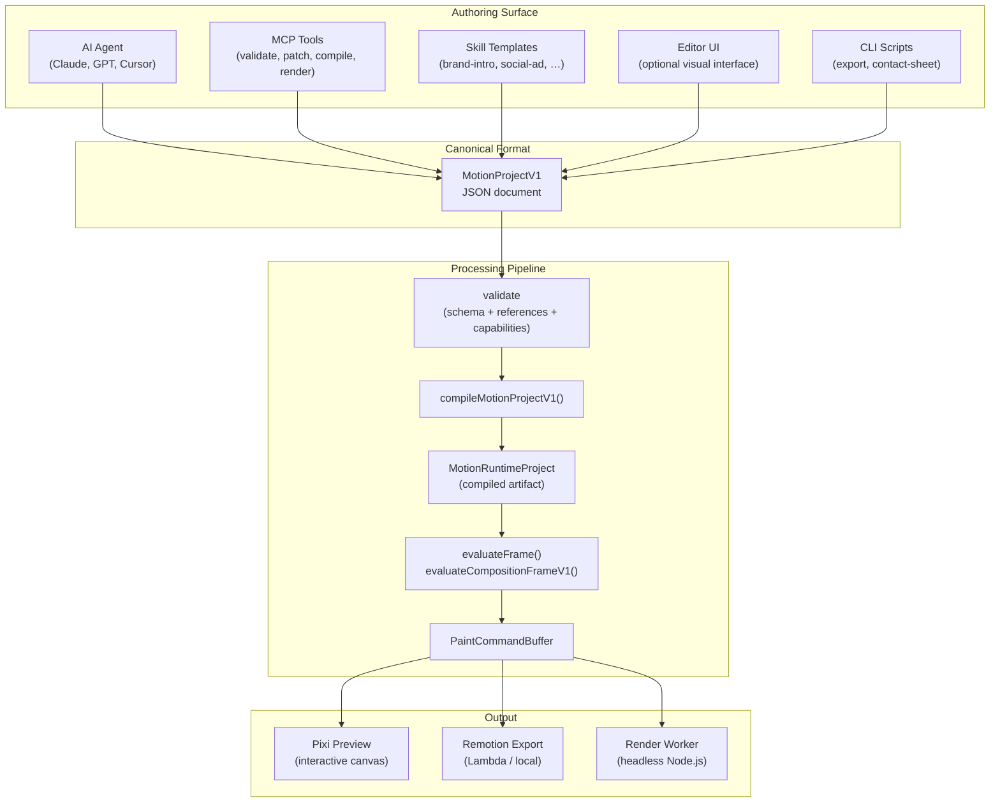

# AI-First Editor Architecture

> **Status**: Canonical architecture document — Phase 14
>
> **Goal**: Document how AI agents, MCP tools, Skills, and the editor UI all
> orbit around the same V1 project format, without requiring knowledge of V2,
> editor internals, or compat layers.

---

## 1. Core Principle: The Editor Is Optional UI Over V1

The MotiClip system has exactly one source of truth: **`MotionProjectV1`** JSON.
Everything else — the editor UI, AI planner, MCP tools, Skill templates,
CLI scripts — reads and writes this single format.



**Key invariant**: All five authoring surfaces produce identical V1 JSON. The
pipeline doesn't know or care which surface created the project — it only
validates `format: "motion-project"`, `formatVersion: 1`.

---

## 2. Boundaries: What Lives Where

| Concern                         | Lives In                                     | NOT In Project JSON   |
| ------------------------------- | -------------------------------------------- | --------------------- |
| Scene graph, clips, tracks      | `MotionProjectV1`                            | —                     |
| Variable definitions & bindings | `MotionProjectV1`                            | —                     |
| Asset references (by ID)        | `MotionProjectV1`                            | Asset binary data     |
| Capability requirements         | `project.capabilities`                       | Runtime detection     |
| Composition settings            | `project.composition`                        | Render worker config  |
| Design tokens                   | `project.tokens`                             | Raw CSS / theme files |
| Editor UI state                 | App-specific store (Zustand / session-store) | ✅ NOT in project     |
| Undo/redo history               | Editor command history                       | ✅ NOT in project     |
| playhead / currentTime, selection, zoom, scroll, panels | UI session only — never in `MotionProjectV1` | ✅ NOT in project     |
| AI generation metadata          | `provenance` (optional)                      | AI model state        |
| Custom extensions               | `extensions` (namespaced)                    | —                     |

**Rule**: If the editor crashes and restarts, the project JSON must survive
intact with no editor-only artifacts.

---

## 3. AI Agent Workflow

### 3.1 How Agents Create Projects

An AI agent (Claude, GPT, Cursor) creates a V1 project through one of these paths:

**Path A — Full project generation:**

```text
User brief → ai-planner → CommandBatch → executor → MotionProjectV1
```

**Path B — Skill-based generation:**

```text
User brief + Skill choice → Skill.apply(params) → MotionProjectV1 + V1Patch
```

**Path C — Direct JSON construction:**

```text
AI generates valid MotionProjectV1 JSON → parseMotionProject() validates
```

All paths converge on the same `parseMotionProject()` entry point, which only
accepts `formatVersion: 1`. There is no V2 fallback.

### 3.2 Agent Edits Via V1 Patches

Agents don't mutate project JSON directly for partial edits — they use
`MotionProjectV1Patch`:

```typescript
import {
  applyMotionProjectV1Patch,
  type MotionProjectV1Patch,
} from "@motionvideo/motion-protocol";

const patch: MotionProjectV1Patch = {
  operations: [
    { op: "addScene", scene: { id: "scene-cta", duration: 3, layers: [...], clips: [] } },
    { op: "addVisualClip", trackId: "track-main", clip: { id: "clip-cta", source: { kind: "scene", sceneId: "scene-cta" }, start: 5, duration: 3 } },
    { op: "updateBinding", bindingId: "bind-headline", property: "payload.content", value: "New headline" },
  ],
};
const updated = applyMotionProjectV1Patch(project, patch);
```

Patch paths match V1 structure exactly:

- `addScene` / `updateScene` / `removeScene`
- `addVisualClip` / `trimVisualClip` / `moveVisualClip` / `reorderVisualTrack`
- `addAsset` / `updateAsset`
- `addVariable` / `updateVariable`
- `addBinding` / `updateBinding`
- `addCaptionCue` / `updateCaptionCue`
- `addAudioTrack` / `updateAudioTrack`
- `setComposition` / `setTokens`

Every patch output is re-validated through `MotionProjectV1Schema.parse()`.

### 3.3 Agent Preflight

Before generating a project, an agent can query capabilities:

```typescript
import {
  preflightProjectCapabilities,
  listCapabilities,
} from "@motionvideo/motion-protocol";

// What capabilities does the runtime support?
const caps = listCapabilities();

// Does this project use any unsupported features?
const preflight = preflightProjectCapabilities(project);
if (!preflight.ok) {
  console.log("Undeclared:", preflight.undeclared);
  console.log("Experimental:", preflight.experimentalInUse);
}
```

---

## 4. Skill Lifecycle

Skills are parameterized templates that produce V1 projects or patches. They
live in `packages/motion-protocol/src/v1/skills.ts` as `MotionSkillManifest`
records.

### 4.1 Skill Manifest Structure

```typescript
type MotionSkillManifest = {
  id: string; // "motion/brand-intro"
  name: string; // "Brand Intro"
  description: string; // Human-readable
  version: string; // Semver
  author: { name: string; url?: string };
  instructionFormat: "text/markdown";
  requiredCapabilities: string[]; // e.g. ["primitive.text", "anim.transform"]
  inputSchema: Record<string, unknown>; // JSON Schema for params
  outputContract: // What the skill produces
    | { kind: "full-project" }
    | { kind: "patch" }
    | { kind: "template-params" }
    | { kind: "validation-report" };
};
```

### 4.2 Built-in Skills

| Skill ID                    | Purpose                 | Required Capabilities                                                                                                                        |
| --------------------------- | ----------------------- | -------------------------------------------------------------------------------------------------------------------------------------------- |
| `motion/brand-intro`        | Animated logo + tagline | `primitive.text`, `primitive.image`, `anim.transform`, `anim.opacity`                                                                        |
| `motion/social-ad`          | Platform-optimized ad   | `primitive.text`, `primitive.image`, `primitive.video`, `anim.transform`, `anim.opacity`                                                     |
| `motion/subtitle-styling`   | Caption overlay         | `primitive.text`                                                                                                                             |
| `motion/product-demo`       | Product showcase        | `primitive.text`, `primitive.image`, `primitive.video`, `primitive.shape`, `anim.transform`, `anim.opacity`, `effect.glow`, `style.gradient` |
| `motion/corporate-template` | Corporate presentation  | `primitive.text`, `primitive.shape`, `primitive.image`, `anim.transform`, `anim.opacity`, `style.gradient`                                   |

### 4.3 Skill Lifecycle

```text
1. AUTHOR — Write SKILL.md instruction + TypeScript generator
2. VALIDATE — skillSchema.parse(manifest)
3. TEST — skill.apply(params) → compile → evaluate → verify frame keys
4. PUBLISH — register in skills.ts manifest registry
5. APPLY — AI or user calls skill with params → V1 project or patch
6. RENDER — V1 → compile → evaluate → Pixi | Remotion | worker
```

### 4.4 Enterprise Template Skills

Enterprises define brand-specific Skills that encode their design system:

```typescript
// Example: Acme Corp brand skill
const acmeBrandSkill: MotionSkillManifest = {
  id: "acme/brand-template",
  name: "Acme Brand Template",
  version: "1.0.0",
  author: { name: "Acme Corp" },
  instructionFormat: "text/markdown",
  requiredCapabilities: [
    "primitive.text",
    "primitive.image",
    "primitive.shape",
    "anim.transform",
    "anim.opacity",
    "style.gradient",
  ],
  inputSchema: {
    type: "object",
    required: ["headline", "ctaText", "logoUrl"],
    properties: {
      headline: { type: "string", maxLength: 80 },
      ctaText: { type: "string", maxLength: 30 },
      logoUrl: { type: "string", format: "uri" },
      primaryColor: { type: "string", pattern: "^#[0-9a-f]{6}$" },
    },
  },
  outputContract: { kind: "full-project" },
};
```

The skill's `apply()` function:

1. Takes params (headline, CTA, logo, colors)
2. Builds a `MotionProjectV1` with the correct `tokens.colors.brand`, scenes, clips
3. Returns validated V1 JSON

No editor UI is needed — an AI agent can call this skill directly.

---

## 5. MCP Tool Lifecycle

MCP tools provide an automation surface around V1 operations. They are defined
in `packages/motion-protocol/src/v1/mcp.ts`.

### 5.1 Available MCP Tools

| Tool                   | Input                          | Output                 | Required Capabilities |
| ---------------------- | ------------------------------ | ---------------------- | --------------------- |
| `create_project`       | composition + metadata         | `MotionProjectV1`      | `[]`                  |
| `validate_project`     | `MotionProjectV1`              | `ValidationReport`     | `[]`                  |
| `apply_patch`          | `MotionProjectV1` + `V1Patch`  | `MotionProjectV1`      | `[]`                  |
| `compile_project`      | `MotionProjectV1`              | `MotionRuntimeProject` | `[]`                  |
| `render_preview_frame` | `MotionRuntimeProject` + frame | `PaintCommandBuffer`   | depends on project    |
| `list_capabilities`    | —                              | `CapabilityId[]`       | `[]`                  |
| `inspect_timeline`     | `MotionProjectV1`              | timeline summary       | `[]`                  |
| `explain_diagnostics`  | `CompileDiagnostic[]`          | human explanation      | `[]`                  |

### 5.2 MCP Workflow

```text
1. VALIDATE — mcp.validate_project(project) → ValidationReport
2. PATCH — mcp.apply_patch(project, patch) → updated MotionProjectV1
3. COMPILE — mcp.compile_project(project) → MotionRuntimeProject
4. PREVIEW — mcp.render_preview_frame(runtime, frame) → base64 PNG
5. EXPORT — render-worker processes runtime → MP4
```

### 5.3 Capability Preflight in MCP

```typescript
import {
  preflightCapabilities,
  canExecuteTool,
} from "@motionvideo/motion-protocol";

// Before executing a tool, check capabilities:
const check = canExecuteTool(
  "render_preview_frame",
  project,
  availableCapabilities,
);
if (!check.allowed) {
  throw new Error(`Missing capabilities: ${check.missing.join(", ")}`);
}
```

---

## 6. Deterministic Hashing & Reproducibility

### 6.1 Project Hash

```typescript
import {
  computeProjectHash,
  computeProjectHashShort,
} from "@motionvideo/motion-protocol";

const hash = computeProjectHash(project); // 64-char SHA-256
const short = computeProjectHashShort(project); // first 16 chars

// Strips: metadata.createdAt, metadata.updatedAt, metadata.generator,
//         provenance, extensions
// Same semantic project → same hash, regardless of timestamps.
```

### 6.2 Runtime Hash

```typescript
import { computeRuntimeHash } from "@motionvideo/motion-protocol";

const runtimeHash = computeRuntimeHash(runtimeIR); // 32-char SHA-256

// Excludes the runtimeHash field itself for stability.
// Same compile input → same runtimeHash.
```

### 6.3 Compile Cache Key

```typescript
import { buildCompileCacheKeyV1 } from "@motionvideo/motion-compiler";

const key = buildCompileCacheKeyV1(project, { profile: "embedded-components" });
// "proj:abc123|compiler:3.0.0-phase11|protocol:3|caps:def456|deps:789012|profile:embedded-components"
```

---

## 7. End-to-End Examples

### 7.1 AI Agent Generates a Social Ad

```typescript
// Step 1: User brief
const brief =
  "Create a 15s Instagram Reel for Nike Air Max. Show the shoe rotating with price tag.";

// Step 2: AI planner creates command batch
const commands = await aiPlanner.plan(brief);

// Step 3: Executor applies commands → V1 project
const project = executor.execute(commands);

// Step 4: Validate
const parsed = parseMotionProject(project); // throws if not valid V1

// Step 5: Capability preflight
const preflight = preflightProjectCapabilities(parsed);
if (!preflight.ok) {
  // Surface missing capabilities to user
  console.log("Missing:", preflight.undeclared);
}

// Step 6: Compile
const result = compileMotionProjectV1(parsed);
if (!result.ok) {
  console.log("Diagnostics:", result.diagnostics);
} else {
  const runtime = result.project;
  // Step 7: Preview frame 0
  const frame = evaluateCompositionFrameV1(runtime, 0, 30, 1080, 1920);
  // Step 8: Export via render-worker
  const manifest = buildRenderManifestDigest(runtime);
  await processJob(parsed);
}
```

### 7.2 Enterprise Defines a Brand Skill

```typescript
// Step 1: Define skill
const skill = createSkill({
  id: "acme/social-ad",
  name: "Acme Social Ad",
  version: "1.0.0",
  requiredCapabilities: ["primitive.text", "primitive.image", "anim.transform"],
  inputSchema: {
    /* acme params */
  },
  apply: (params) => {
    const project = createEmptyProject({ width: 1080, height: 1920, fps: 30 });
    // Apply brand tokens
    project.tokens.colors.brand = params.primaryColor;
    project.tokens.fonts.display = "acme-gothic";
    project.layers.push(
      createTextLayer("headline", params.headline),
      createImageLayer("logo", params.logoAssetId),
    );
    return parseMotionProject(project);
  },
});

// Step 2: AI agent applies skill
const project = skill.apply({
  headline: "Summer Sale",
  primaryColor: "#ff6b35",
  logoUrl: "assets/logo.png",
});

// Step 3: Validate, compile, render (same pipeline as above)
```

### 7.3 MCP Tool: Patch and Render

```text
User: "Change the headline to 'Black Friday' and show me frame 30"

MCP Server:
  1. mcp.apply_patch(project, {
       operations: [{ op: "updateBinding", bindingId: "bind-headline", property: "payload.content", value: "Black Friday" }]
     })
  2. mcp.validate_project(updated)  → ok
  3. mcp.compile_project(updated)   → runtime IR
  4. mcp.render_preview_frame(runtime, 30) → base64 PNG
  5. Return PNG to user
```

---

## 8. Package Map

| Package               | Role                                                  | Exposed To          |
| --------------------- | ----------------------------------------------------- | ------------------- |
| `motion-protocol`     | V1 schema, parsing, patching, capabilities, hashing   | Everyone            |
| `motion-compiler`     | V1 → runtime IR compilation                           | Pipeline, MCP, CLI  |
| `motion-runtime`      | Frame evaluation, paint commands, timeline resolution | Pipeline, renderers |
| `pixi-renderer`       | Interactive Pixi.js preview                           | Editor UI           |
| `remotion-renderer`   | Remotion Lambda export                                | Export service      |
| `render-worker`       | Headless Node.js → MP4                                | CLI, server         |
| `render-contracts`    | Render manifest, preflight, job types                 | Export pipeline     |
| `ai-planner`          | Brief → CommandBatch generation                       | AI API              |
| `editor-core`         | Commands, selection, history, document ops            | Editor UI           |
| `editor-interactions` | Gesture state machines, transform math                | Editor UI           |
| `editor-react`        | DOM measurement, pointer capture, reusable hooks      | Editor UI           |

**Rule for AI developers**: If you're building a Skill, MCP tool, or automation
script, you only need `motion-protocol` (for schema/parse/patch) and optionally
`motion-compiler` (for compilation). You never need `editor-core`,
`editor-interactions`, or `editor-react`.

---

## 9. Gate Checklist

- [x] A developer can build a Skill without opening editor code
- [x] A developer can build an MCP tool without knowing V2/compat
- [x] `parseMotionProject()` accepts only `formatVersion: 1`
- [x] All product paths use the same V1 → compile → evaluate pipeline
- [x] Editor UI state is not part of the project JSON
- [x] Project hash is stable (timestamps, provenance, extensions excluded)
- [x] Runtime hash is stable (same input → same hash)
- [x] `validate-v1-source-of-truth` CI gate passes
- [x] No production code imports V2 authoring types from root public API
