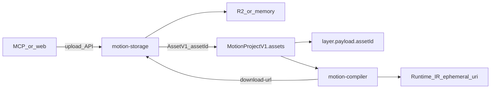

# NeonVideo — Asset Format & Storage

Module: `packages/motion-storage/` · Schema: `packages/motion-protocol/src/v1/assets/`

`motion-storage` là **vòng khép kín** cho binary: nhận asset → lưu object store → emit `AssetV1` (authoring, `@motionvideo/motion-protocol`) → resolve URL ephemeral cho compiler/export. Runtime IR dùng `AssetSchema` trên `@motionvideo/motion-protocol/runtime`. MCP và web chỉ gọi API này; không upload R2 trực tiếp, không nhét URL vào layer.

> **Contract:** All user-provided assets must be ingested through motion-storage before they can be referenced by `MotionProjectV1`. Compiler and clients never talk to object storage directly.

---

## 1. Vai trò trong pipeline



| Thành phần | Việc được làm | Việc không được làm |
| --- | --- | --- |
| Layer payload | Chỉ `assetId` / `fontAssetId` | Không chứa URL |
| `project.assets[]` | Khai báo metadata + storage | Không phải nguồn bytes runtime |
| `motion-storage` | Mint id, giữ bytes, URL tạm, validate còn file | Không quản lý thư viện user / TTL product |
| Compiler | Resolve URI rồi emit runtime IR | Không đọc R2/key trực tiếp |

Drive / URL / máy local: MCP hoặc web **tải về rồi upload** vào storage. JSON không ghi `googleDrive` / `url` — source of truth luôn là file đã nằm trong kho (`source.kind: "upload"`).

---

## 1b. Hai lớp validation (cùng một envelope)

Parse **không** gọi R2. Bytes sống hay chết là việc của storage. Hai lớp nói cùng type `AssetValidationIssue`:

```ts
{
  layer: "authoring" | "storage",
  code: string,
  message: string,
  path: string,
  assetId: string
}
```

| `layer` | Chỗ chạy | `code` |
| --- | --- | --- |
| `authoring` | `validateLayerAssetsV1` lúc parse | `unknown_asset`, `asset_type_mismatch`, `video_trim_invalid` |
| `storage` | `POST /assets/validate` | `missing`, `integrity_mismatch`, `size_mismatch`, `deleted` |

Compile/export: parse (authoring) → `validateAssets` (storage) → compile. Gộp hai mảng `issues` là đọc được.

---

## 2. Hai chế độ asset trong `AssetV1`

### 2.1 Unmanaged (local / fixture)

Dùng cho test, fixture offline, path tương đối trong repo.

```jsonc
{
  "id": "logo",
  "uri": "./assets/logo.png",
  "assetType": "image",
  "mimeType": "image/png",
  "width": 512,
  "height": 512
}
```

- `uri` **bắt buộc**
- `storage` bỏ trống hoặc `{ "managed": false }`
- Compiler pass-through `uri` vào runtime IR

### 2.2 Managed (production)

Sau khi ingest qua Asset API:

```jsonc
{
  "id": "asset.image.9f3c…",
  "assetType": "image",
  "mimeType": "image/png",
  "width": 512,
  "height": 512,
  "integrity": "sha256:…",
  "sizeBytes": 20480,
  "name": "logo.png",
  "storage": {
    "managed": true,
    "provider": "r2",
    "key": "assets/asset.image.9f3c….png",
    "retention": "temporary"
  },
  "source": { "kind": "upload", "originalName": "logo.png" }
}
```

- **Cấm** `uri` trên project JSON
- **Bắt buộc** `integrity`, `sizeBytes`, `storage.managed: true`
- Compiler **bắt buộc** `assetUrlResolver` (map `assetId` → download URL từ storage)

---

## 3. Ai quản lý vòng đời file?

**Storage = kho + id.** Mint `assetId`, giữ bytes, trả URL tạm lúc đọc. Không ghi `expiresAt` vào JSON project. Không tự xóa file **đã complete** vì “vé 24h”.

**Web app (sau này, DB riêng)** = sổ: project nào dùng id nào, thư viện, user gỡ asset khỏi project. Hết hạn “vé ngày” nếu có cũng nằm ở đây.

**File mất / sai:** user upload lại → id **mới** → layer trỏ id mới (kiểu CapCut). Không sửa timestamp cho id cũ sống lại.

`retention` trên JSON chỉ là **nhãn** cho web copy (`temporary` / `project` / `library` / `permanent`). Kho không GC theo nhãn đó.

TTL duy nhất trong storage: **session upload chưa complete** (~15 phút). Bỏ dở thì tạo upload mới.

`POST /assets/validate` hỏi: id còn bytes không, hash/size có khớp không — không hỏi “đã quá 24h chưa”.

---

## 4. Asset API (Express trong `motion-storage`)

Chạy:

```bash
pnpm --filter @motionvideo/motion-storage start
```

Base mặc định: `http://127.0.0.1:8787`

| Method | Path | Mô tả |
| --- | --- | --- |
| `POST` | `/assets/uploads` | Tạo pending + `uploadUrl` (presign R2 hoặc local PUT) |
| `PUT` | `/assets/uploads/:id/bytes` | Upload bytes (provider `memory`) |
| `POST` | `/assets/uploads/:id/complete` | Hash/size → `AssetV1` managed |
| `GET` | `/assets/:id/download-url` | URL ephemeral ngắn hạn |
| `GET` | `/assets/objects/:token` | Serve bytes (memory provider) |
| `POST` | `/assets/validate` | `{ assets: AssetV1[] }` → missing / integrity / size / deleted |
| `DELETE` | `/assets/:id` | Soft-delete + xóa object |

Auth optional: `Authorization: Bearer $MOTION_STORAGE_API_TOKEN`.

Provider:

- `MOTION_STORAGE_PROVIDER=memory` (default, CI/local closed-loop)
- `MOTION_STORAGE_PROVIDER=r2` + `R2_ACCOUNT_ID` / `R2_ACCESS_KEY_ID` / `R2_SECRET_ACCESS_KEY` / `R2_BUCKET`

---

## 5. Client SDK

```ts
import { createAssetStorageClient } from "@motionvideo/motion-storage";

const client = createAssetStorageClient({
  baseUrl: process.env.ASSET_API_BASE_URL!,
  getAuthHeaders: () => ({
    Authorization: `Bearer ${process.env.MOTION_STORAGE_API_TOKEN}`,
  }),
});

const asset = await client.ingestBytes(
  {
    assetType: "image",
    mimeType: "image/png",
    name: "logo.png",
    width: 512,
    height: 512,
  },
  pngBytes,
);

// Gắn vào project: patchProject({ op: "addAsset", asset })
// Layer chỉ reference asset.id
```

Resolve cho compiler:

```ts
import {
  createMapAssetUrlResolver,
} from "@motionvideo/motion-storage";
import { compileMotionProjectV1 } from "@motionvideo/motion-compiler";

const urls = new Map<string, string>();
for (const asset of project.assets) {
  if (asset.storage?.managed) {
    const { url } = await client.getDownloadUrl(asset.id);
    urls.set(asset.id, url);
  }
}

const result = compileMotionProjectV1(project, {
  assetUrlResolver: createMapAssetUrlResolver(urls),
});
```

Thiếu resolver với managed asset → diagnostic `CMP_ASSET_URI_UNRESOLVED`.

---

## 6. Package surface

| Export | Nội dung |
| --- | --- |
| `@motionvideo/motion-storage` | Client, resolve helpers, DTO types |
| `@motionvideo/motion-storage/server` | `AssetService`, Express router/app, memory + R2 providers |

`asset-registry` vẫn chỉ whitelist font / sanitize SVG — **không** chứa R2.

---

## 7. Out of scope (phase sau)

- Relink / replace bytes **cùng** `assetId` (mặc định: upload mới + id mới)
- Web DB quản lý thư viện / TTL product
- MCP tool wrappers (sẽ gọi cùng client này)

---

## 8. Liên quan

- Format tổng: [`v1-format-guide.md`](./v1-format-guide.md) (mục Assets)
- Timeline / layers: [`v1-timeline-guide.md`](./v1-timeline-guide.md)
- Component: [`v1-component-guide.md`](./v1-component-guide.md)
