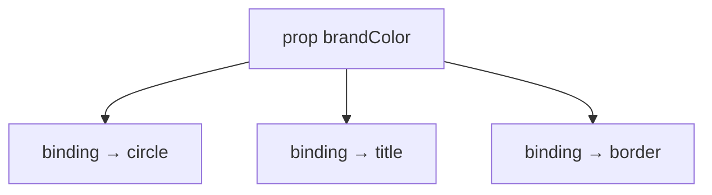
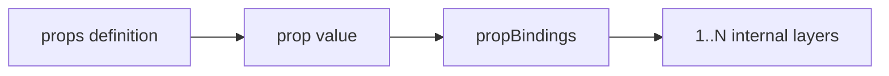
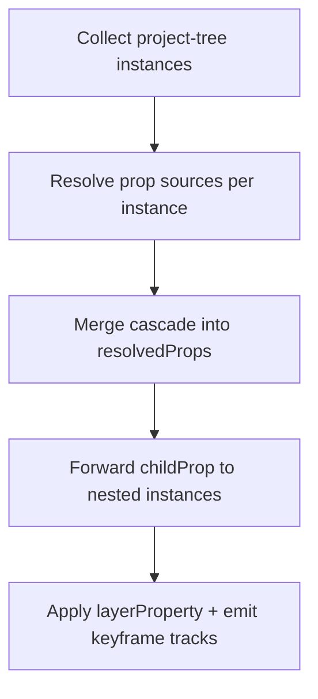

# MotiClip V1 Components

## Cách nên nghĩ

| Khái niệm | Nghĩa đời thường |
| --- | --- |
| **Prop** | Một **tín hiệu public** — nút chỉnh mà user/AI được đụng |
| **PropBindings** | Các **dây nối** tín hiệu đó vào bên trong component |
| **Prop value** | Giá trị gắn lên tín hiệu (màu tĩnh, biến, hoặc keyframes) |
| **Instance** | Layer `type: "component"` trên `project.layers` — wrapper có `zIndex` / `timing` / `transform` / `frame`; nội dung chỉ qua `payload.props` |

```text
User chỉnh props
     │
     ▼
  brandColor = #00ff88          ← một tín hiệu
     │
     ├─► circle.payload.color
     ├─► title.payload.color    ← fan-out nhờ propBindings
     └─► border.style.stroke
```

- **User / app / AI consumer** chỉ chỉnh `props`.
- **Owner / designer AI** thiết kế `propBindings`.
- **Compiler** biến props thành giá trị / motion tracks trên layer nội bộ.

Timeline **không biết** component. Root/group đặt instance. Definition mô tả bên trong.

---

## Câu chốt contract

> A **component** is a sealed design template with public **props** and **variants**.  
> A **component layer** is an **instance** placed on the project layer tree (`type: "component"`, leaf).  
> **Props** are public signals. A prop value can be **static**, **variable-bound**, or **keyframed**.  
> **PropBindings** wire each signal into one or many internal layers (or child props).  
> Only **animatable** props may receive keyframes (`choice` / `asset` default off; set `animatable: true` to opt in; asset stays step-only).  
> Nested components may forward prop values (including keyframes) only to **direct child props**.  
> Asset props must declare `assetKind`; asset keyframes are **step-only**.

---

## 1. Props và PropBindings làm việc thế nào

### 1.1 Một prop = một tín hiệu

Owner khai báo:

```jsonc
{
  "id": "brandColor",
  "label": "Brand color",
  "kind": "color",
  "default": "#ffcc00",
  "animatable": true
}
```

User **không** cần biết có bao nhiêu layer bên trong. Họ chỉ biết: “có nút Brand color”.

### 1.2 PropBindings = dây nối (có thể fan-out)

Muốn một màu đổi **cả 3 vật thể**, owner nối cùng `propId` tới 3 layer:

```jsonc
{
  "propBindings": [
    {
      "propId": "brandColor",
      "target": {
        "kind": "layerProperty",
        "layerId": "circle",
        "property": "payload.color"
      }
    },
    {
      "propId": "brandColor",
      "target": {
        "kind": "layerProperty",
        "layerId": "title",
        "property": "payload.color"
      }
    },
    {
      "propId": "brandColor",
      "target": {
        "kind": "layerProperty",
        "layerId": "border",
        "property": "style.stroke"
      }
    }
  ]
}
```

> `layerId` = id của **layer nội bộ** trong `component.layers` (circle, title, border…).

Compiler `resolvePropTargets(propId)` tìm **mọi** dây nối, không dừng ở binding đầu tiên.

### 1.3 User chỉ set props trên instance

```jsonc
{
  "type": "component",
  "id": "badge-1",
  "payload": {
    "componentId": "promo-badge",
    "props": {
      "brandColor": "#00ff88"
    }
  }
}
```

Compiler hiểu:

```text
badge-1.brandColor = #00ff88
  → circle.payload.color  = #00ff88
  → title.payload.color   = #00ff88
  → border.style.stroke   = #00ff88
```

**Một prop có thể điều khiển nhiều layer.** Đó là fan-out.

### 1.4 Animate cùng tín hiệu

Vì `animatable: true`, value có thể là keyframes:

```jsonc
{
  "payload": {
    "componentId": "promo-badge",
    "props": {
      "brandColor": {
        "kind": "keyframes",
        "keys": [
          { "t": 0, "value": "#ffcc00" },
          { "t": 1, "value": "#00ff88" },
          { "t": 2, "value": "#ff3366" }
        ]
      }
    }
  }
}
```

Compiler **fan-out cùng keyframes** tới mọi dây nối:

```text
brandColor keyframes
  → circle color keyframes
  → title color keyframes
  → border stroke keyframes
```

User vẫn chỉ chỉnh **một** prop. Ba layer chuyển màu đồng bộ.



### 1.5 Ai làm việc gì

| Ai | Làm gì | Không làm |
| --- | --- | --- |
| **User / consumer** | Set `payload.props`, chọn `variantId` | Không sửa `layers` / `propBindings` |
| **Owner** | Khai báo `props[]`, viết `propBindings`, dựng `layers` | — |
| **Compiler** | Resolve value → apply / emit tracks theo bindings | Không suy luận binding thiếu |

---

## 2. Hai phần của Prop

| Phần | Ai viết | JSON |
| --- | --- | --- |
| **Definition** | Owner | `component.props[]` — tín hiệu là gì (`kind`, `default`, `animatable`…) |
| **Value** | Consumer / variant / project binding | `payload.props`, `variant.props`, binding `propId` |



---

## 3. PropKind

```ts
type PropKind = "text" | "number" | "boolean" | "color" | "choice" | "asset";
```

| Kind | Dùng cho | Default `animatable` | Keyframe interpolation |
| --- | --- | --- | --- |
| `text` | title, label | `true` | step |
| `number` | opacity, progress, size | `true` | linear / easing |
| `boolean` | showIcon, visible | `true` | step |
| `color` | brandColor, fill | `true` | color |
| `choice` | style, layout, mode | `false` (`animatable: true` được) | step |
| `asset` | image, video, font… | `false` (`animatable: true` được) | step |

Không dùng `string` / `enum` / `list` trên public API (`text` thay string, `choice` thay enum).

### Ví dụ definition

```jsonc
{ "id": "progress", "label": "Progress", "kind": "number", "default": 0, "min": 0, "max": 1, "animatable": true }
```

```jsonc
{ "id": "avatar", "label": "Avatar", "kind": "asset", "assetKind": "image", "default": "asset-default-avatar" }
```

```jsonc
{ "id": "style", "label": "Style", "kind": "choice", "options": ["solid", "outline", "ghost"], "default": "solid" }
```

### AssetKind

```ts
type AssetKind = "image" | "video" | "audio" | "svg" | "font" | "media";
```

- Strict: `image` / `video` / `audio` / `svg` / `font`
- `media` = image **hoặc** video (heroMedia, backgroundMedia…)
- Không có `any` ở V1 canonical

---

## 4. Prop values

### Static

```jsonc
{
  "payload": {
    "componentId": "progress-ring",
    "props": { "progress": 0.75, "color": "#00ff88", "label": "Loading" }
  }
}
```

### Variable-bound

Instance trên `project.layers` chỉ được ref **`project.variables`**.  
`component.variables` là biến local của owner — dùng cho `props.default`, `variants[].props`, và nested `payload.props` trong `component.layers`. Consumer không được trỏ vào đó.

```jsonc
{
  "props": {
    "label": { "ref": { "kind": "variable", "id": "cta-text" } }
  }
}
```

### Keyframed

```jsonc
{
  "props": {
    "progress": {
      "kind": "keyframes",
      "keys": [
        { "t": 0, "value": 0 },
        { "t": 2, "value": 1, "easing": "easeOut" }
      ]
    }
  }
}
```

### Keyframe rules

- `t` là **local time của component instance layer** — `0..layer.timing.duration`
- `keys` phải **tăng dần**, **không trùng `t`**, và **`t ≤ layer.timing.duration`**
- `number` / `color`: interpolate được
- `text` / `boolean` / `choice` / `asset`: chỉ **step**
- `animatable: false` (hoặc omitted trên choice/asset) + keyframes → **reject**
- `choice` / `asset` có thể `animatable: true`; asset keyframe vẫn **step-only**
- Asset / choice / variable: mỗi key (và variable ref) phải khớp `assetKind` / `options`
- Unknown `ref.variable` → **reject**
- Không animate `payload.props.<propId>` qua animation track bên ngoài. Nếu prop cần animation, đặt keyframes ngay trong `payload.props.<propId>`.

Prop animation ≠ wrapper transform. Animation trên component layer animate **wrapper** của instance; prop keyframes fan-out vào **layer nội bộ** qua `propBindings`.

---

## 5. Hai loại PropBinding

| Target | Shape | Ý nghĩa |
| --- | --- | --- |
| `layerProperty` | `{ kind: "layerProperty", layerId, property }` | Nối tín hiệu → property của layer nội bộ |
| `childProp` | `{ kind: "childProp", childLayerId, propId }` | Forward tín hiệu → prop của **child component trực tiếp** |

### Forward xuống child

Một prop cha có thể forward xuống **nhiều** child (nhiều binding `childProp`):

```jsonc
{
  "propId": "brandColor",
  "target": {
    "kind": "childProp",
    "childLayerId": "button-instance",
    "propId": "color"
  }
}
```

Giá trị (kể cả keyframes) được forward **nguyên**. Child tự fan-out tiếp qua `propBindings` của mình.

```text
A.brandColor keyframes
  → B.color keyframes          (childProp)
    → C.fillColor keyframes    (child của B)
      → layer fill             (layerProperty)
```

Không skip-level: A không bind thẳng layer nội bộ của C.

Compiler resolve recursive: thấy `childProp` thì đi tiếp vào child definition cho đến khi gặp `layerProperty`.

### Project binding

| Field | Ở đâu | Phạm vi |
| --- | --- | --- |
| `project.bindings` | Project | Project-tree layer (`layer`) hoặc **một** component instance (`componentLayer` = `layerId` + `propId`) |

Global bulk `target.type: "component"` **đã gỡ**. Nested Button trong Card không nhận project binding — parent phải `childProp`.

Hai `propBindings` cùng `layerProperty` (`layerId` + `property`) → **reject**. Hai `childProp` cùng (`childLayerId` + `propId`) → **reject**.

---

## 6. Resolve order

Luồng **một chiều**. Không write ngược. Không child override parent. Binding **không** ghi xuống internals.

```text
root source
  -> parent prop
  -> child prop
  -> grandchild prop
  -> internal layerProperty
```

Mọi nguồn đều là **prop source**. Binding chỉ drive public prop. Compiler merge cascade xong rồi mới apply `layerProperty` / emit tracks.

Priority **mỗi prop trên mỗi instance** (sau thắng trước):

1. `prop.default`
2. `variant.props`
3. `payload.props`
4. parent forwarded prop (`childProp`)
5. project binding (`target.type: "componentLayer"`)

Nested instance không nhận project binding. Parent forward (bước 4) ghi vào child `payload.props` rồi recurse.



---

## 7. Definition + instance đầy đủ

```jsonc
{
  "id": "promo-badge",
  "version": "1.0.0",
  "integrity": "sha256:…",
  "props": [
    {
      "id": "brandColor",
      "label": "Brand color",
      "kind": "color",
      "default": "#ffcc00",
      "animatable": true
    }
  ],
  "propBindings": [
    {
      "propId": "brandColor",
      "target": { "kind": "layerProperty", "layerId": "circle", "property": "payload.color" }
    },
    {
      "propId": "brandColor",
      "target": { "kind": "layerProperty", "layerId": "title", "property": "payload.color" }
    },
    {
      "propId": "brandColor",
      "target": { "kind": "layerProperty", "layerId": "border", "property": "style.stroke" }
    }
  ],
  "layers": [/* circle, title, border, … */],
  "variants": []
}
```

```jsonc
{
  "id": "badge-1",
  "type": "component",
  "parentLayerId": null,
  "zIndex": 2,
  "timing": { "start": 0, "duration": 4 },
  "frame": { "width": 256, "height": 256 },
  "payload": {
    "componentId": "promo-badge",
    "props": { "brandColor": "#00ff88" }
  }
}
```

---

## 8. Timeline reminder

Component instance = `type: "component"` layer trên **project layer tree**. Không còn visual clip / `source.kind: "scene"`. Instance có `timing`, `zIndex`, `transform`, `frame` riêng; internals sealed. Timing instance nằm ở `layer.timing`.

---

## 9. Anti-patterns

| ❌ Sai | ✅ Đúng |
| --- | --- |
| User sửa `layers` / `propBindings` | User chỉ set `payload.props` |
| Một màu = ba prop riêng | Một `brandColor` + ba bindings |
| Bind thẳng internals từ project | Bind `propId` (project-tree instance) — compiler resolve prop rồi apply |
| Skip-level vào layer của nested child | `childProp` từng tầng |
| Global bulk binding mọi instance cùng `componentId` | `componentLayer` từng instance; nested qua `childProp` |
| `actions` / named action animations | Đã gỡ; animate bằng prop keyframes hoặc layer tracks |
| `target.kind` / `target.type: "component"` | `target.type: "layer"` \| `"componentLayer"` |
| `PublicParamSchema` / `ComponentBindingSchema` | `ComponentPropV1Schema` + `propBindings` |

---

## 10. Tóm tắt một câu

> **Một prop có thể điều khiển nhiều layer; có thể forward xuống nhiều child; có thể là keyframes. User chỉ chỉnh props. Owner thiết kế propBindings. Project binding chỉ `layer` | `componentLayer`. Không có `actions`.**

---

## 11. Module map

| File | Vai trò |
| --- | --- |
| `src/v1/components/index.ts` | Definition, PropKind, propBindings |
| `src/v1/components/prop-values.ts` | Static / variable / keyframes |
| `src/v1/layers/component.ts` | Instance `payload.props` |
| `src/v1/references/project.ts` | Validation |
| `motion-compiler/compile-v1.ts` | Resolve + fan-out + keyframe tracks |

Xem thêm: [v1-format-guide.md](v1-format-guide.md), [v1-timeline-guide.md](v1-timeline-guide.md), [v1-group-guide.md](v1-group-guide.md).
