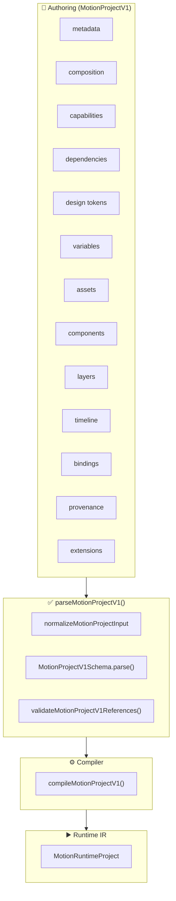
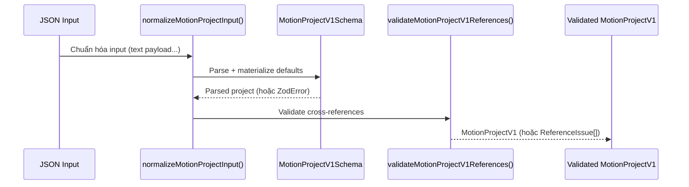

# MotiClip V1 — Canonical Project Format

> **Status**: Source of truth duy nhất. Format này được chấp nhận bởi tất cả product paths (editor, compiler, runtime, preview, export).
>
> **Format discriminator**: `"format": "motion-project"`, `"formatVersion": 1`
>
> **Root parser**: `parseMotionProjectV1()` — chỉ chấp nhận `formatVersion: 1`. Dữ liệu V2 bị từ chối hoàn toàn.

---

## 1. MotionProjectV1 là gì?

`MotionProjectV1` là **định dạng authoring duy nhất** của MotiClip, đại diện cho toàn bộ một dự án motion graphics. Mọi thứ — layers, components, assets, variables, timeline metadata, bindings — đều nằm trong một file JSON duy nhất, có cấu trúc chặt chẽ và được validate nghiêm ngặt qua Zod schema.



### Tại sao là single source of truth?

| Vấn đề                              | Giải pháp                             |
| ----------------------------------- | ------------------------------------- |
| Nhiều định dạng authoring khác nhau | Chỉ có một: `formatVersion: 1`        |
| Dữ liệu V2 cũ lẫn vào pipeline      | Parser từ chối `formatVersion: 2`     |
| Schema không nhất quán              | `.strict()` trên mọi object           |
| Thiếu kiểm tra tham chiếu chéo      | `validateMotionProjectV1References()` |
| Không rõ field nào bắt buộc         | Zod schema có default rõ ràng         |

---

## 2. Cấu trúc Root

```jsonc
{
  "format": "motion-project", // Format discriminator
  "formatVersion": 1, // Bắt buộc = 1

  // ═══ Identity & Render Surface ═══
  "metadata": {
    /* ... */
  }, // id, name, locale, industry, tags
  "composition": {
    /* ... */
  }, // width, height, fps, background, colorSpace

  // ═══ Environment ═══
  "capabilities": {
    /* ... */
  }, // required, optional, experimental
  "dependencies": {
    /* ... */
  }, // compiler range, component deps, plugins
  "tokens": {
    /* ... */
  }, // colors, fonts, spacing, radii, motion

  // ═══ Data ═══
  "variables": [
    /* ... */
  ], // string, color, number, boolean, asset, enum, list
  "assets": [
    /* ... */
  ], // image, svg, video, audio, font
  "components": [
    /* ... */
  ], // embedded sealed components

  // ═══ Content ═══
  "layers": [
    /* ... */
  ], // root layers = timeline lanes; group.children = nested tree
  "timeline": {
    /* ... */
  }, // duration?, workArea?, markers? — no tracks
  "bindings": [
    /* ... */
  ], // variable → layer.property bindings

  // ═══ Optional Metadata ═══
  "provenance": {
    /* ... */
  }, // origin tracking, source map
  "extensions": {
    /* ... */
  }, // namespaced custom data
}
```

### Root Schema map

| Field           | Schema                                | Required          | Description                        |
| --------------- | ------------------------------------- | ----------------- | ---------------------------------- |
| `format`        | `z.literal("motion-project")`         | ✅                | Format discriminator               |
| `formatVersion` | `z.literal(1)`                        | ✅                | Phiên bản format                   |
| `metadata`      | `ProjectMetadataV1Schema`             | ✅                | Identity, locale, tags             |
| `composition`   | `CompositionSettingsSchema`           | ✅                | Render surface                     |
| `capabilities`  | `ProjectCapabilityRequirementsSchema` | ❌ (default `{}`) | Preflight capability check         |
| `dependencies`  | `ProjectDependenciesV1Schema`         | ✅                | Compiler + component + plugin deps |
| `tokens`        | `DesignTokensSchema`                  | ❌ (default `{}`) | Design token values                |
| `variables`     | `ProjectVariableV1Schema[]`           | ❌ (default `[]`) | Typed project variables            |
| `assets`        | `AssetV1Schema[]`                     | ❌ (default `[]`) | Asset declarations                 |
| `components`    | `ComponentDefinitionV1Schema[]`         | ❌ (default `[]`) | Component definitions                |
| `layers`        | `LayerV1Schema[]`                     | ❌ (default `[]`) | Root layers (lanes)                |
| `timeline`      | `ProjectTimelineV1Schema`             | ✅                | Duration / workArea / markers      |
| `bindings`      | `ProjectBindingV1Schema[]`            | ❌ (default `[]`) | Variable bindings                  |
| `provenance`    | `ProjectProvenanceSchema`             | ❌                | Origin tracking                    |
| `extensions`    | `NamespacedExtensionsSchema`          | ✅                | Namespaced custom data             |

---

## 3. Timeline Model: root layers are lanes

Authoring has **no** `scenes` / `visualTracks` / `audioTracks` / `captionTracks`. Extra keys are `.strict()` rejected. Details: [v1-timeline-guide.md](v1-timeline-guide.md).

| | Visual | Audio |
| --- | --- | --- |
| Authoring | Root layer `type !== "audio"`, `zIndex >= 0` | Root layer `type: "audio"`, `zIndex < 0` |
| Nesting | `group.children[]`; child timing is local | Root-only leaf |
| Caption | `group` + `text` children (UI lane, not a type) | — |
| Runtime IR | Flat `layers[]` + in-memory graph `id: "root"` | Audio layers in the same `layers[]`; no clip tracks |

`timeline` is clock metadata only: `duration?`, `workArea?`, `markers?`. Derive duration from root `timing.start + duration`.

---

## 4. Layers

`project.layers[]` = **root layers only**. Nested tree lives in `group.children[]`. Child `parentLayerId` must match parent; do not also list children at root.


### 4.2 Các loại layer

| Type         | Mô tả                        | Payload                                                |
| ------------ | ---------------------------- | ------------------------------------------------------ |
| `group`      | Container layer, có children | `compositing`                                          |
| `text`       | Văn bản                      | `content`, `fontSize`, `color`, `alignment`, `wrap`... |
| `solid`      | Hình chữ nhật màu            | `width`, `height`, `color`                             |
| `shape`      | Hình dạng vector             | `shape`, `cornerRadius` + `style`                      |
| `path`       | Đường path vector            | `contours[]` + `style`                                 |
| `image`      | Ảnh bitmap                   | `assetId`, `fit`, `crop`                               |
| `svg`        | Ảnh vector SVG               | `assetId`, `fit`                                       |
| `video`      | Video clip                   | `assetId`, `fit`, `muted`, `loop`                      |
| `camera`     | Camera view                  | `projection`, `zoom`                                   |
| `bone`       | Bone cho skeletal animation  | `length`, `restRotation`, `rotationLimits`             |
| `adjustment` | Điều chỉnh màu sắc           | `brightness`, `contrast`, `saturation`                 |
| `component`  | Instance của component       | `componentId`, `variantId?`, `props?`            |
| `audio`      | Root-only audio leaf         | `assetId`, trim/fade/volume/loop                 |

> **Component layer** (`type: "component"`) is a sealed instance leaf on the project tree. `payload.componentId` points at `project.components[]`. Component is **not** a timeline clip source.

### 4.3 Cấu trúc layer

```jsonc
{
  "id": "title",
  "type": "text",
  "name": "Title", // optional
  "parentLayerId": null, // null = root, hoặc id của group layer
  "zIndex": 0, // optional, thứ tự z giữa các sibling
  "timing": {
    // optional, relative với parent
    "start": 0,
    "duration": 5,
  },
  "transform": {
    "x": 0,
    "y": 0,
    "width": 800,
    "height": 120,
    "rotation": 0,
    "scaleX": 1,
    "scaleY": 1,
    "anchorX": 0.5,
    "anchorY": 0.5,
    "opacity": 1,
    "visible": true,
    "flipX": false,
    "flipY": false,
  },
  "inheritFlags": {
    // optional, kế thừa từ parent
    "position": true,
    "rotation": true,
    "scale": true,
    "opacity": true,
  },
  "semantic": { "role": "title" }, // optional
  "effects": [
    /* ... */
  ], // optional
  "blendMode": "normal", // optional
  "mask": {
    /* ... */
  }, // optional
  "payload": {
    /* type-specific */
  },
}
```

---

## 5. Group Layer Semantics

### 5.1 Tổng quan

Một `group` layer (`type: "group"`) là **timeline layer thực sự** — không phải folder thụ động. Nó có timing, transform, z-order, animation, effects riêng và có thể chứa child layers.

```text
Project root / layer graph                  ← implicit root
  group.character        parentLayerId: null  ← root layer
    group.upper-body     parentLayerId: group.character
      group.head-rig     parentLayerId: group.upper-body
        head-image       parentLayerId: group.head-rig
```

### 5.2 Parent-Relative Timing

Timing của child được tính **relative với parent**:

```
nodeGlobalStart = parentGlobalStart + node.timing.start
nodeGlobalEnd   = min(parentGlobalEnd, nodeGlobalStart + node.timing.duration)
```

**Default timing**: nếu thiếu, `start = 0`, `duration = parent effective duration`.

### 5.3 Z-Order

`zIndex` chỉ có ý nghĩa giữa các **sibling** (cùng `parentLayerId`):

```text
Project root
  group.character     zIndex 1    ← root sibling
    head              zIndex 99   ← child, chỉ so với sibling cùng parent
  title               zIndex 2    ← root sibling, luôn nằm TRÊN group.character
```

`head` (zIndex 99) nằm **trong** group.character (zIndex 1), không thể render trên `title` (zIndex 2).

**Protocol rule:** trong cùng `parentLayerId` (kể cả `null`), `zIndex` phải **unique** (thiếu `zIndex` được coi như `0`). Hai layer khác parent được phép cùng số. Timing giữa layer **được trùng**; chỉ stack order phải deterministic.

Layer copy (editor): giữ `timing`, cấp `id` mới + `zIndex` mới trong siblings — **không** bắt sang lane khác.

### 5.4 Compositing Modes

| Mode           | Offscreen | Group Effects                 | Blend Mode  | Transform                |
| -------------- | --------- | ----------------------------- | ----------- | ------------------------ |
| `pass-through` | ❌ Không  | Áp dụng riêng từng child      | Child-level | Qua `parent.worldMatrix` |
| `isolate`      | ✅ Có     | Áp dụng lên composited result | Group-level | Proxy sprite             |

```jsonc
{ "compositing": { "mode": "isolate" } }
```

---

## 6. Không có timeline effect primitive

Timeline **không** có `transitionIn` / `transitionOut` / crossfade / wipe. Muốn fade, slide, wipe, flash: animate layer hoặc component trên **layer graph** (opacity, transform, mask). Root layers là timeline lanes, ordered by `zIndex`.

Timing giữa layers **được trùng**; `zIndex` quyết định stack order. Không có model “đặt scene lên track order”.

Audio `fadeIn` / `fadeOut` là DSP envelope trên **chính audio layer đó**, không suy luận crossfade giữa layers.

---

## 7. Variables & Bindings

### 7.1 Variable types

```jsonc
// string
{ "id": "company", "type": "string", "value": "MotiClip" }

// color
{ "id": "brand", "type": "color", "value": "#ff6b35" }

// number (có thể có min/max)
{ "id": "opacity", "type": "number", "value": 0.9, "min": 0, "max": 1 }

// boolean
{ "id": "show-logo", "type": "boolean", "value": true }

// asset
{ "id": "logo", "type": "asset", "assetKind": "image", "value": "asset-logo" }

// enum
{ "id": "theme", "type": "enum", "value": "dark", "options": ["light", "dark"] }

// list
{
  "id": "data-rows",
  "type": "list",
  "itemSchema": { "type": "object", "fields": { "label": { "type": "string" }, "value": { "type": "number" } } },
  "value": [{ "label": "Users", "value": 1.2 }]
}
```

### 7.2 Project Bindings

Binding kết nối project variable với layer property hoặc public component prop. Discriminator là `target.type` (`"layer"` | `"componentLayer"`) — không dùng `kind`, không có bulk `component`.

```jsonc
// Layer binding — layerId + property trên project layer graph
{
  "id": "bind-title",
  "source": { "kind": "variable", "variableId": "company" },
  "target": {
    "type": "layer",
    "layerId": "title",
    "property": "payload.content.text"
  }
}

// Component-layer binding — một project-tree instance cụ thể
{
  "id": "bind-cta",
  "source": { "kind": "variable", "variableId": "cta-text" },
  "target": {
    "type": "componentLayer",
    "layerId": "cta-instance",
    "propId": "label"       // ← component.props[].id
  }
}
```

> **Layer binding** (`type: "layer"`): `layerId` + `property` trực tiếp.
> **ComponentLayer binding** (`type: "componentLayer"`): `layerId` + `propId` trên một instance. Nested trong definition chỉ qua `childProp`. Không còn bulk `target.type: "component"`. Chi tiết: [v1-component-guide.md](v1-component-guide.md).

---

## 8. Composition & Metadata

### 8.1 Composition Settings

```jsonc
{
  "composition": {
    "width": 1080,
    "height": 1920,
    "fps": 30,
    "background": "#ffffff", // default #ffffff
    "colorSpace": "srgb", // default "srgb"
    "pixelAspectRatio": 1, // optional, default 1
    "audioSampleRate": 48000, // default 48000
    "safeArea": {
      // optional
      "top": 0.05,
      "right": 0.05,
      "bottom": 0.1,
      "left": 0.05,
    },
    "motionBlur": {
      // optional
      "samples": 16,
      "shutterAngle": 180,
      "shutterPhase": 0,
    },
  },
}
```

### 8.2 Metadata

```jsonc
{
  "metadata": {
    "id": "my-project",
    "name": "My Project",
    "description": "Mô tả dự án", // optional
    "locale": "vi-VN",
    "industry": "technology", // optional
    "tags": ["demo", "v3"], // optional
    "createdAt": "2026-08-10T00:00:00Z", // optional
    "updatedAt": "2026-08-12T12:00:00Z", // optional
  },
}
```

---

## 9. Assets

5 loại asset được hỗ trợ. Layer chỉ reference `assetId` — **không** gắn URL trên layer.

Có hai chế độ khai báo trên `project.assets[]`:

1. **Unmanaged / fixture** — có `uri` (local path). Dùng cho test/offline.
2. **Managed** — ingest qua `motion-storage` (R2); **cấm `uri`**; bắt buộc `storage` + `integrity` + `sizeBytes`. Không có `expiresAt` trên JSON — hạn/thư viện do web app. File mất thì upload lại, `assetId` mới.

Chi tiết contract, API Express, client SDK và vòng resolve cho compiler: [`asset-format-storage.md`](./asset-format-storage.md).

```jsonc
// Image (unmanaged fixture)
{ "id": "logo", "uri": "./assets/logo.png", "integrity": "sha256:abc", "assetType": "image", "mimeType": "image/png", "width": 512, "height": 512, "pixelFormat": "rgba", "hasAlpha": true }

// Image (managed — sau Asset API)
{
  "id": "asset.image.9f3c",
  "assetType": "image",
  "mimeType": "image/png",
  "width": 512,
  "height": 512,
  "integrity": "sha256:abc",
  "sizeBytes": 20480,
  "storage": { "managed": true, "provider": "r2", "key": "assets/…", "retention": "temporary" },
  "source": { "kind": "upload", "originalName": "logo.png" }
}

// SVG
{ "id": "icon", "uri": "./assets/icon.svg", "integrity": "sha256:def", "assetType": "svg", "mimeType": "image/svg+xml", "width": 64, "height": 64, "viewBox": "0 0 64 64", "sanitized": true }

// Video
{ "id": "intro", "uri": "./assets/intro.mp4", "integrity": "sha256:ghi", "assetType": "video", "mimeType": "video/mp4", "width": 1920, "height": 1080, "duration": 10, "fps": 30, "codec": "h264", "pixelFormat": "yuv420p", "audioCodec": "aac", "audioSampleRate": 48000, "audioChannels": 2 }

// Audio
{ "id": "bgm", "uri": "./assets/bgm.mp3", "integrity": "sha256:jkl", "assetType": "audio", "mimeType": "audio/mpeg", "duration": 30, "codec": "mp3", "sampleRate": 48000, "channels": 2 }

// Font
{ "id": "font-display", "uri": "./assets/font.ttf", "integrity": "sha256:mno", "assetType": "font", "mimeType": "font/ttf", "family": "Be Vietnam Pro", "weight": 700, "style": "normal", "localeCoverage": ["vi", "en"] }
```

---

## 10. Capabilities & Dependencies

### 10.1 Capabilities

Preflight check cho phép compiler phát hiện sớm các tính năng không được hỗ trợ:

```jsonc
{
  "capabilities": {
    "required": ["primitive.text", "primitive.solid", "anim.transform"],
    "optional": ["effect.blur", "effect.shadow"],
    "experimental": ["projection.perspective-3d"],
  },
}
```

- **`required`**: Tính năng bắt buộc để compile
- **`optional`**: Có thể có hoặc không
- **`experimental`**: Cần opt-in, nếu không compiler báo `CAP_EXPERIMENTAL_IN_USE`

### 10.2 Dependencies

```jsonc
{
  "dependencies": {
    "compiler": { "range": ">=1.0.0" },
    "components": [
      {
        "componentId": "lower-third",
        "version": "1.2.0",
        "source": "com.moticlip.store",
        "integrity": "sha256:lower-third-1.2.0",
      },
    ],
    "plugins": [
      {
        "pluginId": "com.moticlip.ai-captions",
        "version": "0.9.0",
        "integrity": "sha256:ai-captions-0.9.0",
      },
    ],
  },
}
```

---

## 11. Minimal Project

Project tối thiểu hợp lệ:

```jsonc
{
  "format": "motion-project",
  "formatVersion": 1,
  "metadata": {
    "id": "my-project",
    "name": "My Project",
    "locale": "vi-VN",
  },
  "composition": {
    "width": 1080,
    "height": 1920,
    "fps": 30,
  },
  "dependencies": {
    "compiler": { "range": ">=1.0.0" },
    "components": [],
  },
  "extensions": {},
}
```

> Các field `capabilities`, `tokens`, `variables`, `assets`, `components`, `layers`, `bindings` đều có default — không cần khai báo nếu không dùng.

---

## 12. Parsing & Validation Pipeline



### Các lỗi validation chính

| Tầng       | Loại lỗi                 | Ví dụ                                   |
| ---------- | ------------------------ | --------------------------------------- |
| Schema     | `formatVersion != 1`     | Từ chối V2 data                         |
| Schema     | Unknown field            | `.strict()` từ chối                     |
| Schema     | Sai type                 | Zod validation error                    |
| References | Missing layer            | `Unknown layer: title`                  |
| References | Missing component        | `Unknown component: cta`                |
| References | Duplicate ID             | `Duplicate layer id: title`             |
| References | Invalid binding target   | `Unknown layer: ghost-layer`              |
| References | Private component access | `propId không có layerProperty binding` |

---

## 13. Extensions & Provenance

### 13.1 Namespaced Extensions

Dữ liệu mở rộng theo namespace, không làm hỏng schema chính:

```jsonc
{
  "extensions": {
    "com.moticlip.constraints": [{ "maxDuration": 30 }],
    "com.moticlip.ai-hints": { "tone": "professional", "pace": "fast" },
  },
}
```

### 13.2 Provenance

Theo dõi nguồn gốc project và source mapping:

```jsonc
{
  "provenance": {
    "workspaceId": "ws-demo",
    "sourceHash": "abc123",
    "bundleProfile": "embedded-components",
    "sourceMap": {
      "layers": { "intro": "src/layers/intro.json" },
      "components": { "lower-third": "src/components/lt.json" },
      "variables": { "company": "src/variables.json" },
      "assets": { "logo": "assets/logo.png" },
    },
  },
}
```

---

## 14. Editor UI State

> **UI session KHÔNG thuộc `MotionProjectV1`.** Các field sau chỉ sống trong editor session (localStorage, IndexedDB, hoặc `editor/workspace.mt`) — **không** serialize vào project contract:
>
> `playhead` / `currentTime`, `selection` (`selectedLayerIds`), `zoom` (`timelineZoom`), `scroll` (`timelineScroll`), panel layout, undo/redo.
>
> Khi nói timing trong contract / compiler / runtime, dùng **`time` / `timelineTime`** (giây trên trục project), không dùng “playhead”.

### 14.1 Editor Duplicate commands (không phải schema)

**Duplicate là command của editor**, không phải field/operation trong JSON. Sau khi chạy, project chỉ chứa state cuối hợp lệ (object mới, id mới, timing/lane/zIndex hợp lệ). Không thêm `duplicatedFrom` / `copyOf` vào schema chính; provenance nếu cần chỉ nằm trong `extensions` / `provenance`.

#### `DuplicateRootLayer`

1. Tạo root layer mới với `id` mới (deep-clone subtree nếu là `group`).
2. Nếu **giữ cùng `start`/`duration`**: cấp `zIndex` sibling mới (ví dụ `max(siblings.zIndex)+1`). Timing trùng được phép.
3. Nếu muốn xếp tuần tự trên cùng lane: đặt `start` sau `prev.start + prev.duration`.
4. Output phải pass `MotionProjectV1Schema` + references.

#### `DuplicateNode` (layer trong cây)

1. Tạo layer mới với `id` mới.
2. **Giữ timing** (được trùng `start`/`duration` với bản gốc).
3. Cấp `zIndex` mới trong siblings cùng `parentLayerId` (ví dụ `max(siblings.zIndex)+1`; thiếu zIndex coi như `0`).
4. Duplicate **group**: deep-clone subtree, remap mọi id con; root siblings nhận `zIndex` mới; relative order nội bộ group giữ sau remap.
5. Không giữ id cũ nếu gây trùng `layer.id` hoặc binding mơ hồ.

---

## 15. Best Practices

### Khi tạo project mới

1. **Luôn dùng `"format": "motion-project"` và `"formatVersion": 1`**
2. **Khai báo `capabilities.required`** để compiler preflight sớm
3. **Dùng `integrity` hash** cho mọi asset và component dependency
4. **Giữ `.strict()` shape** — không thêm field ngoài schema

### Khi dùng timeline

1. **Không dùng timeline effect primitives** — effect = layer / component animation
2. **Dùng sparse `zIndex` unique** (visual `>= 0`, audio `< 0`) — không cần contiguous
3. **Component layer** (`type: "component"`) là root (hoặc nested trong group) instance leaf — không còn visual clip / scene source
4. **Root layers trùng thời gian** → khác `zIndex`; timing trùng được phép
5. **Duplicate layer** chỉ qua editor command — JSON chỉ lưu kết quả
6. **Audio fade** (`fadeIn`/`fadeOut`) là DSP trên audio layer — không suy luận crossfade

### Khi dùng bindings

1. **Layer binding** (`target.type: "layer"`): `layerId` + `property` trực tiếp
2. **Component binding** (`"componentLayer"`): `layerId` + `propId`; nested chỉ qua `childProp`
3. **Kiểm tra type khớp**: string → text, number → opacity, color → fill...

---

## 16. Tóm tắt

| Khái niệm                | Mô tả                                                                                            |
| ------------------------ | ------------------------------------------------------------------------------------------------ |
| **MotionProjectV1**      | Single source of truth, một file JSON cho toàn bộ dự án                                          |
| **Root layers**          | Timeline lanes; `zIndex` unique (`>= 0` visual, `< 0` audio)                                     |
| **timeline**             | Metadata only: `duration?` / `workArea?` / `markers?` — no tracks                                 |
| **Layer types**          | group, text, solid, shape, path, image, svg, video, camera, bone, adjustment, component, audio   |
| **Group layer**          | Wrapper với `children[]`; child timing local                                                     |
| **Audio layer**          | Root-only leaf `type: "audio"`                                                                   |
| **Variables**            | 7 types: string, color, number, boolean, asset, enum, list                                       |
| **Bindings**             | `target.type`: `layer` / `componentLayer` — props drilling only                                  |
| **Strict validation**    | `.strict()` trên mọi object + reference validation                                               |
| **Format discriminator** | `format: "motion-project"`, `formatVersion: 1` — từ chối V2                                      |
| **Duplicate**            | Editor command only — JSON không có op duplicate                                                 |
