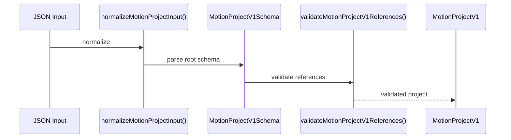

# MotiClip V1 Canonical Format

> Status: source-of-truth overview
>
> Goal: define the root contract of `MotionProjectV1` and point to the specialized guides for field-level semantics.

---

## 1. What this file is

`MotionProjectV1` is the single authoring format of MotiClip.

- All product paths accept the same root JSON document.
- The parser accepts only:
  - `"format": "motion-project"`
  - `"formatVersion": 1`
- Layer, frame, group, media, layout, and binding semantics are documented in specialized guides.

This file should stay focused on:

- root shape
- document-level rules
- parse and validation pipeline
- minimal valid project

It should not become the place that fully explains every field family.

---

## 2. Root document shape

```jsonc
{
  "format": "motion-project",
  "formatVersion": 1,

  "metadata": { /* ... */ },
  "composition": { /* ... */ },

  "capabilities": { /* ... */ },
  "dependencies": { /* ... */ },
  "tokens": { /* ... */ },

  "variables": [ /* ... */ ],
  "assets": [ /* ... */ ],
  "components": [ /* ... */ ],

  "layers": [ /* ... */ ],
  "timeline": { /* ... */ },
  "bindings": [ /* ... */ ],

  "provenance": { /* ... */ },
  "extensions": { /* ... */ }
}
```

### Root fields

| Field | Required | Meaning |
| --- | --- | --- |
| `format` | Yes | Format discriminator |
| `formatVersion` | Yes | Must be `1` |
| `metadata` | Yes | Project identity and locale |
| `composition` | Yes | Render surface |
| `capabilities` | No | Capability requirements |
| `dependencies` | Yes | Compiler/component/plugin dependencies |
| `tokens` | No | Design token values |
| `variables` | No | Typed project variables |
| `assets` | No | Asset declarations |
| `components` | No | Sealed component definitions |
| `layers` | No | Root layer tree |
| `timeline` | Yes | Timeline clock metadata |
| `bindings` | No | Variable-to-layer or variable-to-component bindings |
| `provenance` | No | Origin tracking |
| `extensions` | Yes | Namespaced custom data |

---

## 3. Root-level rules

- The root object is strict.
- Unknown fields should be rejected.
- Authoring is `layers`-only.
- There are no `scenes`, `visualTracks`, `audioTracks`, or `captionTracks`.
- Root layers are timeline lanes.
- Audio is root-only.
- Editor session state does not belong in the project JSON.

Examples of editor-only state that should stay out of the format:

- playhead/current time
- selection
- panel layout
- zoom/scroll
- undo history
- locked UI state

---

## 4. Parsing and validation pipeline



Validation has two layers:

- schema validation
- cross-reference validation

Typical failures:

- wrong `formatVersion`
- unknown root field
- duplicate IDs
- invalid layer nesting
- invalid binding targets
- invalid asset or component references

---

## 5. Minimal valid project

```jsonc
{
  "format": "motion-project",
  "formatVersion": 1,
  "metadata": {
    "id": "my-project",
    "name": "My Project",
    "locale": "vi-VN"
  },
  "composition": {
    "width": 1080,
    "height": 1920,
    "fps": 30
  },
  "dependencies": {
    "compiler": { "range": ">=1.0.0" },
    "components": []
  },
  "timeline": {},
  "extensions": {}
}
```

Most arrays and optional maps may be omitted and filled by defaults.

---

## 6. Specialized guides

The detailed meaning of each field family now lives in dedicated guides:

- Root content and layer model:
  - [v1-layer-guide.md](./v1-layer-guide.md)
  - [v1-timeline-guide.md](./v1-timeline-guide.md)
  - [v1-group-guide.md](./v1-group-guide.md)
  - [v1-frame-guide.md](./v1-frame-guide.md)

- Shared visual fields:
  - [v1-transform-guide.md](./v1-transform-guide.md)
  - [v1-appearance-guide.md](./v1-appearance-guide.md)
  - [v1-compositing-guide.md](./v1-compositing-guide.md)
  - [v1-effects-guide.md](./v1-effects-guide.md)

- Layer-type-specific fields:
  - [v1-shape-guide.md](./v1-shape-guide.md)
  - [v1-path-guide.md](./v1-path-guide.md)
  - [v1-text-guide.md](./v1-text-guide.md)
  - [v1-image-guide.md](./v1-image-guide.md)
  - [v1-video-guide.md](./v1-video-guide.md)
  - [v1-audio-guide.md](./v1-audio-guide.md)

- Data flow and container behavior:
  - [v1-layout-guide.md](./v1-layout-guide.md)
  - [v1-component-guide.md](./v1-component-guide.md)
  - [v1-variables-bindings-guide.md](./v1-variables-bindings-guide.md)

- Production readiness:
  - [v1-production-surface-guide.md](./v1-production-surface-guide.md)
  - [asset-format-storage.md](./asset-format-storage.md)
  - [README.md](./README.md)

---

## 7. Current format decisions

- `modifier` is not part of the preferred AI authoring surface.
- Behavior should live on the domain object that owns it.
- `frame` is a size box. Required on every visual layer, including group. Forbidden on audio and camera.
- `transform` is shared visual geometry: translate, scale (negative = flip), rotate.z, skew, origin, depth. Not layout, not zIndex. Audio has no transform.
- `group` is a visual container.
- `component` is a sealed instance.
- `semantic` is metadata only.
- `locked` should stay out of authoring JSON.

---

## 8. Summary

`v1-format-guide.md` defines the root contract of the project document.

The rest of the semantics should be explained in specialized guides, not duplicated here.

