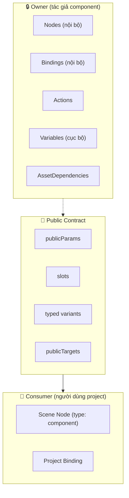
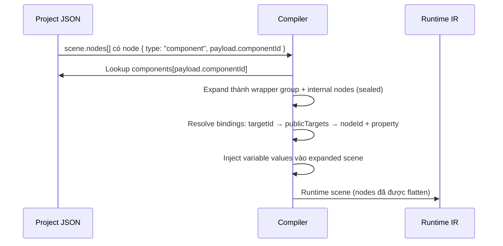
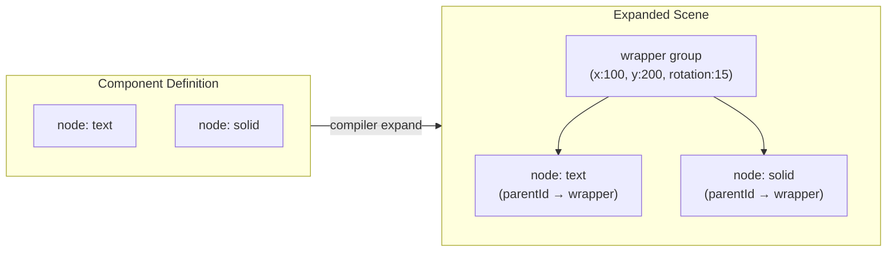

# MotiClip V3 Components

## 1. Component là gì?

Component trong MotiClip V3 là một **đơn vị đồ họa đóng gói (sealed unit)**, do chủ sở hữu (owner) kiểm soát toàn bộ cấu trúc bên trong. Component được nhúng trong project JSON (`EmbeddedComponentV3Schema`) và khởi tạo như **scene node** (`type: "component"`) — có transform / timing / zIndex / effects / blend / mask như group. Timeline visual clip **chỉ** tham chiếu scene (`source.kind: "scene"`); muốn đưa component lên timeline, đặt nó trong một scene rồi clip trỏ scene đó.

“Hiệu ứng chuyển cảnh” (flash, wipe, title) cũng chỉ là component/layer animation trong scene — **không** phải `transitionIn`/`transitionOut` primitive.

Mô hình component tuân theo nguyên tắc **owner-owned, consumer-safe**:

- **Owner** (người tạo component): toàn quyền kiểm soát nodes, bindings, actions, cấu trúc nội bộ.
- **Consumer** (người dùng component): chỉ được truy cập thông qua **public contract** — các API đã được owner cho phép.



### Tại sao cần sealed component?

| Vấn đề                                             | Giải pháp                                                                   |
| -------------------------------------------------- | --------------------------------------------------------------------------- |
| Consumer vô tình sửa cấu trúc nội bộ của component | Schema `.strict()` + compiler từ chối private access                        |
| Không rõ field nào được phép dùng                  | `publicParams`, `slots`, `variants`, `publicTargets` là mặt public duy nhất |
| Component không nhất quán giữa các project         | Dependencies pin version + integrity hash                                   |
| Khó build UI editor cho consumer                   | Chỉ hiển thị public surface, ẩn toàn bộ internals                           |

---

## 2. Cấu trúc một Component

Mỗi component là một object JSON nhúng trong `project.components[]`:

```jsonc
{
  "id": "call-to-action", // ID định danh duy nhất
  "version": "1.0.0", // Semantic version
  "integrity": "sha256:cta-1.0.0", // Hash toàn vẹn nội dung

  // ═══ Public Contract (consumer được dùng) ═══
  "publicParams": [
    /* ... */
  ], // Tham số public
  "slots": [
    /* ... */
  ], // Vùng chèn nội dung có cấu trúc
  "variants": [
    /* ... */
  ], // Preset do owner định nghĩa
  "publicTargets": [
    /* ... */
  ], // Node/property paths consumer được bind

  // ═══ Private Internals (chỉ owner được sửa) ═══
  "variables": [
    /* ... */
  ], // Biến cục bộ của component
  "nodes": [
    /* ... */
  ], // Cây node nội bộ
  "bindings": [
    /* ... */
  ], // Binding nội bộ component
  "actions": [
    /* ... */
  ], // Motion actions
  "assetDependencies": [
    /* ... */
  ], // Asset IDs cần thiết
}
```

---

## 3. Public Contract — 4 mặt consumer

### 3.1 `publicParams` — Tham số scalar

Tham số công khai để consumer cấu hình component. Mỗi param map vào một `variableId` nội bộ của component.

```jsonc
{
  "id": "label",
  "name": "Button label",
  "type": "string", // string | color | number | boolean | asset | enum | list
  "variableId": "cta-label", // Trỏ đến biến nội bộ
  "semantic": { "role": "cta-label" }, // optional
  "label": "Nhãn nút", // optional, cho UI editor
  "min": 1, // optional, với type=number
  "max": 100, // optional, với type=number
  "step": 1, // optional
  "options": ["A", "B"], // optional, với type=enum
  "previewHint": "string", // optional
}
```

**Các type được hỗ trợ**: `string`, `color`, `number`, `boolean`, `asset`, `enum`, `list`

**Cách dùng**: Consumer trỏ binding tới `variableId` của param để inject giá trị từ project variable.

---

### 3.2 `slots` — Vùng chèn nội dung có cấu trúc

Slots cho phép consumer chèn nội dung (text, image, SVG, video...) vào component mà **không cần biết cấu trúc node bên trong**.

```jsonc
{
  "id": "icon",
  "name": "Leading icon",
  "accepts": ["image", "svg"], // Content kinds được chấp nhận
  "count": 1, // Số lượng tối đa (1-16, default 1)
  "fallback": "default-icon", // optional, giá trị mặc định
  "previewHint": "Chọn icon", // optional
}
```

**Content kinds**: `text`, `image`, `svg`, `video`, `color`, `number`, `boolean`, `asset`

**Ví dụ use case**:

- Slot `title` — chèn text tiêu đề
- Slot `icon` — chèn ảnh/SVG icon
- Slot `badge` — chèn text + màu cho badge
- Slot `media` — chèn video hoặc ảnh nền

---

### 3.3 `variants` — Preset do owner định nghĩa

Variants là các **cấu hình được owner phê duyệt trước**, cho phép consumer chọn giữa các kiểu hiển thị khác nhau (layout, style, motion).

```jsonc
[
  {
    "id": "primary",
    "name": "Primary CTA",
    "params": {
      "color": "#1877f2",
      "label": "Click me",
    },
  },
  {
    "id": "outline",
    "name": "Outline CTA",
    "params": {
      "color": "#ffffff",
      "label": "Learn more",
    },
  },
]
```

**Phân biệt với `publicParams`**:

- `publicParams` — consumer tự do gán giá trị scalar
- `variants` — consumer chỉ được chọn trong danh sách owner đã định nghĩa

---

### 3.4 `publicTargets` — Node/property paths được phép bind

Đây là cơ chế kiểm soát truy cập **quan trọng nhất**. Consumer chỉ được bind variable vào các target mà owner đã khai báo.

```jsonc
{
  "id": "cta-label",
  "name": "Button label text",
  "nodeId": "cta-label-node",
  "property": "payload.content.text",
  "description": "Nội dung text hiển thị trên nút CTA",
}
```

**Cách hoạt động**:

1. Owner khai báo `publicTargets` — mỗi target có `id`, `nodeId`, `property`
2. Consumer tạo binding với `target.kind = "componentNode"` (trỏ đến instance trong scene) hoặc `target.kind = "component"` (bind toàn cục vào mọi instance của component) và dùng `targetId` để trỏ đến target
3. Compiler resolve `targetId` → `nodeId + property` và apply binding vào scene đã expand
4. Nếu consumer cố bind vào `nodeId`/`property` không có trong `publicTargets` → compiler báo lỗi `CMP_PRIVATE_COMPONENT_ACCESS`

---

## 4. Cách tạo Component

### Bước 1: Định nghĩa component trong project JSON

```jsonc
// Trong MotionProjectV3
{
  "components": [
    {
      "id": "my-button",
      "version": "1.0.0",
      "integrity": "sha256:abc123",

      // ═══ Định nghĩa public contract ═══
      "publicParams": [
        {
          "id": "text",
          "name": "Button text",
          "type": "string",
          "variableId": "btn-text",
        },
        {
          "id": "btnColor",
          "name": "Button color",
          "type": "color",
          "variableId": "btn-color",
        },
      ],
      "slots": [
        {
          "id": "leading-icon",
          "name": "Icon bên trái",
          "accepts": ["image", "svg"],
          "count": 1,
        },
      ],
      "variants": [
        { "id": "filled", "name": "Filled", "params": { "color": "#1877f2" } },
        {
          "id": "ghost",
          "name": "Ghost",
          "params": { "color": "transparent" },
        },
      ],
      "publicTargets": [
        {
          "id": "btn-text-content",
          "nodeId": "btn-text-node",
          "property": "payload.content.text",
        },
        {
          "id": "btn-bg-color",
          "nodeId": "btn-bg",
          "property": "payload.color",
        },
      ],

      // ═══ Internal (chỉ owner sửa) ═══
      "variables": [
        { "id": "btn-text", "type": "string", "value": "Click" },
        { "id": "btn-color", "type": "color", "value": "#1877f2" },
      ],
      "nodes": [
        {
          "id": "btn-bg",
          "type": "solid",
          "parentId": null,
          "transform": {
            /* ... */
          },
          "payload": { "width": 200, "height": 48, "color": "#1877f2" },
        },
        {
          "id": "btn-text-node",
          "type": "text",
          "parentId": "btn-bg",
          "transform": {
            /* ... */
          },
          "payload": {
            "content": { "kind": "plain", "text": "Click" },
            "fontSize": 18,
            "color": "#ffffff",
            "alignment": "center",
          },
        },
      ],
      "bindings": [],
      "actions": [
        {
          "id": "press",
          "name": "Press animation",
          "clips": [
            {
              "id": "press-scale",
              "targetId": "btn-bg",
              "schedule": { "kind": "absolute", "at": 0 },
              "duration": 0.15,
              "playback": {},
              "source": {
                "kind": "tracks",
                "tracks": [
                  {
                    "targetId": "btn-bg",
                    "property": "transform.scaleX",
                    "keys": [
                      { "t": 0, "v": 1 },
                      { "t": 0.075, "v": 0.95 },
                      { "t": 0.15, "v": 1 },
                    ],
                  },
                ],
              },
            },
          ],
        },
      ],
    },
  ],
}
```

### Bước 2: Khai báo dependencies

```jsonc
"dependencies": {
  "compiler": { "range": ">=1.0.0" },
  "components": [
    {
      "componentId": "my-button",
      "version": "1.0.0",
      "source": "com.moticlip.store",
      "integrity": "sha256:abc123"
    }
  ]
}
```

`integrity` trong dependencies **phải khớp** với `integrity` của component nhúng — nếu không compiler báo lỗi `CMP_COMPONENT_INTEGRITY_MISMATCH`.

### Bước 3: Khởi tạo component trên timeline (qua scene wrapper)

Timeline chỉ chứa clip scene. Để đưa component lên timeline, tạo một scene chứa component node rồi tham chiếu scene đó:

```jsonc
"scenes": [
  {
    "id": "my-button-scene",
    "name": "My Button",
    "duration": 5,
    "nodes": [
      {
        "id": "my-btn-instance",
        "type": "component",
        "parentId": null,
        "transform": {
          "x": 100, "y": 200, "width": 200, "height": 48,
          "rotation": 0, "scaleX": 1, "scaleY": 1,
          "anchorX": 0.5, "anchorY": 0.5,
          "opacity": 1, "visible": true, "flipX": false, "flipY": false
        },
        "payload": { "componentId": "my-button" }
      }
    ]
  }
],
"timeline": {
  "visualTracks": [
    {
      "id": "overlay",
      "role": "overlay",
      "order": 1,
      "clips": [
        {
          "id": "my-btn-instance",
          "source": { "kind": "scene", "sceneId": "my-button-scene" },
          "start": 0,
          "duration": 5,
          "transitionIn": { "type": "fade", "duration": 0.3 }
        }
      ]
    }
  ]
}
```

> Lưu ý: `clip.start` là thời điểm **tuyệt đối** trên global timeline (giây), không phải offset tương đối. Chính sách overlap (`main` không chồng lấn trừ khi có transition, `overlay` được chồng lấn tự do) và `timeline.duration` (độ dài MP4 cuối cùng) được mô tả chi tiết trong `v3-format-guide.md` §3.7–§3.8.

### Bước 4: Bind project variable vào component (qua publicTargets)

```jsonc
// Project variable
"variables": [
  { "id": "hero-cta", "type": "string", "value": "Đăng ký ngay" }
],

// Binding: dùng targetId thay vì nodeId + property
"bindings": [
  {
    "id": "bind-hero-cta",
    "source": { "kind": "variable", "variableId": "hero-cta" },
    "target": {
      "kind": "componentNode",
      "sceneId": "my-button-scene",
      "nodeId": "my-btn-instance",
      "targetId": "btn-text-content"  // ← publicTargets.id
    }
  }
]
```

---

## 5. Chính sách quyền truy cập (Access Control)

### 5.1 Nguyên tắc cốt lõi

| Chủ thể      | Được phép                                                                    | Không được phép                                    |
| ------------ | ---------------------------------------------------------------------------- | -------------------------------------------------- |
| **Owner**    | Sửa nodes, bindings, actions, variables, cấu trúc nội bộ                     | —                                                  |
| **Consumer** | Dùng `publicParams`, `slots`, `variants`, `publicTargets`                    | Truy cập trực tiếp `nodeId.property` của component |
| **Compiler** | Expand component node thành scene subgraph, remap bindings qua publicTargets | Cho phép binding bypass publicTargets              |

### 5.2 Các tầng validation

```
┌──────────────────────────────────────────────┐
│ 1. Schema (.strict())                        │
│    - Từ chối unknown fields                  │
│    - Chấp nhận binding component dạng        │
│      { componentId, targetId } (toàn cục)    │
│      hoặc { sceneId, nodeId, targetId }      │
│      (componentNode)                         │
│    - Không chấp nhận { nodeId, property }    │
│      cho component target                    │
├──────────────────────────────────────────────┤
│ 2. Reference Validation                      │
│    - targetId phải tồn tại trong             │
│      component.publicTargets[]               │
│    - componentId phải có trong project       │
│    - variableId phải tồn tại                 │
├──────────────────────────────────────────────┤
│ 3. Compiler (CMP_* diagnostics)              │
│    - CMP_PRIVATE_COMPONENT_ACCESS:           │
│      targetId không khai báo trong           │
│      publicTargets                           │
│    - CMP_COMPONENT_INTEGRITY_MISMATCH:       │
│      integrity hash không khớp              │
│    - CMP_UNRESOLVED_COMPONENT:               │
│      component không tồn tại                 │
└──────────────────────────────────────────────┘
```

### 5.3 Ví dụ: Truy cập bị từ chối

```jsonc
// ❌ SAI — consumer cố bind trực tiếp vào node nội bộ
{
  "target": {
    "kind": "component",
    "componentId": "my-button",
    "nodeId": "btn-bg", // ← private node!
    "property": "payload.color",
  },
}
// → Schema .strict() từ chối: không có field "nodeId" trong component target
```

```jsonc
// ❌ SAI — targetId không tồn tại trong publicTargets
{
  "target": {
    "kind": "component",
    "componentId": "my-button",
    "targetId": "secret-node", // ← không được khai báo
  },
}
// → CMP_PRIVATE_COMPONENT_ACCESS
```

```jsonc
// ✅ ĐÚNG — dùng targetId đã khai báo
{
  "target": {
    "kind": "component",
    "componentId": "my-button",
    "targetId": "btn-bg-color", // ← có trong publicTargets
  },
}
```

### 5.4 Ma trận quyền truy cập

| Hành động             | Scene          | Component (consumer)  | Component (owner) |
| --------------------- | -------------- | --------------------- | ----------------- |
| Đọc nodes             | ✅             | ❌                    | ✅                |
| Sửa nodes             | ✅             | ❌                    | ✅                |
| Bind vào node         | ✅ (trực tiếp) | ✅ (qua targetId)     | ✅ (trực tiếp)    |
| Đọc variables         | ✅             | ✅ (qua publicParams) | ✅                |
| Dùng variants         | N/A            | ✅ (chọn preset)      | ✅ (định nghĩa)   |
| Dùng slots            | N/A            | ✅                    | ✅ (định nghĩa)   |
| Gọi actions           | N/A            | ✅                    | ✅ (định nghĩa)   |
| Xem assetDependencies | N/A            | ✅ (read-only)        | ✅                |

---

## 6. Compile-time: Component → Runtime

Khi compiler gặp một scene node có `type = "component"`:



**Kết quả**: Runtime IR chỉ chứa các scene phẳng, không còn khái niệm "component". Component đã được "nướng" (baked) thành scene tại compile time.

### 6.1 Transform component node — định vị & keyframe toàn bộ component

Component node hoạt động như một **group layer**. Transform của component node trở thành transform của wrapper group khi compiler expand:

```jsonc
{
  "id": "my-btn-instance",
  "type": "component",
  "payload": { "componentId": "my-button" },
  "transform": {
    "x": 100,
    "y": 200,
    "rotation": 15,
    "scaleX": 0.8,
    "scaleY": 0.8,
    "opacity": 0.9,
  },
}
```



**Cơ chế hoạt động**:

1. Consumer đặt `type: "component"` node trong scene và đặt `transform` cho node đó
2. Compiler tạo một **synthetic group node** (id `<nodeId>__instance`) làm wrapper cho toàn bộ nodes của component
3. Group node mang transform từ component node, các node gốc được re-parent vào group với id deterministic `<nodeId>__<internalNodeId>`
4. Scene-local motion clip nhắm vào component node được remap sang wrapper group — có thể keyframe như layer bình thường

Transform của component node dùng chung các field transform của mọi scene node: `x`, `y`, `width`, `height`, `rotation`, `scaleX`, `scaleY`, `anchorX`, `anchorY`, `opacity`, `visible`, `flipX`, `flipY`.

> **Lưu ý**: `transform` không thay thế public contract — consumer vẫn dùng `publicParams`, `slots`, `variants`, `publicTargets` để cấu hình nội dung bên trong component. `transform` chỉ điều khiển vị trí và hiệu ứng của **toàn bộ instance** trên màn hình.

---

## 7. Legacy Component Clip Migration

Timeline V3 **không** chấp nhận component trực tiếp trên visual clip — component chỉ được khởi tạo qua scene node `type: "component"` (xem Bước 3). Project legacy có thể còn chứa clip `{ kind: "component", componentId }`; shape này sẽ bị `parseMotionProjectV3()` từ chối.

Để nâng cấp project legacy sang scene-only, app gọi normalizer với cờ opt-in:

```ts
import { normalizeMotionProjectV3 } from "@motionvideo/motion-protocol";

const { project, issues } = normalizeMotionProjectV3(legacyProject, {
  migrateComponentClipsToScenes: true,
});
```

Với mỗi clip `{ kind: "component" }`, normalizer tạo một scene wrapper chứa một component node rồi viết lại clip thành `{ kind: "scene", sceneId }`:

| Legacy field               | Canonical V3 shape                                           |
| -------------------------- | ------------------------------------------------------------ |
| `source.kind: "component"` | `source: { kind: "scene", sceneId }` (scene wrapper)         |
| `source.componentId`       | component node `payload.componentId` bên trong scene wrapper |
| `instanceTransform`        | component node `transform`                                   |
| `instanceTransformTracks`  | scene-local motion clips nhắm vào component node             |

- Scene id được sinh từ track + clip (`component-scene__${track.id}__${clip.id}`), với hậu tố deterministic khi trùng id scene đã tồn tại.
- Component node id được sinh từ clip (`component-instance__${clip.id}`), đảm bảo hai clip dùng cùng component vẫn tạo hai scene/node riêng biệt.

> **Chính sách**: `parseMotionProjectV3()` luôn strict và không tự di trú. Import app có thể cung cấp migration, nhưng file V3 canonical sau khi lưu phải là scene-only.

---

## 8. Best Practices

### Cho Owner (người tạo component)

1. **Luôn khai báo `publicTargets`** cho mọi node/property cần consumer bind
2. **Dùng `variants`** thay vì để consumer tự do cấu hình layout phức tạp
3. **Thêm `slots`** cho nội dung có cấu trúc (icon, media) thay vì expose node
4. **Giữ `integrity` hash** nhất quán giữa component và dependencies
5. **Version component** theo semver khi thay đổi public contract

### Cho Consumer (người dùng component)

1. **Chỉ dùng `publicParams`, `slots`, `variants`, `publicTargets`**
2. **Không cố truy cập `nodeId`/`property`** của component — sẽ bị compiler từ chối
3. **Kiểm tra `dependencies.components`** khớp với component đang dùng
4. **Animate qua scene-local motion / node transform** — không dùng timeline transition primitives
5. **Dùng `transform` của component node** (hoặc scene-local motion) để định vị và keyframe toàn bộ component instance

### Cho Editor/UI Developer

1. **Chỉ hiển thị public surface** cho consumer
2. **Ẩn toàn bộ nodes, bindings, actions nội bộ** khỏi consumer UI
3. **Hiển thị `publicTargets`** dưới dạng dropdown có label thân thiện
4. **Preview variant** trước khi consumer chọn

---

## 9. Tóm tắt

| Khái niệm                    | Mô tả                                                             |
| ---------------------------- | ----------------------------------------------------------------- |
| **Component**                | Đơn vị đồ họa đóng gói, nhúng trong project JSON                  |
| **Public Contract**          | `publicParams` + `slots` + `variants` + `publicTargets`           |
| **Private Internals**        | `nodes` + `bindings` + `actions` + `variables` — chỉ owner sửa    |
| **targetId**                 | Cầu nối duy nhất để consumer bind vào component                   |
| **Schema enforcement**       | `.strict()` + Zod discriminator → từ chối sai shape               |
| **Compiler enforcement**     | `CMP_PRIVATE_COMPONENT_ACCESS` → từ chối truy cập private         |
| **Runtime**                  | Component được flatten thành scene, không còn khái niệm component |
| **Component node transform** | Cho phép keyframe toàn bộ component instance như group layer      |
