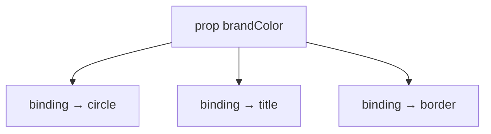
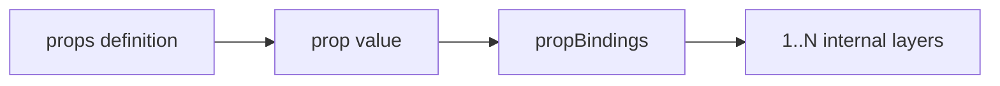
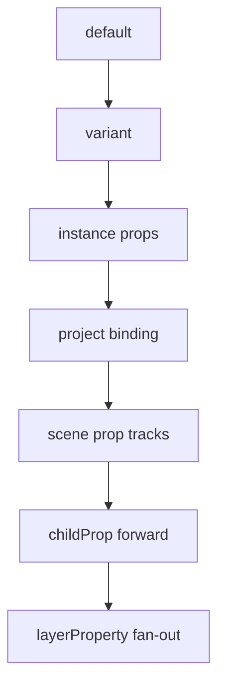

# MotiClip V3 Components

## Cách nên nghĩ

| Khái niệm | Nghĩa đời thường |
| --- | --- |
| **Prop** | Một **tín hiệu public** — nút chỉnh mà user/AI được đụng |
| **PropBindings** | Các **dây nối** tín hiệu đó vào bên trong component |
| **Prop value** | Giá trị gắn lên tín hiệu (màu tĩnh, biến, hoặc keyframes) |
| **Instance** | Bản dùng component trong scene — chỉ set `payload.props` |

```text
User chỉnh props
     │
     ▼
  brandColor = #00ff88          ← một tín hiệu
     │
     ├─► circle.payload.color
     ├─► title.payload.color    ← fan-out nhờ propBindings
     └─► border.style.stroke
```

- **User / app / AI consumer** chỉ chỉnh `props`.
- **Owner / designer AI** thiết kế `propBindings`.
- **Compiler** biến props thành giá trị / motion tracks trên layer nội bộ.

Timeline **không biết** component. Scene đặt instance. Definition mô tả bên trong.

---

## Câu chốt contract

> A **component** is a sealed design template with public **props**, **variants**, and **slots**.  
> A **component node** is an **instance** placed in a scene.  
> **Props** are public signals. A prop value can be **static**, **variable-bound**, or **keyframed**.  
> **PropBindings** wire each signal into one or many internal layers (or child props).  
> Only **animatable** props may receive keyframes.  
> Nested components may forward prop values (including keyframes) only to **direct child props**.  
> Asset props must declare `assetKind`; asset keyframes are **step-only**.

---

## 1. Props và PropBindings làm việc thế nào

### 1.1 Một prop = một tín hiệu

Owner khai báo:

```jsonc
{
  "id": "brandColor",
  "label": "Brand color",
  "kind": "color",
  "default": "#ffcc00",
  "animatable": true
}
```

User **không** cần biết có bao nhiêu layer bên trong. Họ chỉ biết: “có nút Brand color”.

### 1.2 PropBindings = dây nối (có thể fan-out)

Muốn một màu đổi **cả 3 vật thể**, owner nối cùng `propId` tới 3 layer:

```jsonc
{
  "propBindings": [
    {
      "propId": "brandColor",
      "target": {
        "kind": "layerProperty",
        "layerId": "circle",
        "property": "payload.color"
      }
    },
    {
      "propId": "brandColor",
      "target": {
        "kind": "layerProperty",
        "layerId": "title",
        "property": "payload.color"
      }
    },
    {
      "propId": "brandColor",
      "target": {
        "kind": "layerProperty",
        "layerId": "border",
        "property": "style.stroke"
      }
    }
  ]
}
```

> `layerId` = id của **layer nội bộ** trong `component.nodes` (circle, title, border…).

Compiler `resolvePropTargets(propId)` tìm **mọi** dây nối, không dừng ở binding đầu tiên.

### 1.3 User chỉ set props trên instance

```jsonc
{
  "type": "component",
  "id": "badge-1",
  "payload": {
    "componentId": "promo-badge",
    "props": {
      "brandColor": "#00ff88"
    }
  }
}
```

Compiler hiểu:

```text
badge-1.brandColor = #00ff88
  → circle.payload.color  = #00ff88
  → title.payload.color   = #00ff88
  → border.style.stroke   = #00ff88
```

**Một prop có thể điều khiển nhiều layer.** Đó là fan-out.

### 1.4 Animate cùng tín hiệu

Vì `animatable: true`, value có thể là keyframes:

```jsonc
{
  "payload": {
    "componentId": "promo-badge",
    "props": {
      "brandColor": {
        "kind": "keyframes",
        "keys": [
          { "t": 0, "value": "#ffcc00" },
          { "t": 1, "value": "#00ff88" },
          { "t": 2, "value": "#ff3366" }
        ]
      }
    }
  }
}
```

Compiler **fan-out cùng keyframes** tới mọi dây nối:

```text
brandColor keyframes
  → circle color keyframes
  → title color keyframes
  → border stroke keyframes
```

User vẫn chỉ chỉnh **một** prop. Ba layer chuyển màu đồng bộ.



### 1.5 Ai làm việc gì

| Ai | Làm gì | Không làm |
| --- | --- | --- |
| **User / consumer** | Set `payload.props`, chọn `variantId` | Không sửa `nodes` / `propBindings` |
| **Owner** | Khai báo `props[]`, viết `propBindings`, dựng `nodes` | — |
| **Compiler** | Resolve value → apply / emit tracks theo bindings | Không suy luận binding thiếu |

---

## 2. Hai phần của Prop

| Phần | Ai viết | JSON |
| --- | --- | --- |
| **Definition** | Owner | `component.props[]` — tín hiệu là gì (`kind`, `default`, `animatable`…) |
| **Value** | Consumer / variant / project binding | `payload.props`, `variant.props`, binding `propId` |



---

## 3. PropKind

```ts
type PropKind = "text" | "number" | "boolean" | "color" | "choice" | "asset";
```

| Kind | Dùng cho | Default `animatable` | Keyframe interpolation |
| --- | --- | --- | --- |
| `text` | title, label | `true` | step |
| `number` | opacity, progress, size | `true` | linear / easing |
| `boolean` | showIcon, visible | `true` | step |
| `color` | brandColor, fill | `true` | color |
| `choice` | style, layout, mode | `false` | step |
| `asset` | image, video, font… | `false` | step |

Không dùng `string` / `enum` / `list` trên public API (`text` thay string, `choice` thay enum).

### Ví dụ definition

```jsonc
{ "id": "progress", "label": "Progress", "kind": "number", "default": 0, "min": 0, "max": 1, "animatable": true }
```

```jsonc
{ "id": "avatar", "label": "Avatar", "kind": "asset", "assetKind": "image", "default": "asset-default-avatar" }
```

```jsonc
{ "id": "style", "label": "Style", "kind": "choice", "options": ["solid", "outline", "ghost"], "default": "solid" }
```

### AssetKind

```ts
type AssetKind = "image" | "video" | "audio" | "svg" | "font" | "media";
```

- Strict: `image` / `video` / `audio` / `svg` / `font`
- `media` = image **hoặc** video (heroMedia, backgroundMedia…)
- Không có `any` ở V3 canonical

---

## 4. Prop values

### Static

```jsonc
{
  "payload": {
    "componentId": "progress-ring",
    "props": { "progress": 0.75, "color": "#00ff88", "label": "Loading" }
  }
}
```

### Variable-bound

```jsonc
{
  "props": {
    "label": { "ref": { "kind": "variable", "id": "cta-text" } }
  }
}
```

### Keyframed

```jsonc
{
  "props": {
    "progress": {
      "kind": "keyframes",
      "keys": [
        { "t": 0, "value": 0 },
        { "t": 2, "value": 1, "easing": "easeOut" }
      ]
    }
  }
}
```

### Keyframe rules

- `t` là **local time của scene** chứa component instance
- `keys` phải **tăng dần**, **không trùng `t`**, và **`t ≤ scene.duration`**
- `number` / `color`: interpolate được
- `text` / `boolean` / `choice` / `asset`: chỉ **step**
- `animatable: false` + keyframes → **reject**
- Asset / choice / variable: mỗi key (và variable ref) phải khớp `assetKind` / `options`
- Unknown `ref.variable` → **reject**
- **Conflict:** cùng prop vừa có payload keyframes vừa có scene track `payload.props.<propId>` → **reject**

Prop animation ≠ wrapper transform. Scene clips animate **wrapper** của instance; prop keyframes fan-out vào **layer nội bộ** qua `propBindings`.

---

## 5. Hai loại PropBinding

| Target | Shape | Ý nghĩa |
| --- | --- | --- |
| `layerProperty` | `{ kind: "layerProperty", layerId, property }` | Nối tín hiệu → property của layer nội bộ |
| `childProp` | `{ kind: "childProp", childId, propId }` | Forward tín hiệu → prop của **child component trực tiếp** |

### Forward xuống child

Một prop cha có thể forward xuống **nhiều** child (nhiều binding `childProp`):

```jsonc
{
  "propId": "brandColor",
  "target": {
    "kind": "childProp",
    "childId": "button-instance",
    "propId": "color"
  }
}
```

Giá trị (kể cả keyframes) được forward **nguyên**. Child tự fan-out tiếp qua `propBindings` của mình.

```text
A.brandColor keyframes
  → B.color keyframes          (childProp)
    → C.fillColor keyframes    (child của B)
      → layer fill             (layerProperty)
```

Không skip-level: A không bind thẳng layer nội bộ của C.

Compiler resolve recursive: thấy `childProp` thì đi tiếp vào child definition cho đến khi gặp `layerProperty`.

### Project binding vs internalBindings

| Field | Ở đâu | Phạm vi |
| --- | --- | --- |
| `project.bindings` | Project | Scene node, **scene-level** component instance (`componentNode`), hoặc mọi **scene-level** instance của một `componentId` |
| `component.internalBindings` | Definition | Variable/context **nội bộ** → layer nội bộ. Không có `sceneId`. |

Global `target.kind: "component"` **chỉ** áp dụng instance nằm trực tiếp trên scene. Nested Button trong Card không tự nhận binding đó — parent phải `childProp`.

---

## 6. Resolve order

1. `prop.default`  
2. `variant.props`  
3. `instance.payload.props`  
4. Project / data binding (`propId`)  
5. Scene prop animation (`payload.props.*`) — không conflict với keyframes ở bước 3  
6. Forward mọi `childProp`  
7. Apply mọi `layerProperty` (static → set; keyframes → emit track **cho từng** binding)



---

## 7. Definition + instance đầy đủ

```jsonc
{
  "id": "promo-badge",
  "version": "1.0.0",
  "integrity": "sha256:…",
  "props": [
    {
      "id": "brandColor",
      "label": "Brand color",
      "kind": "color",
      "default": "#ffcc00",
      "animatable": true
    }
  ],
  "propBindings": [
    {
      "propId": "brandColor",
      "target": { "kind": "layerProperty", "layerId": "circle", "property": "payload.color" }
    },
    {
      "propId": "brandColor",
      "target": { "kind": "layerProperty", "layerId": "title", "property": "payload.color" }
    },
    {
      "propId": "brandColor",
      "target": { "kind": "layerProperty", "layerId": "border", "property": "style.stroke" }
    }
  ],
  "nodes": [/* circle, title, border, … */],
  "internalBindings": [],
  "slots": [],
  "variants": [],
  "actions": []
}
```

```jsonc
{
  "id": "badge-1",
  "type": "component",
  "payload": {
    "componentId": "promo-badge",
    "props": { "brandColor": "#00ff88" }
  }
}
```

---

## 8. Timeline reminder

Visual clip chỉ `source.kind: "scene"`. Component = scene node, không phải clip source.

---

## 9. Anti-patterns

| ❌ Sai | ✅ Đúng |
| --- | --- |
| User sửa `nodes` / `propBindings` | User chỉ set `payload.props` |
| Một màu = ba prop riêng | Một `brandColor` + ba bindings |
| Bind thẳng internals từ project | Bind `propId` (scene-level instance) |
| Skip-level vào layer của nested child | `childProp` từng tầng |
| Global binding cho nested Button trong Card | Scene-level only; parent forward |
| `component.bindings` (project schema) | `internalBindings` |
| `layerProperty.nodeId` | `layerId` |
| `kind: "string"` / `"enum"` | `text` / `choice` |
| Asset không có `assetKind` | Bắt buộc `assetKind` |
| Variable ref không tồn tại | Reject |
| Choice / asset lệch options / type | Reject (static, keyframes, variable) |
| Keyframes trùng `t` / không sorted / vượt scene | Reject |
| Keyframes + scene track cùng prop | Một kênh thôi |

---

## 10. Tóm tắt một câu

> **Một prop có thể điều khiển nhiều layer; có thể forward xuống nhiều child; có thể là keyframes. User chỉ chỉnh props. Owner thiết kế propBindings. Compiler fan-out props thành internal values / tracks.**

---

## 11. Module map

| File | Vai trò |
| --- | --- |
| `src/v3/components.ts` | Definition, PropKind, propBindings |
| `src/v3/prop-values.ts` | Static / variable / keyframes |
| `src/v3/nodes/component.ts` | Instance `payload.props` |
| `src/v3/references/project.ts` | Validation |
| `motion-compiler/compile-v3.ts` | Resolve + fan-out + keyframe tracks |

Xem thêm: [v3-format-guide.md](v3-format-guide.md), [v3-timeline-guide.md](v3-timeline-guide.md).
