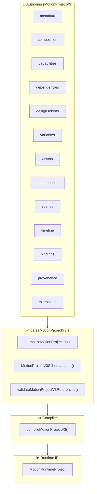
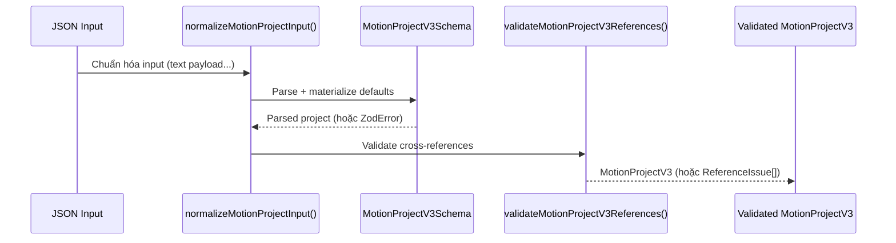

# MotiClip V3 — Canonical Project Format

> **Status**: Source of truth duy nhất. Format này được chấp nhận bởi tất cả product paths (editor, compiler, runtime, preview, export).
>
> **Format discriminator**: `"format": "motion-project"`, `"formatVersion": 3`
>
> **Root parser**: `parseMotionProjectV3()` — chỉ chấp nhận `formatVersion: 3`. Dữ liệu V2 bị từ chối hoàn toàn.

---

## 1. MotionProjectV3 là gì?

`MotionProjectV3` là **định dạng authoring duy nhất** của MotiClip, đại diện cho toàn bộ một dự án motion graphics. Mọi thứ — scenes, components, assets, variables, timeline, transitions — đều nằm trong một file JSON duy nhất, có cấu trúc chặt chẽ và được validate nghiêm ngặt qua Zod schema.



### Tại sao là single source of truth?

| Vấn đề                              | Giải pháp                             |
| ----------------------------------- | ------------------------------------- |
| Nhiều định dạng authoring khác nhau | Chỉ có một: `formatVersion: 3`        |
| Dữ liệu V2 cũ lẫn vào pipeline      | Parser từ chối `formatVersion: 2`     |
| Schema không nhất quán              | `.strict()` trên mọi object           |
| Thiếu kiểm tra tham chiếu chéo      | `validateMotionProjectV3References()` |
| Không rõ field nào bắt buộc         | Zod schema có default rõ ràng         |

---

## 2. Cấu trúc Root

```jsonc
{
  "format": "motion-project", // Format discriminator
  "formatVersion": 3, // Bắt buộc = 3

  // ═══ Identity & Render Surface ═══
  "metadata": {
    /* ... */
  }, // id, name, locale, industry, tags
  "composition": {
    /* ... */
  }, // width, height, fps, background, colorSpace

  // ═══ Environment ═══
  "capabilities": {
    /* ... */
  }, // required, optional, experimental
  "dependencies": {
    /* ... */
  }, // compiler range, component deps, plugins
  "tokens": {
    /* ... */
  }, // colors, fonts, spacing, radii, motion

  // ═══ Data ═══
  "variables": [
    /* ... */
  ], // string, color, number, boolean, asset, enum, list
  "assets": [
    /* ... */
  ], // image, svg, video, audio, font
  "components": [
    /* ... */
  ], // embedded sealed components

  // ═══ Content ═══
  "scenes": [
    /* ... */
  ], // scene definitions (node graph, clips, drivers)
  "timeline": {
    /* ... */
  }, // visualTracks, audioTracks, captionTracks
  "bindings": [
    /* ... */
  ], // variable → node.property bindings

  // ═══ Optional Metadata ═══
  "provenance": {
    /* ... */
  }, // origin tracking, source map
  "extensions": {
    /* ... */
  }, // namespaced custom data
}
```

### Root Schema map

| Field           | Schema                                | Required          | Description                        |
| --------------- | ------------------------------------- | ----------------- | ---------------------------------- |
| `format`        | `z.literal("motion-project")`         | ✅                | Format discriminator               |
| `formatVersion` | `z.literal(3)`                        | ✅                | Phiên bản format                   |
| `metadata`      | `ProjectMetadataV3Schema`             | ✅                | Identity, locale, tags             |
| `composition`   | `CompositionSettingsSchema`           | ✅                | Render surface                     |
| `capabilities`  | `ProjectCapabilityRequirementsSchema` | ❌ (default `{}`) | Preflight capability check         |
| `dependencies`  | `ProjectDependenciesV3Schema`         | ✅                | Compiler + component + plugin deps |
| `tokens`        | `DesignTokensSchema`                  | ❌ (default `{}`) | Design token values                |
| `variables`     | `ProjectVariableV3Schema[]`           | ❌ (default `[]`) | Typed project variables            |
| `assets`        | `AssetV3Schema[]`                     | ❌ (default `[]`) | Asset declarations                 |
| `components`    | `EmbeddedComponentV3Schema[]`         | ❌ (default `[]`) | Embedded components                |
| `scenes`        | `SceneDefinitionV3Schema[]`           | ❌ (default `[]`) | Scene definitions                  |
| `timeline`      | `ProjectTimelineV3Schema`             | ✅                | Track layout                       |
| `bindings`      | `ProjectBindingV3Schema[]`            | ❌ (default `[]`) | Variable bindings                  |
| `provenance`    | `ProjectProvenanceSchema`             | ❌                | Origin tracking                    |
| `extensions`    | `NamespacedExtensionsSchema`          | ✅                | Namespaced custom data             |

---

## 3. Timeline Model: `visualTracks` thay thế `sceneOrder`

### 3.1 Kiến trúc Track/Lane

```mermaid
flowchart LR
    subgraph Timeline["Project Timeline"]
        direction TB
        VT["visualTracks: VisualTrackV3[]"]
        AT["audioTracks: AudioTrackV3[]"]
        CT["captionTracks: CaptionTrackV3[]"]
    end

    subgraph VisualTrack["VisualTrackV3"]
        role["role: main | overlay"]
        order["order: số nguyên"]
        clips["clips: VisualClipV3[]"]
    end

    subgraph VisualClip["VisualClipV3"]
        source["source: { kind: scene, sceneId }"]
        start["start, duration"]
        trim["trimStart, playbackRate, loop"]
        opacity["opacity"]
        trans["transitionIn, transitionOut"]
    end

    Timeline --> VisualTrack --> VisualClip
```



### 3.2 VisualTrack

```jsonc
{
  "id": "overlay-track",
  "role": "overlay", // "main" | "overlay"
  "order": 1, // Track order: nhỏ hơn vẽ trước (nằm dưới)
  "muted": false, // optional
  "clips": [
    /* VisualClipV3[] */
  ],
}
```

### 3.3 VisualClip

```jsonc
{
  "id": "clip-cta",
  "source": {
    "kind": "scene", // luôn là "scene" — timeline chỉ chứa clip scene
    "sceneId": "cta-scene",
  },
  "start": 1, // Vị trí bắt đầu TUYỆT ĐỐI trên global timeline (giây) — không phải offset tương đối
  "duration": 2.5, // Thời lượng (giây)
  "trimStart": 0.5, // optional, cắt từ đầu
  "playbackRate": 1.5, // optional, tốc độ phát
  "loop": false, // default false
  "opacity": 0.9, // default 1
  "transitionIn": {
    "type": "fade",
    "duration": 0.3,
    "easing": "easeOut",
  },
  "transitionOut": {
    "type": "slide",
    "duration": 0.3,
    "direction": "left",
    "mode": "push",
  },
}
```

> **Scene-only timeline**: `VisualClipSourceV3` chỉ cho phép `{ kind: "scene", sceneId }`. Component/object không được đặt trực tiếp lên timeline — thay vào đó, editor/app sẽ tạo một scene chứa component node rồi tham chiếu scene đó. Việc định vị/keyframe toàn bộ component nằm ở `transform` của component node (xem mục 4.2), không nằm trên clip.

> **`clip.start` là absolute global time**: `start` là thời điểm tuyệt đối trên trục timeline của cả project (giây, tính từ 0), **không** phải offset tương đối so với clip trước. Compiler/runtime/renderer **không** được tái dựng `start` bằng cursor — chúng phải dùng đúng giá trị `clip.start` của authoring input. Ví dụ: overlay clip ở `start: 1.5` phải giữ nguyên `1.5` sau khi compile, kể cả khi main track có gap trước đó.

### 3.4 Thuật ngữ Track / Layer

| Thuật ngữ      | Ý nghĩa                               | Cơ chế xếp chồng            |
| -------------- | ------------------------------------- | --------------------------- |
| **Track**      | Lane trong `timeline.visualTracks`    | `VisualTrackV3.order`       |
| **Layer**      | Node bên trong một scene              | `NodeV3.zIndex`             |
| **Track role** | `main` hoặc `overlay` — ý nghĩa mô tả | Không tạo ưu tiên tuyệt đối |

### 3.5 Quy tắc xếp chồng

```
Track order nhỏ  →  vẽ trước, nằm dưới
Track order lớn  →  vẽ sau, nằm trên

Node zIndex nhỏ  →  nằm dưới (trong cùng scene)
Node zIndex lớn  →  nằm trên (trong cùng scene)
```

```jsonc
// Ví dụ: overlay track nằm trên main track
{
  "timeline": {
    "visualTracks": [
      {
        "id": "main-track",
        "role": "main",
        "order": 0, // ← vẽ trước, nằm dưới
        "clips": [
          {
            "id": "clip-base",
            "source": { "kind": "scene", "sceneId": "base" },
            "start": 0,
            "duration": 5,
          },
        ],
      },
      {
        "id": "overlay-track",
        "role": "overlay",
        "order": 1, // ← vẽ sau, nằm trên
        "clips": [
          {
            "id": "clip-logo",
            "source": { "kind": "scene", "sceneId": "logo" },
            "start": 2,
            "duration": 3,
            "opacity": 0.8,
          },
        ],
      },
    ],
  },
}
```

### 3.6 So sánh với V2 (đã bỏ)

> **V2 đã bị loại bỏ hoàn toàn.** Bảng dưới đây chỉ để tham khảo lịch sử.

| V2 (đã bỏ)                      | V3 (canonical)                            |
| ------------------------------- | ----------------------------------------- |
| `timeline.sceneOrder: string[]` | `timeline.visualTracks: VisualTrackV3[]`  |
| `scene.transition`              | `visualClip.transitionIn / transitionOut` |
| Một lane duy nhất               | Nhiều track (`main` + `overlay`)          |
| Scene-level transition          | Clip-level transition                     |
| Không có loop/playbackRate      | Có `loop`, `playbackRate`, `opacity`      |

### 3.7 `timeline.duration` — Độ dài MP4 cuối cùng

`timeline.duration` là **độ dài (giây) của MP4 cuối cùng**. Trường này **tùy chọn** ở mức authoring — khi thiếu, compiler/canonicalizer sẽ tự suy ra từ thời điểm kết thúc nội dung cuối cùng trên timeline:

```
derivedDuration = max(
  ...visualTracks.flatMap(t => t.clips.map(c => c.start + c.duration)),
  ...audioTracks.map(t => t.start + t.duration),
  ...captionTracks.flatMap(t => t.tokens.map(tok => tok.end)),
)
```

| Trường hợp                     | Kết quả                                                             |
| ------------------------------ | ------------------------------------------------------------------- |
| Thiếu `duration`               | Điền bằng `derivedDuration`                                         |
| `duration` > `derivedDuration` | Hợp lệ — phần thừa cuối là _empty tail_ (nền trống/im lặng)         |
| `duration` < `derivedDuration` | Lỗi validation — content vượt quá độ dài khai báo                   |
| Timeline rỗng                  | `derivedDuration = 0` — export bị chặn (trừ khi hỗ trợ video trắng) |

```jsonc
// Authoring input — duration omitted, derived from content (8s)
{
  "timeline": {
    "visualTracks": [
      {
        "id": "main",
        "role": "main",
        "order": 0,
        "clips": [
          { "id": "c1", "source": { "kind": "scene", "sceneId": "intro" }, "start": 0, "duration": 5 },
          { "id": "c2", "source": { "kind": "scene", "sceneId": "outro" }, "start": 5, "duration": 3 }
        ]
      }
    ],
    "audioTracks": [],
    "captionTracks": []
  }
}

// Canonical output — explicit duration
{
  "timeline": {
    "duration": 8,
    "visualTracks": [ /* ... */ ],
    "audioTracks": [],
    "captionTracks": []
  }
}
```

```jsonc
// Manual empty tail — content ends at 8s, MP4 length is 10s
{
  "timeline": {
    "duration": 10,
    "visualTracks": [
      /* ... kết thúc tại 8s ... */
    ],
  },
}
```

### 3.8 Chính sách overlap & gap

| Quy tắc                           | Chính sách                                                                                                                                                          |
| --------------------------------- | ------------------------------------------------------------------------------------------------------------------------------------------------------------------- |
| **Main-track overlap**            | Clips trên track `role: "main"` **không** được chồng lấn — trừ khi có transition (non-cut `transitionOut`/`transitionIn`, ví dụ `crossfade`) bắc cầu giữa hai clip. |
| **Overlay overlap**               | Track `role: "overlay"` được phép chồng lấn tự do.                                                                                                                  |
| **Duplicate clip id**             | `clip.id` phải **unique trên toàn bộ timeline** (không chỉ trong một track).                                                                                        |
| **Duplicate track order**         | Được phép — compiler sort track theo `order` bằng stable sort, khi trùng `order` thì giữ nguyên thứ tự khai báo trong mảng (`VisualTrackV3` array order).           |
| **Gaps (khoảng trống giữa clip)** | Hợp lệ. Trong khoảng gap chỉ có background được render; audio/caption vẫn có thể tồn tại trong gap.                                                                 |

```jsonc
// Ví dụ: crossfade overlap hợp lệ trên main track (clip B bắt đầu trước khi A kết thúc)
{
  "visualTracks": [
    {
      "id": "main",
      "role": "main",
      "order": 0,
      "clips": [
        {
          "id": "a",
          "source": { "kind": "scene", "sceneId": "intro" },
          "start": 0,
          "duration": 3,
          "transitionOut": { "type": "crossfade", "duration": 1 },
        },
        {
          "id": "b",
          "source": { "kind": "scene", "sceneId": "body" },
          "start": 2,
          "duration": 3,
          "transitionIn": { "type": "crossfade", "duration": 1 },
        },
      ],
    },
  ],
}
```

> **Source layout**: Timeline schema/utilities nằm trong thư mục
> `packages/motion-protocol/src/v3/timeline/` (`schema.ts`, `duration.ts`,
> `canonicalize.ts`, `validation.ts`, `index.ts`). Import qua `./timeline`
> (hoặc `@moticlip/motion-protocol` public exports).

---

## 4. Scenes & Nodes

### 4.1 Scene Definition

```jsonc
{
  "id": "intro",
  "name": "Intro Scene", // optional
  "duration": 5, // Thời lượng (giây)
  "semantic": { "role": "intro" }, // optional
  "space": "layered-2.5d", // optional: "flat-2d" | "layered-2.5d"
  "nodes": [
    /* NodeV3[] */
  ], // Cây node
  "clips": [
    /* MotionClipV3[] */
  ], // Animation clips trong scene
  "markers": [
    /* SceneMarkerV3[] */
  ], // optional
  "drivers": [
    /* Driver[] */
  ], // optional: procedural drivers
  "motionBlur": {
    // optional
    "enabled": true,
    "shutterAngle": 180,
    "sampleCount": 8,
  },
  "activeCameraId": "cam", // optional
}
```

### 4.2 Các loại Node

| Type         | Mô tả                        | Payload                                                |
| ------------ | ---------------------------- | ------------------------------------------------------ |
| `group`      | Container layer, có children | `compositing`                                          |
| `text`       | Văn bản                      | `content`, `fontSize`, `color`, `alignment`, `wrap`... |
| `solid`      | Hình chữ nhật màu            | `width`, `height`, `color`                             |
| `shape`      | Hình dạng vector             | `shape`, `cornerRadius` + `style`                      |
| `path`       | Đường path vector            | `contours[]` + `style`                                 |
| `image`      | Ảnh bitmap                   | `assetId`, `fit`, `crop`                               |
| `svg`        | Ảnh vector SVG               | `assetId`, `fit`                                       |
| `video`      | Video clip                   | `assetId`, `fit`, `muted`, `loop`                      |
| `camera`     | Camera view                  | `projection`, `zoom`                                   |
| `bone`       | Bone cho skeletal animation  | `length`, `restRotation`, `rotationLimits`             |
| `adjustment` | Điều chỉnh màu sắc           | `brightness`, `contrast`, `saturation`                 |
| `component`  | Instance của component       | `componentId`, `variantId?`, `publicProps?`            |

> **Component node** (`type: "component"`) đại diện cho một instance của component đã nhúng. `payload.componentId` trỏ đến `project.components[]`; `transform` của node đóng vai trò wrapper transform khi compiler expand. Component **không** được instantiate qua visual clip.

### 4.3 Cấu trúc Node

```jsonc
{
  "id": "title",
  "type": "text",
  "name": "Title", // optional
  "parentId": null, // null = root, hoặc id của group node
  "zIndex": 0, // optional, thứ tự z giữa các sibling
  "timing": {
    // optional, relative với parent
    "start": 0,
    "duration": 5,
  },
  "transform": {
    "x": 0,
    "y": 0,
    "width": 800,
    "height": 120,
    "rotation": 0,
    "scaleX": 1,
    "scaleY": 1,
    "anchorX": 0.5,
    "anchorY": 0.5,
    "opacity": 1,
    "visible": true,
    "flipX": false,
    "flipY": false,
  },
  "inheritFlags": {
    // optional, kế thừa từ parent
    "position": true,
    "rotation": true,
    "scale": true,
    "opacity": true,
  },
  "semantic": { "role": "title" }, // optional
  "effects": [
    /* ... */
  ], // optional
  "blendMode": "normal", // optional
  "mask": {
    /* ... */
  }, // optional
  "payload": {
    /* type-specific */
  },
}
```

---

## 5. Group Layer Semantics

### 5.1 Tổng quan

Một `group` node (`type: "group"`) là **timeline layer thực sự** — không phải folder thụ động. Nó có timing, transform, z-order, animation, effects riêng và có thể chứa child layers.

```text
Scene                                   ← implicit root
  group.character        parentId: null  ← root layer
    group.upper-body     parentId: group.character
      group.head-rig     parentId: group.upper-body
        head-image       parentId: group.head-rig
```

### 5.2 Parent-Relative Timing

Timing của child được tính **relative với parent**:

```
nodeGlobalStart = parentGlobalStart + node.timing.start
nodeGlobalEnd   = min(parentGlobalEnd, nodeGlobalStart + node.timing.duration)
```

**Default timing**: nếu thiếu, `start = 0`, `duration = parent effective duration`.

### 5.3 Z-Order

`zIndex` chỉ có ý nghĩa giữa các **sibling** (cùng `parentId`):

```text
Scene
  group.character     zIndex 1    ← root sibling
    head              zIndex 99   ← child, chỉ so với sibling cùng parent
  title               zIndex 2    ← root sibling, luôn nằm TRÊN group.character
```

`head` (zIndex 99) nằm **trong** group.character (zIndex 1), không thể render trên `title` (zIndex 2).

### 5.4 Compositing Modes

| Mode           | Offscreen | Group Effects                 | Blend Mode  | Transform                |
| -------------- | --------- | ----------------------------- | ----------- | ------------------------ |
| `pass-through` | ❌ Không  | Áp dụng riêng từng child      | Child-level | Qua `parent.worldMatrix` |
| `isolate`      | ✅ Có     | Áp dụng lên composited result | Group-level | Proxy sprite             |

```jsonc
{ "compositing": { "mode": "isolate" } }
```

---

## 6. Transitions

Transition là thuộc tính của **clip**, không phải của scene:

```jsonc
{
  "id": "clip-intro",
  "source": { "kind": "scene", "sceneId": "intro" },
  "start": 0,
  "duration": 3,
  "transitionIn": {
    "type": "fade",
    "duration": 0.5,
    "easing": "easeOut",
  },
  "transitionOut": {
    "type": "slide",
    "duration": 0.3,
    "direction": "left",
    "mode": "push",
  },
}
```

### Các loại transition

| Type        | Duration | Tham số thêm                                   |
| ----------- | -------- | ---------------------------------------------- |
| `cut`       | 0        | —                                              |
| `fade`      | ✅       | `color`, `easing`                              |
| `crossfade` | ✅       | `easing`                                       |
| `slide`     | ✅       | `direction`, `mode` (`push`/`cover`), `easing` |
| `wipe`      | ✅       | `direction`, `softness`, `easing`              |
| `zoom`      | ✅       | `direction` (`in`/`out`), `easing`             |

---

## 7. Variables & Bindings

### 7.1 Variable types

```jsonc
// string
{ "id": "company", "type": "string", "value": "MotiClip" }

// color
{ "id": "brand", "type": "color", "value": "#ff6b35" }

// number (có thể có min/max)
{ "id": "opacity", "type": "number", "value": 0.9, "min": 0, "max": 1 }

// boolean
{ "id": "show-logo", "type": "boolean", "value": true }

// asset
{ "id": "logo", "type": "asset", "assetKind": "image", "value": "asset-logo" }

// enum
{ "id": "theme", "type": "enum", "value": "dark", "options": ["light", "dark"] }

// list
{
  "id": "data-rows",
  "type": "list",
  "itemSchema": { "type": "object", "fields": { "label": { "type": "string" }, "value": { "type": "number" } } },
  "value": [{ "label": "Users", "value": 1.2 }]
}
```

### 7.2 Project Bindings

Binding kết nối project variable với node property của scene hoặc component:

```jsonc
// Scene binding — truy cập trực tiếp nodeId + property
{
  "id": "bind-title",
  "source": { "kind": "variable", "variableId": "company" },
  "target": {
    "kind": "scene",
    "sceneId": "intro",
    "nodeId": "title",
    "property": "payload.content.text"
  }
}

// Component binding — qua publicTarget (trỏ đến instance trong scene)
{
  "id": "bind-cta",
  "source": { "kind": "variable", "variableId": "cta-text" },
  "target": {
    "kind": "componentNode",
    "sceneId": "cta-scene",
    "nodeId": "cta-instance",
    "targetId": "cta-label"       // ← publicTargets.id
  }
}
```

> **Scene binding**: dùng `nodeId` + `property` trực tiếp.
> **Component binding**: bắt buộc dùng `targetId` (trỏ đến `component.publicTargets`). Hai dạng: `componentNode` (trỏ đến instance cụ thể) và `component` (bind toàn cục vào mọi instance).

---

## 8. Composition & Metadata

### 8.1 Composition Settings

```jsonc
{
  "composition": {
    "width": 1080,
    "height": 1920,
    "fps": 30,
    "background": "#ffffff", // default #ffffff
    "colorSpace": "srgb", // default "srgb"
    "pixelAspectRatio": 1, // optional, default 1
    "audioSampleRate": 48000, // default 48000
    "safeArea": {
      // optional
      "top": 0.05,
      "right": 0.05,
      "bottom": 0.1,
      "left": 0.05,
    },
    "motionBlur": {
      // optional
      "samples": 16,
      "shutterAngle": 180,
      "shutterPhase": 0,
    },
  },
}
```

### 8.2 Metadata

```jsonc
{
  "metadata": {
    "id": "my-project",
    "name": "My Project",
    "description": "Mô tả dự án", // optional
    "locale": "vi-VN",
    "industry": "technology", // optional
    "tags": ["demo", "v3"], // optional
    "createdAt": "2026-08-10T00:00:00Z", // optional
    "updatedAt": "2026-08-12T12:00:00Z", // optional
  },
}
```

---

## 9. Assets

5 loại asset được hỗ trợ:

```jsonc
// Image
{ "id": "logo", "uri": "./assets/logo.png", "integrity": "sha256:abc", "assetType": "image", "mimeType": "image/png", "width": 512, "height": 512, "pixelFormat": "rgba", "hasAlpha": true }

// SVG
{ "id": "icon", "uri": "./assets/icon.svg", "integrity": "sha256:def", "assetType": "svg", "mimeType": "image/svg+xml", "width": 64, "height": 64, "viewBox": "0 0 64 64", "sanitized": true }

// Video
{ "id": "intro", "uri": "./assets/intro.mp4", "integrity": "sha256:ghi", "assetType": "video", "mimeType": "video/mp4", "width": 1920, "height": 1080, "duration": 10, "fps": 30, "codec": "h264", "pixelFormat": "yuv420p", "audioCodec": "aac", "audioSampleRate": 48000, "audioChannels": 2 }

// Audio
{ "id": "bgm", "uri": "./assets/bgm.mp3", "integrity": "sha256:jkl", "assetType": "audio", "mimeType": "audio/mpeg", "duration": 30, "codec": "mp3", "sampleRate": 48000, "channels": 2 }

// Font
{ "id": "font-display", "uri": "./assets/font.ttf", "integrity": "sha256:mno", "assetType": "font", "mimeType": "font/ttf", "family": "Be Vietnam Pro", "weight": 700, "style": "normal", "localeCoverage": ["vi", "en"] }
```

---

## 10. Capabilities & Dependencies

### 10.1 Capabilities

Preflight check cho phép compiler phát hiện sớm các tính năng không được hỗ trợ:

```jsonc
{
  "capabilities": {
    "required": ["primitive.text", "primitive.solid", "anim.transform"],
    "optional": ["effect.blur", "effect.shadow"],
    "experimental": ["projection.perspective-3d"],
  },
}
```

- **`required`**: Tính năng bắt buộc để compile
- **`optional`**: Có thể có hoặc không
- **`experimental`**: Cần opt-in, nếu không compiler báo `CAP_EXPERIMENTAL_IN_USE`

### 10.2 Dependencies

```jsonc
{
  "dependencies": {
    "compiler": { "range": ">=1.0.0" },
    "components": [
      {
        "componentId": "lower-third",
        "version": "1.2.0",
        "source": "com.moticlip.store",
        "integrity": "sha256:lower-third-1.2.0",
      },
    ],
    "plugins": [
      {
        "pluginId": "com.moticlip.ai-captions",
        "version": "0.9.0",
        "integrity": "sha256:ai-captions-0.9.0",
      },
    ],
  },
}
```

---

## 11. Minimal Project

Project tối thiểu hợp lệ:

```jsonc
{
  "format": "motion-project",
  "formatVersion": 3,
  "metadata": {
    "id": "my-project",
    "name": "My Project",
    "locale": "vi-VN",
  },
  "composition": {
    "width": 1080,
    "height": 1920,
    "fps": 30,
  },
  "dependencies": {
    "compiler": { "range": ">=1.0.0" },
    "components": [],
  },
  "extensions": {},
}
```

> Các field `capabilities`, `tokens`, `variables`, `assets`, `components`, `scenes`, `bindings` đều có default — không cần khai báo nếu không dùng.

---

## 12. Parsing & Validation Pipeline



### Các lỗi validation chính

| Tầng       | Loại lỗi                 | Ví dụ                                   |
| ---------- | ------------------------ | --------------------------------------- |
| Schema     | `formatVersion != 3`     | Từ chối V2 data                         |
| Schema     | Unknown field            | `.strict()` từ chối                     |
| Schema     | Sai type                 | Zod validation error                    |
| References | Missing scene            | `Unknown scene: intro`                  |
| References | Missing component        | `Unknown component: cta`                |
| References | Duplicate ID             | `Duplicate scene id: intro`             |
| References | Invalid binding target   | `Unknown node: ghost-node`              |
| References | Private component access | `targetId không có trong publicTargets` |

### 12.1 Di trú legacy component clip (opt-in)

Trong model V3, timeline **chỉ** chấp nhận visual clip `{ kind: "scene", sceneId }`. Các project legacy (V2 hoặc bản nháp V3 cũ) có thể chứa clip `{ kind: "component", componentId }` — `parseMotionProjectV3()` **từ chối** shape này một cách nghiêm ngặt.

Để nâng cấp một project legacy lên shape scene-only, app phải gọi normalizer với cờ opt-in:

```ts
import { normalizeMotionProjectV3 } from "@motionvideo/motion-protocol";

const { project, issues } = normalizeMotionProjectV3(legacyProject, {
  migrateComponentClipsToScenes: true,
});
// project giờ đây là scene-only và có thể parse/compile bình thường.
```

Khi cờ được bật, mỗi clip `{ kind: "component" }` được viết lại thành:

1. Một **scene mới** được tổng hợp, id sinh từ track + clip: `component-scene__${track.id}__${clip.id}` (cộng hậu tố `__2`, `__3`, … nếu trùng với scene đã tồn tại).
2. Một **component node** bên trong scene đó, id `component-instance__${clip.id}`.
3. `instanceTransform` được gấp vào `transform` của component node.
4. `instanceTransformTracks` trở thành **scene-local motion clip** nhắm vào component node.
5. Clip gốc trên timeline được viết lại thành `{ kind: "scene", sceneId }`.

> **Chính sách**:
>
> - `parseMotionProjectV3()` **luôn strict và không tự di trú**.
> - Import app **có thể** cung cấp migration, nhưng file V3 canonical sau khi lưu **phải** là scene-only.
> - Di trú là **opt-in rõ ràng** và có thể kiểm toán qua `NormalizeIssue[]` trả về.

---

## 13. Extensions & Provenance

### 13.1 Namespaced Extensions

Dữ liệu mở rộng theo namespace, không làm hỏng schema chính:

```jsonc
{
  "extensions": {
    "com.moticlip.constraints": [{ "maxDuration": 30 }],
    "com.moticlip.ai-hints": { "tone": "professional", "pace": "fast" },
  },
}
```

### 13.2 Provenance

Theo dõi nguồn gốc project và source mapping:

```jsonc
{
  "provenance": {
    "workspaceId": "ws-demo",
    "sourceHash": "abc123",
    "bundleProfile": "embedded-components",
    "sourceMap": {
      "scenes": { "intro": "src/scenes/intro.json" },
      "components": { "lower-third": "src/components/lt.json" },
      "variables": { "company": "src/variables.json" },
      "assets": { "logo": "assets/logo.png" },
    },
  },
}
```

---

## 14. Editor UI State

> **Editor UI state KHÔNG thuộc về project JSON.** Các dữ liệu sau được lưu riêng (localStorage, IndexedDB, hoặc workspace file):

- Vị trí scroll/viewport của timeline
- Tab đang mở, panel layout
- Node đang được chọn
- Undo/redo stack
- Playhead position

---

## 15. Best Practices

### Khi tạo project mới

1. **Luôn dùng `"format": "motion-project"` và `"formatVersion": 3`**
2. **Khai báo `capabilities.required`** để compiler preflight sớm
3. **Dùng `integrity` hash** cho mọi asset và component dependency
4. **Giữ `.strict()` shape** — không thêm field ngoài schema

### Khi dùng timeline

1. **Dùng `transitionIn`/`transitionOut` trên clip** thay vì scene-level transition
2. **Dùng `order` để xếp track**, không dựa vào `role`
3. **Component node** (`type: "component"`) trong scene thay vì component source clip

### Khi dùng bindings

1. **Scene binding**: `nodeId` + `property` trực tiếp
2. **Component binding**: `targetId` (tham chiếu `publicTargets`)
3. **Kiểm tra type khớp**: string → text, number → opacity, color → fill...

---

## 16. Tóm tắt

| Khái niệm                | Mô tả                                                                                            |
| ------------------------ | ------------------------------------------------------------------------------------------------ |
| **MotionProjectV3**      | Single source of truth, một file JSON cho toàn bộ dự án                                          |
| **visualTracks**         | Thay thế `sceneOrder`, hỗ trợ multi-track (`main` + `overlay`)                                   |
| **VisualClip**           | Clip-level transition, loop, playbackRate, opacity, scene-only source                            |
| **Node types**           | 12 loại: group, text, solid, shape, path, image, svg, video, camera, bone, adjustment, component |
| **Group layer**          | Timeline layer thực sự, parent-relative timing, sibling-local zIndex                             |
| **Variables**            | 7 types: string, color, number, boolean, asset, enum, list                                       |
| **Bindings**             | Scene: `nodeId` + `property`. Component: `targetId`                                              |
| **Strict validation**    | `.strict()` trên mọi object + reference validation                                               |
| **Format discriminator** | `format: "motion-project"`, `formatVersion: 3` — từ chối V2                                      |
