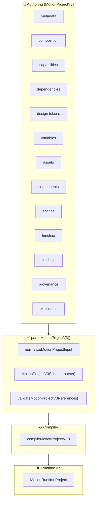
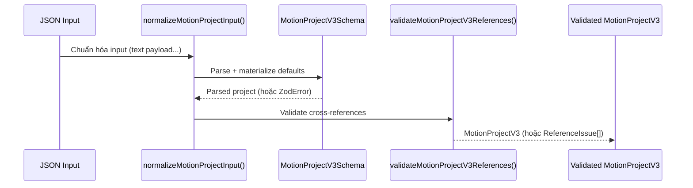

# MotiClip V3 — Canonical Project Format

> **Status**: Source of truth duy nhất. Format này được chấp nhận bởi tất cả product paths (editor, compiler, runtime, preview, export).
>
> **Format discriminator**: `"format": "motion-project"`, `"formatVersion": 3`
>
> **Root parser**: `parseMotionProjectV3()` — chỉ chấp nhận `formatVersion: 3`. Dữ liệu V2 bị từ chối hoàn toàn.

---

## 1. MotionProjectV3 là gì?

`MotionProjectV3` là **định dạng authoring duy nhất** của MotiClip, đại diện cho toàn bộ một dự án motion graphics. Mọi thứ — scenes, components, assets, variables, timeline, bindings — đều nằm trong một file JSON duy nhất, có cấu trúc chặt chẽ và được validate nghiêm ngặt qua Zod schema.



### Tại sao là single source of truth?

| Vấn đề                              | Giải pháp                             |
| ----------------------------------- | ------------------------------------- |
| Nhiều định dạng authoring khác nhau | Chỉ có một: `formatVersion: 3`        |
| Dữ liệu V2 cũ lẫn vào pipeline      | Parser từ chối `formatVersion: 2`     |
| Schema không nhất quán              | `.strict()` trên mọi object           |
| Thiếu kiểm tra tham chiếu chéo      | `validateMotionProjectV3References()` |
| Không rõ field nào bắt buộc         | Zod schema có default rõ ràng         |

---

## 2. Cấu trúc Root

```jsonc
{
  "format": "motion-project", // Format discriminator
  "formatVersion": 3, // Bắt buộc = 3

  // ═══ Identity & Render Surface ═══
  "metadata": {
    /* ... */
  }, // id, name, locale, industry, tags
  "composition": {
    /* ... */
  }, // width, height, fps, background, colorSpace

  // ═══ Environment ═══
  "capabilities": {
    /* ... */
  }, // required, optional, experimental
  "dependencies": {
    /* ... */
  }, // compiler range, component deps, plugins
  "tokens": {
    /* ... */
  }, // colors, fonts, spacing, radii, motion

  // ═══ Data ═══
  "variables": [
    /* ... */
  ], // string, color, number, boolean, asset, enum, list
  "assets": [
    /* ... */
  ], // image, svg, video, audio, font
  "components": [
    /* ... */
  ], // embedded sealed components

  // ═══ Content ═══
  "scenes": [
    /* ... */
  ], // scene definitions (node graph, clips, drivers)
  "timeline": {
    /* ... */
  }, // visualTracks, audioTracks, captionTracks
  "bindings": [
    /* ... */
  ], // variable → node.property bindings

  // ═══ Optional Metadata ═══
  "provenance": {
    /* ... */
  }, // origin tracking, source map
  "extensions": {
    /* ... */
  }, // namespaced custom data
}
```

### Root Schema map

| Field           | Schema                                | Required          | Description                        |
| --------------- | ------------------------------------- | ----------------- | ---------------------------------- |
| `format`        | `z.literal("motion-project")`         | ✅                | Format discriminator               |
| `formatVersion` | `z.literal(3)`                        | ✅                | Phiên bản format                   |
| `metadata`      | `ProjectMetadataV3Schema`             | ✅                | Identity, locale, tags             |
| `composition`   | `CompositionSettingsSchema`           | ✅                | Render surface                     |
| `capabilities`  | `ProjectCapabilityRequirementsSchema` | ❌ (default `{}`) | Preflight capability check         |
| `dependencies`  | `ProjectDependenciesV3Schema`         | ✅                | Compiler + component + plugin deps |
| `tokens`        | `DesignTokensSchema`                  | ❌ (default `{}`) | Design token values                |
| `variables`     | `ProjectVariableV3Schema[]`           | ❌ (default `[]`) | Typed project variables            |
| `assets`        | `AssetV3Schema[]`                     | ❌ (default `[]`) | Asset declarations                 |
| `components`    | `ComponentDefinitionV3Schema[]`         | ❌ (default `[]`) | Component definitions                |
| `scenes`        | `SceneDefinitionV3Schema[]`           | ❌ (default `[]`) | Scene definitions                  |
| `timeline`      | `ProjectTimelineV3Schema`             | ✅                | Track layout                       |
| `bindings`      | `ProjectBindingV3Schema[]`            | ❌ (default `[]`) | Variable bindings                  |
| `provenance`    | `ProjectProvenanceSchema`             | ❌                | Origin tracking                    |
| `extensions`    | `NamespacedExtensionsSchema`          | ✅                | Namespaced custom data             |

---

## 3. Timeline Model: AE visual stack + audio DSP

### 3.1 Hai mô hình

| | Visual | Audio |
| --- | --- | --- |
| Metaphor | After Effects layer stack | Mixer / clip playback |
| Transition giữa clips | **Không** | **Không** suy luận crossfade |
| Fade | Trong content/animation | `fadeIn` / `fadeOut` trên clip |
| Same-track overlap | **Cấm** | **Cho phép** (mix) |
| Role labels | UI only (`main`/`overlay`) | UI only (`bgm`/…) |

### 3.2 VisualTrack

```jsonc
{
  "id": "track.base",
  "order": 0, // sparse >= 0; unique across timeline; thấp = dưới
  "muted": false,
  "clips": [ /* VisualClipV3[] */ ]
}
```

### 3.3 VisualClip

```jsonc
{
  "id": "clip.a",
  "source": { "kind": "scene", "sceneId": "scene.a" },
  "start": 1,
  "duration": 2,
  "trimStart": 0,
  "playbackRate": 1,
  "loop": false,
  "opacity": 1
}
```

> **Scene-only**: `VisualClipSourceV3` chỉ `{ kind: "scene", sceneId }`. Component là scene node (`type: "component"`), không phải clip source.
>
> Canonical parse (`MotionProjectV3Schema` / `parseMotionProjectV3`) **reject** `source.kind: "component"`. Không có auto-migrate. Component chỉ qua scene node (`type: "component"`).

> **Không** `transitionIn` / `transitionOut`. Hiệu ứng = layer/component animation trong scene trên track `order` phù hợp.

> **`clip.start` absolute**: không rebuild bằng cursor. Gap là gap thật.

> **Audio fade** (`fadeIn`/`fadeOut` trên audio clip) là DSP primitive có chủ đích — chỉ envelope chính clip, không suy luận crossfade giữa clips.

Render tại `t`: active scene clips → sort `order` → vẽ thấp→cao.

### 3.4 Thuật ngữ Track / Layer

| Thuật ngữ | Ý nghĩa                            | Cơ chế xếp chồng      |
| --------- | ---------------------------------- | --------------------- |
| **Track** | Lane trong `timeline.visualTracks` | `VisualTrackV3.order` |
| **Layer** | Node bên trong một scene           | `NodeV3.zIndex`       |

UI có thể gọi track `order === 0` là “main” và track cao hơn là “overlay” — **không** phải field JSON.

### 3.5 Quy tắc xếp chồng

```
Track order nhỏ  →  vẽ trước, nằm dưới
Track order lớn  →  vẽ sau, nằm trên

Node zIndex nhỏ  →  nằm dưới (trong cùng scene)
Node zIndex lớn  →  nằm trên (trong cùng scene)
```

Stacking **chỉ** theo `order`. Không có ưu tiên `primary` / `overlay`.

```jsonc
// Ví dụ: track order cao nằm trên track order thấp
{
  "timeline": {
    "visualTracks": [
      {
        "id": "visual-0",
        "order": 0, // ← vẽ trước, nằm dưới
        "clips": [
          {
            "id": "clip-base",
            "source": { "kind": "scene", "sceneId": "base" },
            "start": 0,
            "duration": 5,
          },
        ],
      },
      {
        "id": "visual-10",
        "order": 10, // ← vẽ sau, nằm trên (sparse; không cần contiguous)
        "clips": [
          {
            "id": "clip-logo",
            "source": { "kind": "scene", "sceneId": "logo" },
            "start": 2,
            "duration": 3,
            "opacity": 0.8,
          },
        ],
      },
    ],
  },
}
```

### 3.6 So sánh với V2 (đã bỏ)

> **V2 đã bị loại bỏ hoàn toàn.** Bảng dưới đây chỉ để tham khảo lịch sử.

| V2 (đã bỏ)                      | V3 (canonical)                                       |
| ------------------------------- | ---------------------------------------------------- |
| `timeline.sceneOrder: string[]` | `timeline.visualTracks: VisualTrackV3[]`             |
| `scene.transition`              | Không còn — effect = scene/component layer animation |
| Một lane duy nhất               | Nhiều track; `order` unique = stacking               |
| Scene/clip-level transition     | Không có — animation trong scene/component           |
| Không có loop/playbackRate      | Có `loop`, `playbackRate`, `opacity`                 |

### 3.7 `timeline.duration` — Độ dài MP4 cuối cùng

`timeline.duration` là **độ dài (giây) của MP4 cuối cùng**. Trường này **tùy chọn** ở mức authoring — khi thiếu, compiler/canonicalizer sẽ tự suy ra từ thời điểm kết thúc nội dung cuối cùng trên timeline:

```
derivedDuration = max(
  ...visualTracks.flatMap(t => t.clips.map(c => c.start + c.duration)),
  ...audioTracks.map(t => t.start + t.duration),
  ...captionTracks.flatMap(t => t.tokens.map(tok => tok.end)),
)
```

| Trường hợp                     | Kết quả                                                             |
| ------------------------------ | ------------------------------------------------------------------- |
| Thiếu `duration`               | Điền bằng `derivedDuration`                                         |
| `duration` > `derivedDuration` | Hợp lệ — phần thừa cuối là _empty tail_ (nền trống/im lặng)         |
| `duration` < `derivedDuration` | Lỗi validation — content vượt quá độ dài khai báo                   |
| Timeline rỗng                  | `derivedDuration = 0` — export bị chặn (trừ khi hỗ trợ video trắng) |

```jsonc
// Authoring input — duration omitted, derived from content (8s)
{
  "timeline": {
    "visualTracks": [
      {
        "id": "visual-0",
        "order": 0,
        "clips": [
          { "id": "c1", "source": { "kind": "scene", "sceneId": "intro" }, "start": 0, "duration": 5 },
          { "id": "c2", "source": { "kind": "scene", "sceneId": "outro" }, "start": 5, "duration": 3 }
        ]
      }
    ],
    "audioTracks": [],
    "captionTracks": []
  }
}

// Canonical output — explicit duration
{
  "timeline": {
    "duration": 8,
    "visualTracks": [ /* ... */ ],
    "audioTracks": [],
    "captionTracks": []
  }
}
```

```jsonc
// Manual empty tail — content ends at 8s, MP4 length is 10s
{
  "timeline": {
    "duration": 10,
    "visualTracks": [
      /* ... kết thúc tại 8s ... */
    ],
  },
}
```

### 3.8 Chính sách overlap & gap

| Quy tắc | Chính sách |
| --- | --- |
| **Lane exclusive** | Một visual track = một lane. Trong **cùng lane**, clips **không** chồng thời gian. Không exception. |
| **Trùng thời gian giữa scenes** | Được phép **chỉ khi** clips nằm trên **track/`order` khác**. Không được copy hai clip cùng `start`/`duration` vào cùng một lane. |
| **Duplicate clip id** | `clip.id` phải **unique trên toàn bộ timeline**. |
| **Reuse `sceneId`** | Nhiều clip được tham chiếu cùng `source.sceneId` miễn `clip.id` khác. |
| **Track `order`** | Sparse integer. Visual `>= 0`, audio `< 0`, unique across timeline. Not contiguous. |
| **Gaps** | Hợp lệ. Trong gap không có visual clip active; audio/caption vẫn có thể tồn tại. |
| **Duplicate = editor command** | JSON **không** có op/field `duplicate`. UI tạo object mới → id mới → timing/lane hợp lệ → lưu state sạch. |

```jsonc
// Reject: cùng lane chồng thời gian — visual lane exclusive
{
  "visualTracks": [
    {
      "id": "visual-0",
      "order": 0,
      "clips": [
        {
          "id": "a",
          "source": { "kind": "scene", "sceneId": "intro" },
          "start": 0,
          "duration": 3
        },
        {
          "id": "b",
          "source": { "kind": "scene", "sceneId": "body" },
          "start": 2,
          "duration": 3
        }
      ]
    }
  ]
}
```

```jsonc
// Hợp lệ: hai scene cùng timing — khác lane / order
{
  "visualTracks": [
    {
      "id": "visual-0",
      "order": 0,
      "clips": [
        {
          "id": "clip_a",
          "source": { "kind": "scene", "sceneId": "intro" },
          "start": 0,
          "duration": 3
        }
      ]
    },
    {
      "id": "visual-10",
      "order": 10,
      "clips": [
        {
          "id": "clip_a_copy",
          "source": { "kind": "scene", "sceneId": "intro" },
          "start": 0,
          "duration": 3
        }
      ]
    }
  ]
}
```

> **Source layout**: Timeline schema/utilities nằm trong
> `packages/motion-protocol/src/v3/timeline/` (`schema.ts`, `duration.ts`,
> `canonicalize.ts`, `validation.ts`, `index.ts`). Import qua `./timeline`
> (hoặc `@moticlip/motion-protocol` public exports). Chi tiết:
> [v3-timeline-guide.md](v3-timeline-guide.md).

---

## 4. Scenes & Nodes

### 4.1 Scene Definition

```jsonc
{
  "id": "intro",
  "name": "Intro Scene", // optional
  "duration": 5, // Thời lượng (giây)
  "semantic": { "role": "intro" }, // optional
  "space": "layered-2.5d", // optional: "flat-2d" | "layered-2.5d"
  "nodes": [
    /* NodeV3[] */
  ], // Cây node
  "clips": [
    /* MotionClipV3[] */
  ], // Animation clips trong scene
  "markers": [
    /* SceneMarkerV3[] */
  ], // optional
  "drivers": [
    /* Driver[] */
  ], // optional: procedural drivers
  "motionBlur": {
    // optional
    "enabled": true,
    "shutterAngle": 180,
    "sampleCount": 8,
  },
  "activeCameraId": "cam", // optional
}
```

### 4.2 Các loại Node

| Type         | Mô tả                        | Payload                                                |
| ------------ | ---------------------------- | ------------------------------------------------------ |
| `group`      | Container layer, có children | `compositing`                                          |
| `text`       | Văn bản                      | `content`, `fontSize`, `color`, `alignment`, `wrap`... |
| `solid`      | Hình chữ nhật màu            | `width`, `height`, `color`                             |
| `shape`      | Hình dạng vector             | `shape`, `cornerRadius` + `style`                      |
| `path`       | Đường path vector            | `contours[]` + `style`                                 |
| `image`      | Ảnh bitmap                   | `assetId`, `fit`, `crop`                               |
| `svg`        | Ảnh vector SVG               | `assetId`, `fit`                                       |
| `video`      | Video clip                   | `assetId`, `fit`, `muted`, `loop`                      |
| `camera`     | Camera view                  | `projection`, `zoom`                                   |
| `bone`       | Bone cho skeletal animation  | `length`, `restRotation`, `rotationLimits`             |
| `adjustment` | Điều chỉnh màu sắc           | `brightness`, `contrast`, `saturation`                 |
| `component`  | Instance của component       | `componentId`, `variantId?`, `props?`            |

> **Component node** (`type: "component"`) đại diện cho một instance của component đã nhúng. `payload.componentId` trỏ đến `project.components[]`; `transform` của node đóng vai trò wrapper transform khi compiler expand. Component **không** được instantiate qua visual clip.

### 4.3 Cấu trúc Node

```jsonc
{
  "id": "title",
  "type": "text",
  "name": "Title", // optional
  "parentId": null, // null = root, hoặc id của group node
  "zIndex": 0, // optional, thứ tự z giữa các sibling
  "timing": {
    // optional, relative với parent
    "start": 0,
    "duration": 5,
  },
  "transform": {
    "x": 0,
    "y": 0,
    "width": 800,
    "height": 120,
    "rotation": 0,
    "scaleX": 1,
    "scaleY": 1,
    "anchorX": 0.5,
    "anchorY": 0.5,
    "opacity": 1,
    "visible": true,
    "flipX": false,
    "flipY": false,
  },
  "inheritFlags": {
    // optional, kế thừa từ parent
    "position": true,
    "rotation": true,
    "scale": true,
    "opacity": true,
  },
  "semantic": { "role": "title" }, // optional
  "effects": [
    /* ... */
  ], // optional
  "blendMode": "normal", // optional
  "mask": {
    /* ... */
  }, // optional
  "payload": {
    /* type-specific */
  },
}
```

---

## 5. Group Layer Semantics

### 5.1 Tổng quan

Một `group` node (`type: "group"`) là **timeline layer thực sự** — không phải folder thụ động. Nó có timing, transform, z-order, animation, effects riêng và có thể chứa child layers.

```text
Scene                                   ← implicit root
  group.character        parentId: null  ← root layer
    group.upper-body     parentId: group.character
      group.head-rig     parentId: group.upper-body
        head-image       parentId: group.head-rig
```

### 5.2 Parent-Relative Timing

Timing của child được tính **relative với parent**:

```
nodeGlobalStart = parentGlobalStart + node.timing.start
nodeGlobalEnd   = min(parentGlobalEnd, nodeGlobalStart + node.timing.duration)
```

**Default timing**: nếu thiếu, `start = 0`, `duration = parent effective duration`.

### 5.3 Z-Order

`zIndex` chỉ có ý nghĩa giữa các **sibling** (cùng `parentId`):

```text
Scene
  group.character     zIndex 1    ← root sibling
    head              zIndex 99   ← child, chỉ so với sibling cùng parent
  title               zIndex 2    ← root sibling, luôn nằm TRÊN group.character
```

`head` (zIndex 99) nằm **trong** group.character (zIndex 1), không thể render trên `title` (zIndex 2).

**Protocol rule:** trong cùng `parentId` (kể cả `null`), `zIndex` phải **unique** (thiếu `zIndex` được coi như `0`). Hai node khác parent được phép cùng số. Timing giữa layer **được trùng**; chỉ stack order phải deterministic.

Layer copy (editor): giữ `timing`, cấp `id` mới + `zIndex` mới trong siblings — **không** bắt sang lane khác.

### 5.4 Compositing Modes

| Mode           | Offscreen | Group Effects                 | Blend Mode  | Transform                |
| -------------- | --------- | ----------------------------- | ----------- | ------------------------ |
| `pass-through` | ❌ Không  | Áp dụng riêng từng child      | Child-level | Qua `parent.worldMatrix` |
| `isolate`      | ✅ Có     | Áp dụng lên composited result | Group-level | Proxy sprite             |

```jsonc
{ "compositing": { "mode": "isolate" } }
```

---

## 6. Không có timeline effect primitive

Timeline **không** có `transitionIn` / `transitionOut` / crossfade / wipe. Muốn fade, slide, wipe, flash: animate layer hoặc component **bên trong scene** (opacity, transform, mask), rồi đặt scene đó trên track `order` phù hợp.

Cut giữa hai clip trên cùng lane = clip A kết thúc, clip B bắt đầu (`B.start >= A.start + A.duration`). Chồng thời gian trên cùng lane = **reject**.

Audio `fadeIn` / `fadeOut` là DSP envelope trên **chính clip đó**, không suy luận crossfade giữa clips.

---

## 7. Variables & Bindings

### 7.1 Variable types

```jsonc
// string
{ "id": "company", "type": "string", "value": "MotiClip" }

// color
{ "id": "brand", "type": "color", "value": "#ff6b35" }

// number (có thể có min/max)
{ "id": "opacity", "type": "number", "value": 0.9, "min": 0, "max": 1 }

// boolean
{ "id": "show-logo", "type": "boolean", "value": true }

// asset
{ "id": "logo", "type": "asset", "assetKind": "image", "value": "asset-logo" }

// enum
{ "id": "theme", "type": "enum", "value": "dark", "options": ["light", "dark"] }

// list
{
  "id": "data-rows",
  "type": "list",
  "itemSchema": { "type": "object", "fields": { "label": { "type": "string" }, "value": { "type": "number" } } },
  "value": [{ "label": "Users", "value": 1.2 }]
}
```

### 7.2 Project Bindings

Binding kết nối project variable với node property của scene hoặc component:

```jsonc
// Scene binding — truy cập trực tiếp nodeId + property
{
  "id": "bind-title",
  "source": { "kind": "variable", "variableId": "company" },
  "target": {
    "kind": "scene",
    "sceneId": "intro",
    "nodeId": "title",
    "property": "payload.content.text"
  }
}

// Component binding — qua publicTarget (trỏ đến instance trong scene)
{
  "id": "bind-cta",
  "source": { "kind": "variable", "variableId": "cta-text" },
  "target": {
    "kind": "componentNode",
    "sceneId": "cta-scene",
    "nodeId": "cta-instance",
    "propId": "label"       // ← component.props[].id
  }
}
```

> **Scene binding**: dùng `nodeId` + `property` trực tiếp.
> **Component binding**: bắt buộc dùng `propId` (trỏ đến `component.props`). Hai dạng: `componentNode` (instance cụ thể) và `component` (bind mọi instance). Chi tiết: [v3-component-guide.md](v3-component-guide.md).

---

## 8. Composition & Metadata

### 8.1 Composition Settings

```jsonc
{
  "composition": {
    "width": 1080,
    "height": 1920,
    "fps": 30,
    "background": "#ffffff", // default #ffffff
    "colorSpace": "srgb", // default "srgb"
    "pixelAspectRatio": 1, // optional, default 1
    "audioSampleRate": 48000, // default 48000
    "safeArea": {
      // optional
      "top": 0.05,
      "right": 0.05,
      "bottom": 0.1,
      "left": 0.05,
    },
    "motionBlur": {
      // optional
      "samples": 16,
      "shutterAngle": 180,
      "shutterPhase": 0,
    },
  },
}
```

### 8.2 Metadata

```jsonc
{
  "metadata": {
    "id": "my-project",
    "name": "My Project",
    "description": "Mô tả dự án", // optional
    "locale": "vi-VN",
    "industry": "technology", // optional
    "tags": ["demo", "v3"], // optional
    "createdAt": "2026-08-10T00:00:00Z", // optional
    "updatedAt": "2026-08-12T12:00:00Z", // optional
  },
}
```

---

## 9. Assets

5 loại asset được hỗ trợ:

```jsonc
// Image
{ "id": "logo", "uri": "./assets/logo.png", "integrity": "sha256:abc", "assetType": "image", "mimeType": "image/png", "width": 512, "height": 512, "pixelFormat": "rgba", "hasAlpha": true }

// SVG
{ "id": "icon", "uri": "./assets/icon.svg", "integrity": "sha256:def", "assetType": "svg", "mimeType": "image/svg+xml", "width": 64, "height": 64, "viewBox": "0 0 64 64", "sanitized": true }

// Video
{ "id": "intro", "uri": "./assets/intro.mp4", "integrity": "sha256:ghi", "assetType": "video", "mimeType": "video/mp4", "width": 1920, "height": 1080, "duration": 10, "fps": 30, "codec": "h264", "pixelFormat": "yuv420p", "audioCodec": "aac", "audioSampleRate": 48000, "audioChannels": 2 }

// Audio
{ "id": "bgm", "uri": "./assets/bgm.mp3", "integrity": "sha256:jkl", "assetType": "audio", "mimeType": "audio/mpeg", "duration": 30, "codec": "mp3", "sampleRate": 48000, "channels": 2 }

// Font
{ "id": "font-display", "uri": "./assets/font.ttf", "integrity": "sha256:mno", "assetType": "font", "mimeType": "font/ttf", "family": "Be Vietnam Pro", "weight": 700, "style": "normal", "localeCoverage": ["vi", "en"] }
```

---

## 10. Capabilities & Dependencies

### 10.1 Capabilities

Preflight check cho phép compiler phát hiện sớm các tính năng không được hỗ trợ:

```jsonc
{
  "capabilities": {
    "required": ["primitive.text", "primitive.solid", "anim.transform"],
    "optional": ["effect.blur", "effect.shadow"],
    "experimental": ["projection.perspective-3d"],
  },
}
```

- **`required`**: Tính năng bắt buộc để compile
- **`optional`**: Có thể có hoặc không
- **`experimental`**: Cần opt-in, nếu không compiler báo `CAP_EXPERIMENTAL_IN_USE`

### 10.2 Dependencies

```jsonc
{
  "dependencies": {
    "compiler": { "range": ">=1.0.0" },
    "components": [
      {
        "componentId": "lower-third",
        "version": "1.2.0",
        "source": "com.moticlip.store",
        "integrity": "sha256:lower-third-1.2.0",
      },
    ],
    "plugins": [
      {
        "pluginId": "com.moticlip.ai-captions",
        "version": "0.9.0",
        "integrity": "sha256:ai-captions-0.9.0",
      },
    ],
  },
}
```

---

## 11. Minimal Project

Project tối thiểu hợp lệ:

```jsonc
{
  "format": "motion-project",
  "formatVersion": 3,
  "metadata": {
    "id": "my-project",
    "name": "My Project",
    "locale": "vi-VN",
  },
  "composition": {
    "width": 1080,
    "height": 1920,
    "fps": 30,
  },
  "dependencies": {
    "compiler": { "range": ">=1.0.0" },
    "components": [],
  },
  "extensions": {},
}
```

> Các field `capabilities`, `tokens`, `variables`, `assets`, `components`, `scenes`, `bindings` đều có default — không cần khai báo nếu không dùng.

---

## 12. Parsing & Validation Pipeline



### Các lỗi validation chính

| Tầng       | Loại lỗi                 | Ví dụ                                   |
| ---------- | ------------------------ | --------------------------------------- |
| Schema     | `formatVersion != 3`     | Từ chối V2 data                         |
| Schema     | Unknown field            | `.strict()` từ chối                     |
| Schema     | Sai type                 | Zod validation error                    |
| References | Missing scene            | `Unknown scene: intro`                  |
| References | Missing component        | `Unknown component: cta`                |
| References | Duplicate ID             | `Duplicate scene id: intro`             |
| References | Invalid binding target   | `Unknown node: ghost-node`              |
| References | Private component access | `propId không có layerProperty binding` |

---

## 13. Extensions & Provenance

### 13.1 Namespaced Extensions

Dữ liệu mở rộng theo namespace, không làm hỏng schema chính:

```jsonc
{
  "extensions": {
    "com.moticlip.constraints": [{ "maxDuration": 30 }],
    "com.moticlip.ai-hints": { "tone": "professional", "pace": "fast" },
  },
}
```

### 13.2 Provenance

Theo dõi nguồn gốc project và source mapping:

```jsonc
{
  "provenance": {
    "workspaceId": "ws-demo",
    "sourceHash": "abc123",
    "bundleProfile": "embedded-components",
    "sourceMap": {
      "scenes": { "intro": "src/scenes/intro.json" },
      "components": { "lower-third": "src/components/lt.json" },
      "variables": { "company": "src/variables.json" },
      "assets": { "logo": "assets/logo.png" },
    },
  },
}
```

---

## 14. Editor UI State

> **UI session KHÔNG thuộc `MotionProjectV3`.** Các field sau chỉ sống trong editor session (localStorage, IndexedDB, hoặc `editor/workspace.mt`) — **không** serialize vào project contract:
>
> `playhead` / `currentTime`, `selection` (`selectedNodeIds` / `selectedClipIds`), `zoom` (`timelineZoom`), `scroll` (`timelineScroll`), panel layout, undo/redo.
>
> Khi nói timing trong contract / compiler / runtime, dùng **`time` / `timelineTime`** (giây trên trục project), không dùng “playhead”.

### 14.1 Editor Duplicate commands (không phải schema)

**Duplicate là command của editor**, không phải field/operation trong JSON. Sau khi chạy, project chỉ chứa state cuối hợp lệ (object mới, id mới, timing/lane/zIndex hợp lệ). Không thêm `duplicatedFrom` / `copyOf` vào schema chính; provenance nếu cần chỉ nằm trong `extensions` / `provenance`.

#### `DuplicateVisualClip`

1. Tạo clip mới với `id` mới (được reuse `source.sceneId`).
2. Nếu **giữ cùng `start`/`duration`**: đặt clip lên **track khác** (`order` khác). Không ghi hai clip chồng thời gian vào cùng lane.
3. Nếu **cùng lane**: đặt `start` sau `prev.start + prev.duration` (không overlap).
4. Output phải pass `MotionProjectV3Schema` + timeline integrity + references.

#### `DuplicateNode` (layer trong scene)

1. Tạo node mới với `id` mới.
2. **Giữ timing** (được trùng `start`/`duration` với bản gốc).
3. Cấp `zIndex` mới trong siblings cùng `parentId` (ví dụ `max(siblings.zIndex)+1`; thiếu zIndex coi như `0`).
4. Duplicate **group**: deep-clone subtree, remap mọi id con; root siblings nhận `zIndex` mới; relative order nội bộ group giữ sau remap.
5. Không giữ id cũ nếu gây trùng `node.id` hoặc binding mơ hồ.

---

## 15. Best Practices

### Khi tạo project mới

1. **Luôn dùng `"format": "motion-project"` và `"formatVersion": 3`**
2. **Khai báo `capabilities.required`** để compiler preflight sớm
3. **Dùng `integrity` hash** cho mọi asset và component dependency
4. **Giữ `.strict()` shape** — không thêm field ngoài schema

### Khi dùng timeline

1. **Không dùng timeline effect primitives** — effect = scene/component node animation
2. **Dùng sparse `order` unique** (visual `>= 0`, audio `< 0`) — không cần contiguous
3. **Component node** (`type: "component"`) trong scene; visual clip chỉ `source.kind: "scene"`
4. **Scene trùng thời gian** → khác track `order`; cùng lane không overlap
5. **Duplicate clip/layer** chỉ qua editor command — JSON chỉ lưu kết quả
6. **Audio fade** (`fadeIn`/`fadeOut`) là DSP trên clip — không suy luận crossfade

### Khi dùng bindings

1. **Scene binding**: `nodeId` + `property` trực tiếp
2. **Component binding**: `propId` (tham chiếu `component.props`)
3. **Kiểm tra type khớp**: string → text, number → opacity, color → fill...

---

## 16. Tóm tắt

| Khái niệm                | Mô tả                                                                                            |
| ------------------------ | ------------------------------------------------------------------------------------------------ |
| **MotionProjectV3**      | Single source of truth, một file JSON cho toàn bộ dự án                                          |
| **visualTracks**         | Thay thế `sceneOrder`; multi-track `order` unique; lane exclusive theo thời gian     |
| **VisualClip**           | Scene-only source; loop, playbackRate, opacity; **không** timeline effect primitive  |
| **Node types**           | 12 loại: group, text, solid, shape, path, image, svg, video, camera, bone, adjustment, component |
| **Group layer**          | Timeline layer thực sự, parent-relative timing, sibling-local unique zIndex                      |
| **Variables**            | 7 types: string, color, number, boolean, asset, enum, list                                       |
| **Bindings**             | Scene: `nodeId` + `property`. Component: `propId` (global `kind: "component"` = scene-level instances only) |
| **Strict validation**    | `.strict()` trên mọi object + reference validation                                               |
| **Format discriminator** | `format: "motion-project"`, `formatVersion: 3` — từ chối V2                                      |
| **Duplicate**            | Editor command only — JSON không có op duplicate                                                 |
