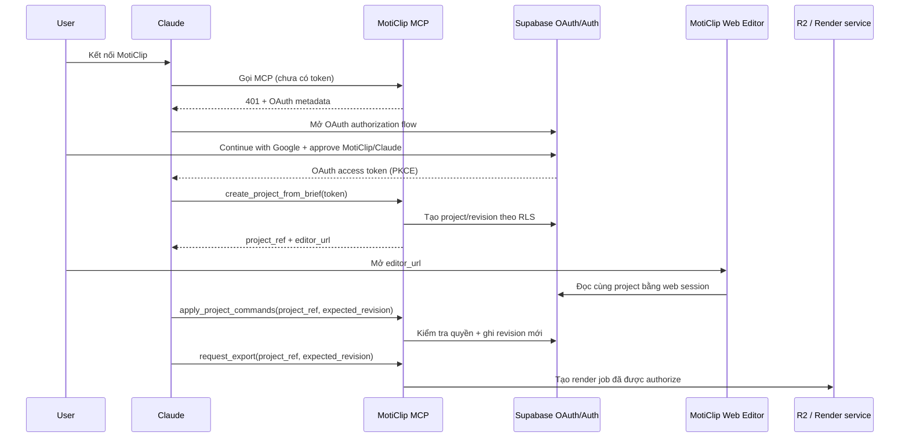

# Kế hoạch triển khai MotiClip MCP + Google OAuth

> Trạng thái: đề xuất triển khai
>
> Mục tiêu: người dùng kết nối MotiClip với Claude một lần bằng Google OAuth; sau đó Claude tạo, chỉnh sửa và yêu cầu export video trong đúng workspace của người dùng.

## 1. Quyết định kiến trúc

MCP là một **remote HTTP MCP server** của MotiClip. Không cho phép gọi các tool tạo/sửa/export khi chưa xác thực.



Nguyên tắc:

- Google là identity provider; Supabase Auth là identity/OAuth server của MotiClip.
- MCP không giữ Google token và không chuyển Supabase token tới AWS, R2 hay service khác.
- Mọi thay đổi document dùng `project_ref` và `expected_revision`; server từ chối ghi đè revision mới hơn.
- Mọi file media ở R2; Postgres chỉ lưu metadata, quyền và object key.
- Mọi export qua `render_jobs`, không gọi Lambda trực tiếp từ Claude hoặc browser.

## 2. Phạm vi MVP

Các MCP tool MVP:

| Tool | Vai trò | Điều kiện quyền |
| --- | --- | --- |
| `create_project_from_brief` | Tạo project và revision đầu tiên từ brief/command batch | `projects:write` |
| `get_project` | Đọc snapshot/revision hiện tại | `projects:read` |
| `apply_project_commands` | Validate command batch, tạo revision mới | `projects:write` |
| `get_editor_link` | Trả link editor của project hiện tại | `projects:read` |
| `request_export` | Tạo render job có idempotency key | `renders:create` |
| `get_render_status` | Đọc trạng thái và link download đã ký | `renders:read` |

Không đưa vào MVP: upload binary qua MCP, tool SQL tổng quát, service-role token, quyền cross-workspace, hoặc tự động export không có xác nhận của người dùng.

## 3. Thứ tự triển khai

### Phase 0 — Tài khoản và cấu hình bên ngoài

1. Tạo Supabase project ở Singapore.
2. Tạo Google OAuth Web Client.
3. Cấu hình Google provider trong Supabase Auth: Google client ID/secret, Site URL và redirect URLs cho localhost, preview Vercel, production.
4. Bật Supabase OAuth 2.1 Server và đặt authorization path là `/oauth/consent`.
5. Bật dynamic client registration chỉ khi Claude cần nó; bắt buộc hiện consent screen và theo dõi các OAuth client được đăng ký.
6. Tạo Cloudflare R2 private bucket; AWS/Remotion chỉ cần tạo sau khi export API sẵn sàng.

Supabase OAuth Server hiện là beta. Tách code xác minh token và OAuth metadata vào một module riêng để có thể thay đổi khi API ổn định.

### Phase 1 — Auth web và database contract

1. Cài `@supabase/supabase-js` và `@supabase/ssr` trong `apps/web`.
2. Tạo browser client, server client và auth callback cho Next.js cookie/PKCE.
3. Tạo Supabase migrations; không tạo schema/RLS thủ công trên Dashboard.
4. Cài Google sign-in cho trang web và trang `/oauth/consent`.
5. Viết test cho RLS: user A tuyệt đối không đọc/ghi dữ liệu workspace B.

### Phase 2 — Remote MCP server

1. Triển khai endpoint HTTP, ví dụ `https://api.moticlip.com/mcp`, ở Node runtime.
2. Công bố Protected Resource Metadata theo MCP và trỏ authorization server tới Supabase OAuth endpoints.
3. Xác minh JWT từ `Authorization: Bearer ...` bằng JWKS/issuer/audience; token không hợp lệ trả `401`.
4. Mỗi tool tạo Supabase client theo JWT user, để RLS là lớp bảo vệ cuối cùng.
5. Implement sáu tool MVP và log audit có cấu trúc.
6. Kiểm thử OAuth/DCR bằng Claude trước khi công bố URL MCP.

### Phase 3 — Editor và concurrency

1. `get_editor_link` trả `https://app.moticlip.com/editor/{project_ref}`; không dùng secret trong URL.
2. Web editor lấy session Supabase và tải project qua RLS.
3. `apply_project_commands` yêu cầu `expected_revision`; transaction chỉ thành công khi revision hiện tại khớp.
4. Nếu conflict, trả canonical revision hiện tại để Claude rebase commands thay vì ghi đè user.
5. Gửi event revision/render trạng thái qua Supabase Realtime hoặc SSE.

### Phase 4 — Asset và export

1. Thêm R2 presigned upload/download endpoint trên server; browser upload trực tiếp, không qua Vercel.
2. Khóa một immutable RenderManifest theo revision/hash trước khi tạo job.
3. `request_export` ghi `render_jobs` trước, sau đó server mới gọi Remotion Lambda.
4. Nhận signed webhook idempotent; cập nhật job và trả download URL ngắn hạn.
5. Áp quota theo workspace, rate limit và idempotency key để không render trùng.

## 4. Database tối thiểu

```text
profiles
  id (FK auth.users), display_name, avatar_url, created_at

workspaces
  id, name, created_by, created_at

workspace_members
  workspace_id, user_id, role (owner | editor | viewer)

projects
  id, public_ref (unique), workspace_id, title,
  current_revision_no, created_by, created_at, updated_at

project_revisions
  id, project_id, revision_no, document_json, content_hash,
  created_by, created_at

assets
  id, workspace_id, r2_key, content_hash, mime_type, byte_size,
  created_by, created_at

render_jobs
  id, public_ref, workspace_id, project_id, revision_id,
  status, preset_json, idempotency_key, provider_render_id,
  output_key, error_code, created_by, created_at, finished_at

audit_events
  id, workspace_id, actor_user_id, actor_client_id,
  action, target_type, target_id, metadata_json, created_at
```

`public_ref` là ID công khai, ngắn, không tuần tự (ví dụ `prj_...`); UUID nội bộ không cần xuất hiện trong prompt hoặc URL. `document_json` luôn là canonical `MotionProject`, không có state UI.

## 5. RLS và quyền

RLS phải bật trên tất cả bảng trong danh sách trên.

- User chỉ truy cập workspace có hàng `workspace_members` tương ứng.
- Project/revision/assets/render job suy quyền từ `workspace_id`.
- Chỉ owner/editor được tạo revision hoặc render; viewer chỉ đọc.
- `profiles.id` luôn bằng `auth.uid()` cho thao tác update.
- `service_role` chỉ dùng trong endpoint nội bộ (webhook, cleanup); không bao giờ được gửi vào client, Claude hoặc MCP response.
- MCP ghi `client_id` từ OAuth token vào `audit_events`; có thể giới hạn một số tool theo client ID của Claude.

## 6. API và tool contract

Ví dụ tạo project:

```ts
type CreateProjectResult = {
  projectRef: string;
  revision: number;
  editorUrl: string;
};
```

Ví dụ cập nhật:

```ts
type ApplyProjectCommandsInput = {
  projectRef: string;
  expectedRevision: number;
  idempotencyKey: string;
  commands: CommandBatch;
};
```

Server thực hiện: authorize → load canonical revision → validate command batch/schema/capability → apply trong transaction → tăng revision → ghi audit event → trả revision/hash mới.

Claude chỉ nhận/sửa `MotionProject` hoặc `CommandBatch` có schema rõ ràng. Không cho Claude sinh JSX/CSS/SQL tuỳ ý hoặc gọi credential của hạ tầng.

## 7. Biến môi trường

### `apps/web/.env.local` — local development

```dotenv
# Public — được phép xuất hiện trong browser
NEXT_PUBLIC_APP_URL=http://localhost:3000
NEXT_PUBLIC_SUPABASE_URL=https://<project-ref>.supabase.co
NEXT_PUBLIC_SUPABASE_PUBLISHABLE_KEY=<sb_publishable_key>

# Server-only — không thêm NEXT_PUBLIC_ và không commit
SUPABASE_SERVICE_ROLE_KEY=<service_role_key>
MCP_SERVER_URL=http://localhost:3000/api/mcp
MCP_TOKEN_AUDIENCE=<mcp-resource-identifier>
MCP_AUDIT_SALT=<random-32-plus-byte-secret>

# R2 server-only (chỉ cần ở Phase 4)
R2_ACCOUNT_ID=<cloudflare-account-id>
R2_BUCKET_NAME=moticlip-assets-dev
R2_ACCESS_KEY_ID=<r2-access-key>
R2_SECRET_ACCESS_KEY=<r2-secret>
R2_S3_ENDPOINT=https://<account-id>.r2.cloudflarestorage.com

# Render server-only (chỉ cần ở Phase 4)
AWS_REGION=<aws-region>
AWS_ACCESS_KEY_ID=<iam-access-key>
AWS_SECRET_ACCESS_KEY=<iam-secret>
REMOTION_FUNCTION_NAME=<function-name>
REMOTION_SERVE_URL=<versioned-remotion-site-url>
REMOTION_BUCKET_NAME=<s3-render-bucket>
REMOTION_WEBHOOK_SECRET=<random-32-plus-byte-secret>
```

### Supabase local CLI

Google secret đặt trong secret store/local environment, không commit vào `supabase/config.toml`:

```dotenv
SUPABASE_AUTH_EXTERNAL_GOOGLE_CLIENT_SECRET=<google-oauth-client-secret>
```

`supabase/config.toml` chỉ tham chiếu `env(SUPABASE_AUTH_EXTERNAL_GOOGLE_CLIENT_SECRET)`.

### Cấu hình đặt ở Dashboard, không cần `.env` runtime

- Google OAuth client ID và client secret: Supabase Auth > Google provider.
- Site URL và Redirect URL allow-list: Supabase Auth > URL Configuration.
- OAuth 2.1 Server, authorization path và dynamic client registration: Supabase Auth > OAuth Server.
- OAuth client registrations và redirect URI: Supabase Auth > OAuth Apps.
- Vercel Preview/Production giữ cùng tên biến môi trường nhưng dùng giá trị của từng environment.

Không cần `ANTHROPIC_API_KEY` cho remote MCP được Claude gọi: Claude là MCP client. Chỉ cần key này nếu MotiClip tự gọi Anthropic API ở một luồng AI độc lập.

## 8. Checklist bảo mật trước production

- [ ] Không có secret trong Git, MCP response, browser bundle hoặc `NEXT_PUBLIC_*`.
- [ ] HTTPS ở production; redirect URL là allow-list chính xác, không wildcard.
- [ ] MCP xác minh issuer, audience, expiry và chữ ký JWT qua JWKS.
- [ ] Mọi tool mutating dùng idempotency key và audit log.
- [ ] Mọi tool export yêu cầu xác nhận người dùng và kiểm tra quota.
- [ ] R2 bucket private; signed URL thời hạn ngắn; CORS chỉ các origin ứng dụng cần thiết.
- [ ] Webhook render được ký, timestamped và xử lý idempotent.
- [ ] DCR/OAuth client được theo dõi; có UI thu hồi quyền MCP trong MotiClip.
- [ ] RLS integration tests chạy trong CI.

## 9. Tiêu chí hoàn thành MVP

1. User kết nối MotiClip MCP từ Claude, đăng nhập Google và approve thành công.
2. Claude tạo được project trong workspace của user và trả editor link.
3. Editor và Claude cùng đọc đúng cùng `project_ref`; conflict revision không ghi đè dữ liệu.
4. User khác không thể đọc/sửa project dù biết `project_ref`.
5. Claude tạo render job được; trạng thái và download chỉ thấy với user/workspace có quyền.

## 10. Tài liệu tham chiếu

- [Supabase MCP Authentication](https://supabase.com/docs/guides/auth/oauth-server/mcp-authentication)
- [Supabase OAuth 2.1 Server](https://supabase.com/docs/guides/auth/oauth-server)
- [Supabase Login with Google](https://supabase.com/docs/guides/auth/social-login/auth-google)
- [MCP Authorization specification](https://modelcontextprotocol.io/specification/2025-06-18/basic/authorization)

## Phase 2 implementation (Neonix)

- Remote endpoint: `https://neonix.video/api/mcp`.
- `open_editor` returns a clean editor URL such as `https://app.neonix.video/editor/{project_id}`.
- Protected resource metadata: `https://neonix.video/.well-known/oauth-protected-resource`.
- Supabase issuer: `https://<project-ref>.supabase.co/auth/v1`.
- Supabase JWKS: `https://<project-ref>.supabase.co/auth/v1/.well-known/jwks.json`.
- Supabase access-token JWT audience is `authenticated`; `MCP_TOKEN_AUDIENCE` identifies the MCP resource and is not used as the JWT audience.
