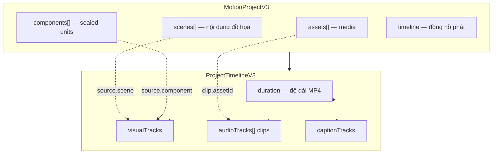
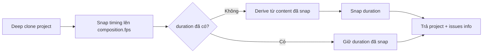
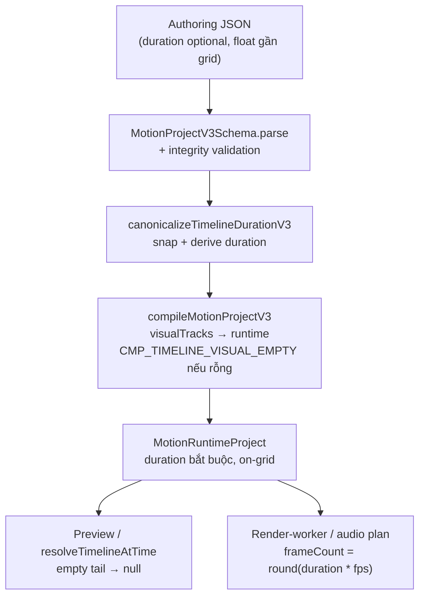

# MotiClip V3 Timeline

Module protocol tại `packages/motion-protocol/src/v3/timeline/`.

Timeline là **đồng hồ (clock) và source of truth** cho độ dài MP4, thứ tự phát scene, audio và caption. Mọi consumer (compiler, runtime, render-worker) phải đọc timing từ timeline — không tự dựng lại bằng cursor hay fallback từ `project.scenes`.

---

## 1. Timeline là gì?

Timeline V3 mô tả **khi nào** nội dung xuất hiện trên trục thời gian toàn cục (giây, bắt đầu từ `0`), không mô tả **cây node bên trong scene**.

| Khái niệm              | Vai trò                                                                 |
| ---------------------- | ----------------------------------------------------------------------- |
| `timeline.duration`    | Độ dài MP4 cuối cùng (giây) — clock / source of truth                   |
| `visualTracks`         | Lane hình ảnh (AE layer stack); `order` unique = stacking               |
| `audioTracks`          | Lane âm thanh với `clips[]` + fadeIn/fadeOut (DSP)                      |
| `captionTracks`        | Lane phụ đề                                                             |
| `workArea` / `markers` | Vùng làm việc và mốc thời gian (editor), vẫn phải nằm trong `duration` |



### Tại sao timeline phải là source of truth?

| Vấn đề cũ                                                         | Giải pháp V3                                                              |
| ----------------------------------------------------------------- | ------------------------------------------------------------------------- |
| Compiler tự xếp scene theo declaration order khi thiếu visual clip | Hard error `CMP_TIMELINE_VISUAL_EMPTY` — không silent fallback             |
| Duration MP4 suy từ clip cuối, bỏ empty tail                      | `timeline.duration` tường minh (canonical)                                |
| `start` bị rebuild bằng cursor → mất gap/overlay                  | `clip.start` / `audio.start` là **absolute global time**                  |
| Schema đúng nhưng render sai (audio kéo theo asset)               | Audio/visual timing theo track/clip; asset chỉ phục vụ trim/loop          |
| Float lệch frame (`1.001` @ `1fps`) → MP4 lệch 1 frame            | Frame-grid: snap + validate theo `composition.fps`                        |

---

## 2. Cấu trúc một Timeline

Mỗi project có đúng một `timeline`:

```jsonc
{
  "timeline": {
    // ═══ Clock ═══
    "duration": 10, // optional lúc authoring; bắt buộc ở canonical/export

    // ═══ Editor helpers (optional) ═══
    "workArea": { "start": 0, "end": 8 },
    "markers": [{ "id": "beat-1", "t": 2.5 /* ... */ }],

    // ═══ Nội dung phát ═══
    "visualTracks": [
      /* VisualTrackV3[] */
    ],
    "audioTracks": [
      /* AudioTrackV3[] — default [] */
    ],
    "captionTracks": [
      /* CaptionTrackV3[] — default [] */
    ],
  },
}
```

> **Source layout**: Schema/utilities nằm trong thư mục này (`schema.ts`, `duration.ts`, `canonicalize.ts`, `validation.ts`, `frame-grid.ts`, `index.ts`). Import qua `./timeline` hoặc public export của `@motionvideo/motion-protocol`.

---

## 3. Khái niệm cốt lõi

### 3.1 Absolute global time

`start` trên visual clip / audio track là thời điểm **tuyệt đối** trên trục project (giây), **không** phải offset tương đối so với phần tử trước.

```
0s -------- 2s -------- 5s -------- 8s -------- 10s
|--- clip A ---|         |--- clip B ---|        |
                         ^ start = 5 (tuyệt đối)
                                      duration=10 (empty tail 8→10)
```

Compiler / runtime / render **không** được tái dựng `start` bằng cursor. Gap giữa clip là hợp lệ; empty tail (`duration` > content end) cũng hợp lệ.

### 3.2 Visual clip source

`VisualClipSourceV3` = `scene | component`.

- `{ kind: "scene", sceneId }` — scene trong project.
- `{ kind: "component", componentId }` — component nhúng; compiler synthesize scene wrapper khi emit runtime IR.

`kind: "node"` = follow-up (chưa ship).

UI có thể gọi track `order === 0` là “main” và track cao hơn là “overlay” — **đó không phải field JSON**.

### 3.3 Visual track = AE layer stack

| Field | Rule |
| --- | --- |
| `id` | Unique track id |
| `order` | **Unique** stacking order; thấp render dưới, cao trên |
| `muted` | Optional |
| `clips` | Occupancy theo thời gian |

**Lane exclusive (visual):** trong cùng track, clips **không** overlap. Gap là gap thật. Khác track được trùng thời gian.

**Không** có `role`, `transitionIn` / `transitionOut`, boundary, hay suy luận effect từ khoảng cách giữa clips.

Tại thời điểm `t`:

```
active = clips where start <= t < start + duration
sort by track.order ascending
render low → high
```

Nếu không có layer nào active → empty (background/transparent theo export setting).

### 3.3b Audio ≠ visual

Audio giữ DSP playback primitives trên **clip**:

```ts
audioTracks: Array<{
  id: string;
  order?: number; // optional listing; không bắt unique như visual
  muted?: boolean;
  clips: Array<{
    id: string;
    assetId: string;
    start: number;
    duration: number;
    volume?: number;   // default 1
    fadeIn?: number;   // default 0 — 0→volume ở đầu clip
    fadeOut?: number;  // default 0 — volume→0 ở cuối clip
    // trimStart, playbackRate, loop, muted…
  }>;
}>;
```

- `fadeIn + fadeOut ≤ duration`.
- Same-track audio **được overlap** (mix). Không suy luận crossfade giữa hai clip.
- Muốn “crossfade”: overlap thời gian + `fadeOut` / `fadeIn` trên từng clip (thường hai lane).

### 3.3c Duplicate = editor command

JSON **không** mô tả operation duplicate. Editor tạo clip/node mới (`id` mới), chọn lane/zIndex hợp lệ, rồi ghi state sạch. Chi tiết command: [v3-format-guide.md §14.1](../../../../docs/guide/v3-format-guide.md).

### 3.4 Composition window vs media local time

Với visual clip:

- **Cửa sổ phát (composition)**: clip active khi `globalTime ∈ [start, start + duration)`.
- **Đồng hồ scene (media local)**:  
  `effectiveLocalTime = trimStart + (globalTime - start) * playbackRate`  
  (có rule `loop` qua `resolveMediaTiming`).

Transition opacity ramp theo **composition window**; đánh giá node/scene theo **media local time**.

### 3.5 Empty timeline

Không có visual clip → **compile fail** (`CMP_TIMELINE_VISUAL_EMPTY`). Không dựng lại timeline từ `project.scenes`.

---

## 4. Thiết kế từng schema

### 4.1 Không còn TransitionV3 trên timeline

Timeline **không** có transition primitive. `TransitionV3Schema` đã gỡ khỏi authoring clip. Hiệu ứng = layer/component trên stack.

### 4.2 `VisualClipV3Schema`

```jsonc
{
  "id": "clip-intro",
  "source": { "kind": "scene", "sceneId": "intro" },
  // hoặc { "kind": "component", "componentId": "logo-reveal" }
  "start": 0, // absolute global time
  "duration": 5,
  "trimStart": 0.5,
  "playbackRate": 1,
  "loop": false,
  "opacity": 1
}
```

Thiết kế:

- `.strict()` — từ chối field lạ (`role`, `transitionIn`, …).
- `superRefine` bắt `playbackRate > 0`.
- Timing media (`trimStart` / `playbackRate` / `loop`) **không** đổi cửa sổ active; chỉ đổi local time khi evaluate.

### 4.3 `VisualTrackV3Schema`

```jsonc
{
  "id": "main",
  "role": "main", // "main" | "overlay"
  "order": 0,
  "muted": false,
  "clips": [
    /* tối thiểu 1 clip */
  ],
}
```

Track rỗng không hợp lệ ở schema track (`clips.min(1)`). Timeline có thể có `visualTracks: []` lúc draft — nhưng compile sẽ fail nếu không có clip nào.

### 4.4 `AudioTrackV3Schema`

```jsonc
{
  "id": "aud.bgm",
  "role": "bgm", // bgm | voiceover | sfx
  "assetId": "asset.bgm",
  "start": 1,
  "duration": 3, // SoT cửa sổ phát — không kéo theo asset dài hơn
  "trimStart": 0.5,
  "trimEnd": 20, // optional, ≤ duration (source window)
  "playbackRate": 1,
  "volume": 0.8,
  "loop": false,
  "fadeIn": 0.5,
  "fadeOut": 1,
  "muted": false,
}
```

Thiết kế:

- `duration` trên track là **source of truth** cho độ dài phát trong composition.
- Asset length chỉ phục vụ trim/loop — `buildAudioRenderPlan` không được kéo clip dài hơn `track.duration`.
- `muted` → envelope volume 0 (vẫn giữ timing).
- `fadeIn + fadeOut ≤ duration`; `trimEnd ≤ duration`.

### 4.5 `ProjectTimelineV3Schema` vs canonical

| Schema                              | `duration`     | Dùng khi                         |
| ----------------------------------- | -------------- | -------------------------------- |
| `ProjectTimelineV3Schema`           | optional       | Authoring / parse draft          |
| `CanonicalProjectTimelineV3Schema`  | **bắt buộc**   | Export / save / biên canonical   |

Khi `duration` đã khai báo, `superRefine` kiểm tra mọi clip/audio/caption/workArea/marker **không vượt** `duration`.

Ngoài ra, `CanonicalMotionProjectV3Schema` (ở `project.ts`) còn reject timing **lệch frame-grid** theo `composition.fps`.

---

## 5. Các module logic trong thư mục

```
timeline/
  index.ts          — barrel export
  schema.ts         — Zod schemas + types
  duration.ts       — derive duration từ content ends
  canonicalize.ts   — điền duration + snap frame-grid
  validation.ts     — integrity (unique order, lane exclusive, clip ids)
  frame-grid.ts     — snap / isOnGrid / collectFrameGridIssues
  README.md         — tài liệu này
```

### 5.1 Derive duration — `duration.ts`

```
derivedDuration = max(
  visual:  max(clip.start + clip.duration),
  audio:   max(track.start + track.duration),
  caption: max(token.end),
)
```

Không có nội dung → `0`. Giá trị được `roundTimelineValue` (làm tròn nanosecond) để giảm nhiễu float.

| Trường hợp                         | Kết quả                                              |
| ---------------------------------- | ---------------------------------------------------- |
| Thiếu `duration`                   | Canonicalize điền = `derivedDuration` (đã snap)      |
| `duration` > derived               | Hợp lệ — **empty tail**                              |
| `duration` < derived               | Lỗi validation biên timeline                         |
| Derived = `0`                      | Export MP4 bị chặn (blank video)                     |

### 5.2 Integrity — `validation.ts`

`collectTimelineIntegrityIssues(timeline)`:

1. **Duplicate visual clip id** / **duplicate audio clip id**.
2. **Unique visual `order`** — reject trùng order giữa tracks.
3. **Visual lane exclusive** trên mọi track — overlap cùng track → reject (không transition bridge).
4. Audio overlap trong cùng track **được phép** (mix).

### 5.3 Frame-grid — `frame-grid.ts`

Policy (half-up):

```
frames = Math.round(seconds * fps)
canonicalSeconds = frames / fps
onGrid ⇔ |seconds * fps - round(seconds * fps)| ≤ 1e-9
```

Áp dụng cho: `duration`, clip `start`/`duration`/`trimStart`, transition durations, audio timing, caption `start`/`end`, workArea, markers.

Ví dụ: `fps = 1`, `1.001` → snap thành `1`; canonical schema reject nếu vẫn còn `1.001`.

### 5.4 Canonicalize — `canonicalize.ts`

`canonicalizeTimelineDurationV3(project)` — **không mutate** input:



Compiler gọi bước này trước khi emit runtime IR, nên runtime luôn có `timeline.duration` on-grid.

---

## 6. Luồng end-to-end



### 6.1 Compile visual

- Có visual clip → map từng clip (`start`, `trimStart`, `playbackRate`, `loop`, transitions) sang runtime.
- Không có visual clip → **error**, không synthesize từ scenes.

### 6.2 Resolve playhead

`resolveTimelineAtTime(runtime, t)`:

- Prefer **primary** khi primary và overlay chồng nhau.
- `t` trong empty tail hoặc `t ≥ duration` → `null` (không clamp scene cuối).

### 6.3 Audio render plan

`buildAudioRenderPlan`:

- `fromFrame = round(track.start * fps)`
- `durationInFrames = round(track.duration * fps)` ← SoT
- Không `min(remaining, assetDuration)` để kéo dài clip

### 6.4 Frame plan (MP4)

Sau canonicalize, `duration` đã on-grid →  
`frameCount = round(duration * fps)` khớp clock → độ dài file = `frameCount / fps`.

---

## 7. Ví dụ nhanh

### Authoring thiếu duration

```jsonc
{
  "composition": { "width": 1920, "height": 1080, "fps": 30 },
  "timeline": {
    "visualTracks": [
      {
        "id": "main",
        "role": "main",
        "order": 0,
        "clips": [
          {
            "id": "c1",
            "source": { "kind": "scene", "sceneId": "intro" },
            "start": 0,
            "duration": 5,
          },
          {
            "id": "c2",
            "source": { "kind": "scene", "sceneId": "outro" },
            "start": 5,
            "duration": 3,
          },
        ],
      },
    ],
  },
}
```

Sau canonicalize → `timeline.duration = 8` (đã on-grid @ 30fps).

### Concurrent scenes = khác `order`

```jsonc
{
  "visualTracks": [
    {
      "id": "track.base",
      "order": 0,
      "clips": [
        { "id": "a", "source": { "kind": "scene", "sceneId": "intro" }, "start": 0, "duration": 3 }
      ]
    },
    {
      "id": "track.fx",
      "order": 1,
      "clips": [
        { "id": "fx", "source": { "kind": "component", "componentId": "flash" }, "start": 0, "duration": 3 }
      ]
    }
  ]
}
```

Cùng track + overlap thời gian → **reject** integrity.

### Empty tail

```jsonc
{
  "timeline": {
    "duration": 10, // content kết thúc 8s → 2s trống cuối
    "visualTracks": [
      /* clips end at 8s */
    ],
  },
}
```

Playhead `t = 9` → không có layer / `resolveTimelineAtTime` = `null`.

---

## 8. Checklist khi sửa timeline

1. Timing mới có nằm trên frame-grid sau canonicalize không?
2. `start` có absolute không — có đang rebuild bằng cursor không?
3. Cùng visual lane có overlap không? (phải reject — tách track `order`)
4. Scene trùng timing đã nằm khác `order` chưa? Visual `order` unique chưa?
5. Audio tôn trọng clip duration + fadeIn/fadeOut ≤ duration chưa?
6. Visual local time có đi qua trim/rate/loop không?
7. Empty visual clips có fail rõ ràng (không silent fallback) không?
8. Empty tail có trả “không scene” thay vì clamp scene cuối không?
9. Sibling nodes có `zIndex` unique trong cùng `parentId` không?
8. Empty tail có trả “không scene” thay vì clamp scene cuối không?
9. Sibling nodes có `zIndex` unique trong cùng `parentId` không?

---

## 9. Tham chiếu

| Tài liệu / file                                      | Nội dung                          |
| ---------------------------------------------------- | --------------------------------- |
| [v3-format-guide.md](../../../../docs/guide/v3-format-guide.md) §3 | Timeline model trong format guide |
| [v3-component-guide.md](../../../../docs/guide/v3-component-guide.md) | Component node + timeline component source |
| `schema.ts`                                          | Zod schemas                       |
| `duration.ts` / `canonicalize.ts`                    | Derive + snap                     |
| `validation.ts` / `frame-grid.ts`                    | Integrity + frame-grid            |
