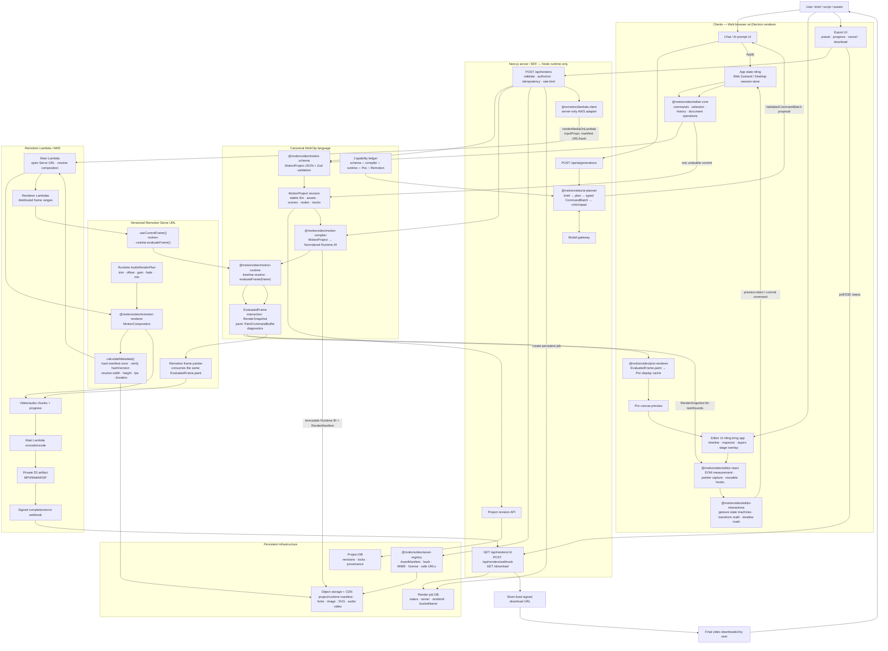

# Web architecture — AI → Pixi preview → Remotion Lambda export

> Trạng thái: kiến trúc mục tiêu cho Web MVP và Desktop dùng chung core  
> Cập nhật: 2026-08-06  
> Remotion đã kiểm tra: `4.0.506`  
> Quyết định engine: PixiJS cho preview/editor; Remotion Renderer + Remotion Lambda cho export cloud.

## 1. Quyết định kiến trúc

MotiClip có một ngôn ngữ animation duy nhất: `MotionProject` JSON.

- AI chỉ tạo creative plan và typed authoring commands.
- `MotionProject` là document canonical để lưu, edit, version và export.
- `motion-compiler` dịch document sang Runtime IR.
- `motion-runtime` là nơi duy nhất tính giá trị của một frame.
- PixiJS và Remotion không tự tính easing, timing, transform hoặc layout theo cách riêng.
- PixiJS chỉ paint frame để preview tương tác.
- Remotion chỉ paint cùng frame contract để tạo video, quản lý audio, chia render và encode.
- CSS/React trong Remotion renderer là implementation do MotiClip kiểm soát; AI không sinh CSS, TSX hay Remotion component.
- Web và Desktop tự quản lý UI, theme và Zustand/reducer. Chỉ logic interaction và React hooks được đóng gói dùng chung.

Remotion không thay thế schema, compiler hay runtime của MotiClip. Nó thay thế hạ tầng export tự viết: phân phối frame, Chromium rendering, audio/codec, ghép chunk và lưu output.

## 2. Kết luận từ tài liệu Remotion local

Clone Remotion và các dependency trong MotiClip đều đang ở phiên bản `4.0.506`; xem [version.ts](./remotion/packages/core/src/version.ts).

Các điểm ảnh hưởng trực tiếp tới kiến trúc:

1. `renderMediaOnLambda()` gọi một main Lambda. Main Lambda mở Serve URL bằng headless browser, resolve composition/metadata, chia frame cho các renderer Lambda, nhận chunk bằng response streaming, ghép video và upload kết quả lên S3. Xem [How Remotion Lambda works](./remotion/packages/docs/docs/lambda/how-lambda-works.mdx).
2. Lambda cần một deployed function và một deployed Remotion site/Serve URL. `inputProps` phải là JSON object. Xem [renderMediaOnLambda](./remotion/packages/docs/docs/lambda/rendermediaonlambda.mdx).
3. `calculateMetadata()` chạy một lần trước render, độc lập với số renderer Lambda. Đây là nơi phù hợp để tải và xác minh render manifest, sau đó quyết định `durationInFrames`, `fps`, `width`, `height` và resolved props. Xem [calculateMetadata](./remotion/packages/docs/docs/calculate-metadata.mdx).
4. API Lambda phải được gọi từ server. Tài liệu cảnh báo không gọi trực tiếp từ browser vì sẽ lộ AWS credentials. Next.js server route có thể dùng light client. Xem [Lambda light client](./remotion/packages/docs/docs/lambda/light-client.mdx).
5. Mỗi chunk có thể tải lại asset mà chunk sử dụng; asset origin yếu có thể bị quá tải hoặc rate-limit. Asset phải đi qua CDN/object storage và immutable URL. Xem [How Remotion Lambda works](./remotion/packages/docs/docs/lambda/how-lambda-works.mdx).
6. AWS Lambda có giới hạn concurrency, RAM/disk tối đa 10 GB và timeout tối đa 15 phút cho mỗi invocation. Một render dùng tối đa 200 renderer functions. Xem [Lambda limits](./remotion/packages/docs/docs/lambda/limits.mdx) và [renderMediaOnLambda](./remotion/packages/docs/docs/lambda/rendermediaonlambda.mdx).
7. Function, deployed site và Lambda client nên cùng version. Upgrade production phải deploy site/function mới trước, chuyển traffic rồi mới xóa bản cũ. Xem [Upgrading Lambda](./remotion/packages/docs/docs/lambda/upgrading.mdx).
8. Production phải có rate limit, private output, quyền IAM tối thiểu và kiểm tra license. Xem [Lambda production checklist](./remotion/packages/docs/docs/lambda/checklist.mdx).

## 3. Sơ đồ kiến trúc E2E



## 4. Làm sao Pixi và Remotion nói cùng một ngôn ngữ?

Không để Pixi đọc `MotionProject` rồi tự tính animation, trong khi Remotion lại đọc JSON và tự tạo CSS animation. Cả hai phải đi qua cùng pipeline:

```text
MotionProject JSON
  → parseMotionProject()
  → compileMotionProject()
  → NormalizedMotionProjectV2 / Runtime IR
  → resolve global timeline + local scene time
  → evaluateFrame(frame)
  → EvaluatedFrame
       ├── interaction: RenderSnapshot
       ├── paint: PaintCommandBuffer
       └── diagnostics
            ├── PixiFramePainter
            └── RemotionFramePainter
```

### 4.1 Ba contract bắt buộc

#### Authoring contract — `MotionProject`

Là JSON mà AI, editor, database và API hiểu:

- scene/node/asset stable IDs;
- transform, style, hierarchy và 2.5D depth;
- clips, tracks, keyframes, easing, drivers và transitions;
- audio/video timing;
- capability/version metadata;
- không có Pixi object, React element, CSS animation hoặc function tùy ý.

#### Runtime contract — `NormalizedMotionProjectV2`

Là kết quả compiler đã resolve:

- defaults;
- references;
- component instances;
- animation tracks;
- layout constraints;
- render ordering;
- camera/projection;
- diagnostics.

Runtime IR có thể được cache/upload cho render job nhưng không phải document để user edit.

#### Frame contract — `EvaluatedFrame`

```ts
type EvaluatedFrame = {
  frame: number;
  time: number;
  sceneId: string;
  interaction: RenderSnapshot;
  paint: PaintCommandBuffer;
  diagnostics: RenderDiagnostic[];
};
```

- `interaction` phục vụ hit-test, selection bounds và transform handles.
- `paint` là lệnh vẽ renderer-neutral.
- Pixi và Remotion không được thay đổi giá trị transform/timing đã evaluate.
- Renderer gặp `unsupported` phải fail render hoặc hiện diagnostic rõ ràng; không được silently bỏ node.

### 4.2 Remotion không được trở thành schema thứ hai

`MotionComposition` chỉ làm bốn việc:

1. Nhận `RenderManifest` đã validate.
2. Lấy `frame` từ `useCurrentFrame()`.
3. Gọi cùng `motion-runtime.evaluateFrame()` như preview.
4. Paint `EvaluatedFrame.paint` và dựng audio từ `AudioRenderPlan`.

Không dùng `spring()`, `interpolate()` hoặc `<Sequence>` để tự định nghĩa lại motion đã tồn tại trong schema. Các API đó chỉ được dùng bên trong adapter nếu chúng không thay đổi semantic canonical; mặc định không cần dùng.

### 4.3 Capability gate

AI chỉ thấy giao của các capability đã hoàn tất:

```text
AI capability = schema ∩ compiler ∩ runtime ∩ Pixi ∩ Remotion ∩ editor
```

Ví dụ `mask:luma` có trong schema nhưng Remotion painter chưa hỗ trợ thì capability đó chưa được đưa cho AI. Mỗi capability cần fixture ở các frame `before/start/middle/end/after` và parity test giữa Pixi và Remotion.

## 5. Kiến trúc package đích

### 5.1 Packages thuộc kiến trúc đích

| Package               | Vai trò kiến trúc                                                                                                                                                                                                                         | Ranh giới                                                                        |
| --------------------- | ----------------------------------------------------------------------------------------------------------------------------------------------------------------------------------------------------------------------------------------- | -------------------------------------------------------------------------------- |
| `motion-schema`       | Canonical JSON, Zod parse, reference validation, versioning                                                                                                                                                                               | Giữ độc lập với mọi renderer                                                     |
| `motion-compiler`     | Authoring JSON → Runtime IR                                                                                                                                                                                                               | Compiler version là một phần của render manifest                                 |
| `motion-runtime`      | Timeline resolve, evaluator, `EvaluatedFrame`, hit-test, paint commands, audio plan                                                                                                                                                       | Sở hữu toàn bộ composition evaluation dùng chung preview/export                  |
| `editor-core`         | Commands, selection, history, document operations<br/>Timeline: lane rows, ruler ticks, viewport layout, drop target policy, layer tree, context actions                                                                                  | Không React/DOM/Zustand                                                          |
| `editor-interactions` | Gesture state machines và geometry thuần<br/>Timeline: clip move/trim, auto-scroll, seek, marquee, drop geometry, layer reorder                                                                                                           | Không React/DOM/Pixi/Remotion                                                    |
| `editor-react`        | Hooks DOM/React dùng chung Web/Desktop<br/>Timeline: useClipMove, useClipTrim, useLayerMove, useLayerTrim, useTimelineSeek, useTimelineMarquee, useTimelineViewportMetrics, useVisibleTimeline, useTimelineHotkeys, usePointerSessionHost | Controlled hooks, không import app store                                         |
| `ai-planner`          | Brief → plans → typed commands → critic/repair                                                                                                                                                                                            | Planning grammar thuộc nội bộ package; zero-template là default path             |
| `asset-registry`      | Asset contract, hash, SVG safety, font/license metadata                                                                                                                                                                                   | Có browser/server exports riêng; server implementation có thể dùng `node:crypto` |
| `pixi-renderer`       | Preview painter và display-object cache                                                                                                                                                                                                   | Chỉ tiêu thụ contract từ `motion-runtime`, không sở hữu authoring semantics      |
| `remotion-renderer`   | Production Remotion composition, paint/audio adapter                                                                                                                                                                                      | Chỉ tiêu thụ `EvaluatedFrame`; không đóng vai trò editor preview                 |
| `render-contracts`    | Render manifest, job request/status/result và webhook payload                                                                                                                                                                             | Thuần TypeScript/Zod; không AWS SDK, React hay renderer implementation           |

### 5.2 Thành phần không tồn tại như package độc lập trong kiến trúc đích

| Package/app hiện tại | Lý do không là package độc lập                                      | Nơi sở hữu contract trong kiến trúc đích                                               |
| -------------------- | ------------------------------------------------------------------- | -------------------------------------------------------------------------------------- |
| `motion-grammar`     | Chỉ là policy của AI planning                                       | `ai-planner/planning`                                                                  |
| `shared`             | Misc bucket làm mờ ownership                                        | App config, `motion-schema` hoặc `render-contracts` tùy loại dữ liệu                   |
| `preview-kit`        | Composition evaluation không chỉ phục vụ preview                    | `motion-runtime`; fixtures nằm ngoài production barrel                                 |
| `template-library`   | Template không thuộc zero-template MVP                              | Ngoài active dependency graph; chỉ quay lại như feature module khi có template product |
| `apps/render-worker` | Không phải production renderer khi Remotion Lambda là export engine | Chỉ là công cụ local/golden/parity trong giai đoạn chuyển tiếp                         |
| `@remotion/player`   | Pixi là preview engine duy nhất                                     | Không nằm trong production editor dependency graph                                     |

Không nên xóa `asset-registry` chỉ vì hiện chưa có consumer. AI video và Lambda render đều cần asset provenance, hashing, font licensing, URI resolution và SVG sanitization. Package này cần được đưa vào luồng thật thay vì nằm chết.

## 6. Thành phần package/app bổ sung trong kiến trúc đích

### 6.1 `@motionvideo/render-contracts`

Package thuần TypeScript/Zod, không AWS SDK, React hoặc Remotion:

```text
packages/render-contracts/src/
  render-manifest.ts
  create-render-job.ts
  render-job.ts
  render-webhook.ts
  render-presets.ts
```

Nó được dùng bởi Web client types, Web server, Desktop và render site.

```ts
type RenderManifest = {
  format: "moticlip-render-manifest";
  formatVersion: 1;

  projectId: string;
  projectRevision: number;

  versions: {
    schema: number;
    compiler: string;
    runtime: string;
    remotion: "4.0.506";
    capabilityManifest: string;
  };

  composition: {
    width: number;
    height: number;
    fps: number;
    durationInFrames: number;
    background: string;
  };

  runtime: {
    url: string;
    sha256: string;
  };

  assets: Array<{
    id: string;
    url: string;
    sha256: string;
    mimeType: string;
  }>;

  output: {
    codec: "h264" | "h265" | "vp9" | "prores";
    pixelFormat: string;
    privacy: "private";
  };
};
```

### 6.2 `apps/remotion-site` — deployable app, không phải library package

```text
apps/remotion-site/
  src/index.ts
  src/Root.tsx
  src/MotiClipComposition.tsx
  remotion.config.ts
  package.json
```

Nó chỉ đăng ký composition và dùng `@motionvideo/remotion-renderer`. CI deploy bundle này thành immutable Serve URL. Không đặt AWS credentials trong site bundle.

### 6.3 Remotion dependencies

Với MVP Web:

- `@remotion/lambda-client@4.0.506`: dependency server-only của `apps/web`, dùng start/status/presign/webhook helpers.
- `@remotion/lambda@4.0.506`: dev/deployment dependency cho deploy function/site và policy commands.
- `@remotion/cli@4.0.506`: dev dependency nếu deploy bằng CLI.
- `remotion@4.0.506`: giữ trong `remotion-renderer`/`remotion-site`.
- `@remotion/player`: không cần khi Pixi là preview duy nhất.

Không import Lambda client từ Client Component. Đặt adapter dưới đường dẫn server-only, ví dụ:

```text
apps/web/lib/server/render/remotion-lambda.ts
```

Desktop không gọi AWS trực tiếp; Desktop gọi cùng Web API render như browser.

### 6.4 Những package không thuộc kiến trúc đích hiện tại

- Không cần `editor-ui` package.
- Không cần shared Zustand package.
- Không cần một schema Remotion riêng.
- Không cần queue library ngay nếu database render job + Lambda webhook đáp ứng MVP.
- Không cần tự viết distributed frame worker hoặc FFmpeg orchestration mới.

## 7. Luồng AI tạo video 0→1

1. Client gửi brief, script, format, brand và supplied asset IDs tới `/api/ai/generations`.
2. Server xác thực user, quota và asset ownership.
3. `ai-planner` tạo `CreativePlan` và `SceneDesignPlan`.
4. Model chỉ trả typed `CommandBatch`; không trả TSX/CSS/JS.
5. Command executor apply batch vào draft transaction.
6. `motion-schema` parse/reference validation.
7. `motion-compiler` compile probe.
8. `motion-runtime` evaluate probe frames và trả diagnostics.
9. Critic sửa theo command batch, tối đa số vòng đã cấu hình.
10. Server trả `GenerationProposal`, không tự ghi đè project user đang mở.
11. User chọn Apply; app kiểm tra `baseRevision` và commit một history transaction.
12. Pixi preview paint project mới; user click từng element để sửa tiếp.

## 8. Luồng edit và preview 1→100

1. Web/Desktop UI nhận pointer event.
2. `editor-react` chuẩn hóa DOM metrics và pointer lifecycle.
3. `editor-interactions` tạo move/resize/rotate/timeline session.
4. Pointer move tạo ephemeral preview intent, không ghi history từng frame.
5. App store giữ preview state riêng.
6. Runtime evaluate frame cùng preview override.
7. Pixi cập nhật cached display objects.
8. `RenderSnapshot` cung cấp hit-test, bounds và handles cho UI riêng của mỗi app.
9. Pointer up tạo một command; `editor-core` commit đúng một history entry.
10. Escape, pointer cancel hoặc lost capture rollback preview.

## 9. Luồng export Lambda

### 9.1 Tạo job

`POST /api/renders` thực hiện:

1. Authenticate, authorize project revision và kiểm tra quota.
2. Validate `MotionProject` bằng schema hiện hành.
3. Compile Runtime IR đúng một lần.
4. Kiểm tra capability ledger; fail nếu Remotion painter thiếu capability.
5. Resolve asset IDs thành immutable CDN URLs và hashes.
6. Tạo/upload Runtime IR và `RenderManifest`.
7. Tạo persistent render job với idempotency key.
8. Gọi `renderMediaOnLambda()` bằng server-only client:

```ts
await renderMediaOnLambda({
  region,
  functionName,
  serveUrl,
  composition: "MotiClipVideo",
  inputProps: {
    manifestUrl,
    manifestSha256,
  },
  codec: "h264",
  privacy: "private",
  downloadBehavior: {
    type: "download",
    fileName: `${safeProjectName}.mp4`,
  },
  webhook: {
    url: `${publicApiBase}/api/renders/webhook`,
    secret: webhookSecret,
    customData: { jobId },
  },
});
```

Không hard-code `concurrency` trước benchmark. Có thể bắt đầu bằng default của Remotion rồi benchmark theo duration, asset weight và resolution.

### 9.2 Trong Remotion site

1. `calculateMetadata()` tải manifest, kiểm tra hash/version và trả metadata động.
2. `MotionComposition` lấy `useCurrentFrame()`.
3. Runtime resolve global timeline sang scene/local time.
4. `evaluateFrame()` tạo cùng `EvaluatedFrame` như Pixi.
5. Remotion painter thực thi paint commands.
6. Audio adapter dựng audio elements từ `AudioRenderPlan`.
7. Asset loading phải dùng Remotion-aware components hoặc `delayRender()/continueRender()` để frame không bị capture trước khi tải xong.
8. Lỗi asset/hash/unsupported capability gọi `cancelRender()` thay vì xuất video thiếu element.

### 9.3 Hoàn thành và download

1. Lambda upload private artifact lên S3.
2. Signed webhook cập nhật job thành `completed` hoặc `failed`.
3. Client poll/SSE từ MotiClip API; không poll AWS trực tiếp.
4. Khi completed, download endpoint kiểm tra ownership.
5. Server tạo short-lived presigned URL.
6. User tải file trực tiếp từ S3/CDN.
7. Job DB giữ audit metadata; signed URL có thể hết hạn mà artifact vẫn tồn tại theo retention policy.

## 10. Render manifest và tính deterministic

Mỗi render phải pin:

- project ID và exact revision;
- schema/compiler/runtime/capability versions;
- exact Remotion version, function name và Serve URL version;
- width, height, fps, duration và frame range;
- codec, pixel format, sample rate và color space;
- random seed;
- asset URL + SHA-256;
- font family/file/version/license;
- locale/timezone nếu text formatting phụ thuộc chúng.

Không render trực tiếp “project hiện tại” bằng mutable database query trong từng chunk. Job phải tham chiếu immutable manifest để retry cùng job cho cùng kết quả.

## 11. Asset strategy

`asset-registry` phải trở thành contract thật:

- validate MIME, size, dimensions, duration và codec;
- sanitize SVG;
- hash binary;
- lưu source/provenance/license;
- tạo immutable object key;
- resolve asset ID thành CDN URL;
- xác minh font có glyph cần thiết;
- chặn arbitrary internal URL để tránh SSRF;
- không dùng expiring URL có TTL ngắn hơn thời gian render tối đa.

Asset lớn được Lambda chunks tải nhiều lần. Ưu tiên CDN gần region Lambda, cache headers immutable và cùng AWS region khi có thể.

## 12. Audio contract

Schema có audio assets/tracks. Contract render tương ứng thuộc `motion-runtime` dưới dạng `AudioRenderPlan`, không cần một package audio riêng:

```ts
type AudioRenderPlan = {
  clips: Array<{
    assetId: string;
    uri: string;
    fromFrame: number;
    durationInFrames: number;
    trimStartSeconds: number;
    playbackRate: number;
    volumeEnvelope: Array<{ frame: number; value: number }>;
  }>;
};
```

Pixi preview có thể dùng Web Audio adapter; Remotion dùng `<Audio>`/media adapter. Hai bên cùng đọc `AudioRenderPlan`, không tự resolve timing riêng.

## 13. Security và production rules

- AWS credentials chỉ tồn tại ở server/deploy environment.
- Output mặc định `private`; download qua presigned URL ngắn hạn.
- Validate chữ ký webhook và chống replay.
- Rate limit create-render theo user/project/IP.
- Dùng idempotency key từ `userId + projectRevision + renderPreset`.
- Không nhận arbitrary `serveUrl`, function name hoặc output bucket từ client.
- Không để client gửi resolved runtime URL tùy ý; server tạo manifest.
- Kiểm tra ownership của mọi asset trước render.
- Log render ID, bucket name, project revision và engine versions.
- Có cancel, retention và cleanup policy.
