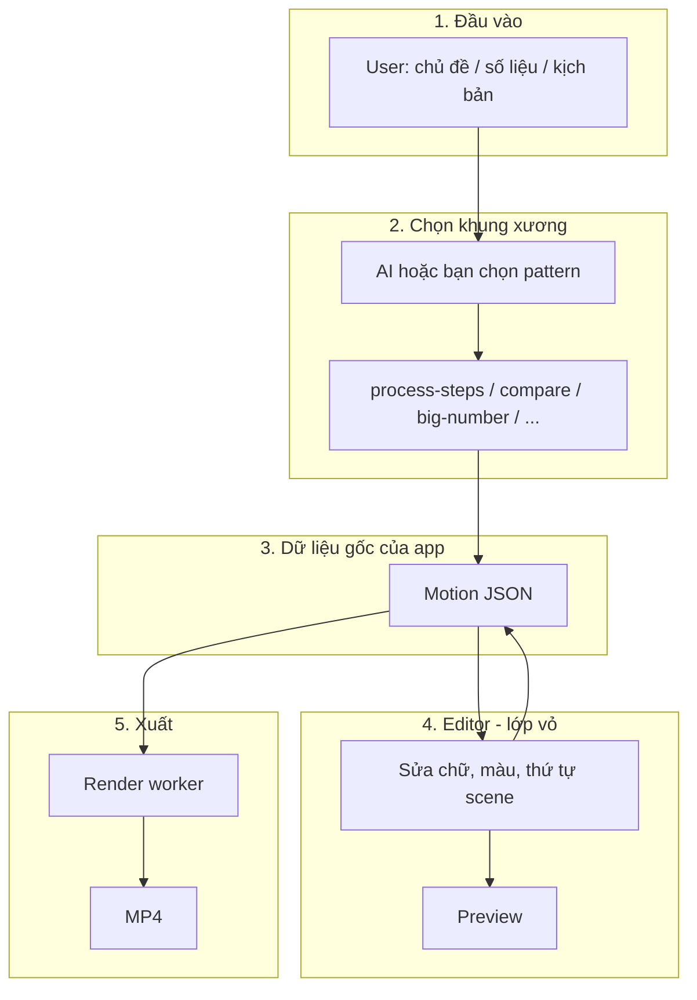
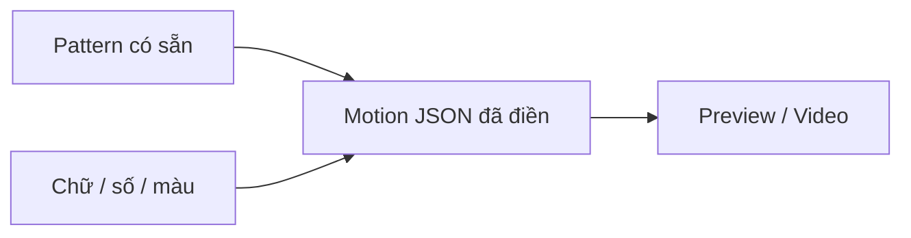

# Quy trình MotionVideo (giải thích đơn giản)

Bạn mới bắt đầu: **đừng nghĩ app = editor đẹp trước**.  
Nghĩ app = **có vài mẫu chuyển động chạy được**, rồi mới bọc editor quanh chúng.

---

## Câu hỏi: Editor trước hay mẫu animation trước?

| | Hoàn thiện editor | Hoàn thiện vài mẫu infographic |
|---|---|---|
| Là gì? | Giao diện CapCut-like | Pattern + Motion JSON + (sau) render ra video |
| Người dùng mua vì? | “Dễ dùng” | “Video/motion ra được, đẹp, đúng tiếng Việt” |
| Không có cái kia thì? | Editor trống = vô dụng | Vẫn demo/bán tay (concierge) được |

### Kết luận (gốc rễ)

```text
GỐC RỄ = Mẫu motion (template / pattern)
           ↓
         Motion JSON chuẩn
           ↓
         Xem được / xuất được
           ↓
         Editor chỉ là CÁCH SỬA mẫu đó
```

**Gốc rễ của app = vài mẫu animation infographic (hoặc TVC) chạy được.**  
Editor là lớp vỏ để người dùng sửa mẫu — quan trọng, nhưng **không phải gốc**.

Làm một mình:  
1. **Trước:** 3–5 mẫu + JSON đúng schema  
2. **Song song mỏng:** editor đủ để đổi chữ/màu/xem preview  
3. **Sau:** AI chọn mẫu, render MP4, chat đẹp hơn  

Đừng mài editor 2 tháng khi chưa có mẫu nào “thật”.

---

## App làm gì? (1 hình dung)

Người dùng đưa **nội dung** → hệ thống chọn **khung xương chuyển động** → điền chữ/số/màu → user chỉnh nhẹ → **xuất video**.

AI **không** vẽ cả video như Runway.  
AI (sau này) chỉ **chọn khung + điền nội dung**.  
Engine + template lo phần chuyển động.

---

## Sơ đồ quy trình tổng thể



**Motion JSON** nằm giữa mọi thứ.  
Editor đọc/ghi JSON. Render đọc JSON. AI cũng chỉ được phép ghi JSON đúng schema.

---

## Sơ đồ “mẫu infographic” là gì?

Mỗi mẫu = một **pattern** (kịch bản chuyển động cố định) + chỗ trống để điền.

Ví dụ pattern `process-steps` (quy trình):

```text
0s     Bước 1 hiện (fade-up)
2s     Bước 2 hiện
4s     Bước 3 hiện
6s     Kết luận / CTA
```

AI hoặc bạn chỉ điền:

- “Thu thập dữ liệu”
- “Phân tích”
- “Kết luận”
- màu brand

**Không** invent animation mỗi lần từ đầu.



Bạn cần khoảng **3 mẫu đầu** (đủ để hiểu quy trình):

1. `big-number` — số liệu lớn + chú thích  
2. `process-steps` — 3–5 bước  
3. `compare-2` — so sánh A vs B  

Sau mới thêm nhiều pattern.

---

## Việc làm theo thứ tự (solo)

### Giai đoạn A — Gốc rễ (làm trước)

1. Chốt schema Motion JSON (đã có trong `packages/motion-schema`)  
2. Viết tay **3 template** trong `template-library`  
3. Preview trong app: đọc JSON → hiện chữ/scene (stub cũng được)  
4. (Tuỳ chọn sớm) 1 pipeline render thử → 1 file MP4  

**Xong giai đoạn A = bạn đã có “sản phẩm cốt lõi”**, dù UI còn xấu.

### Giai đoạn B — Editor đủ dùng

1. Đổi chữ, màu, duration scene  
2. Timeline chọn scene  
3. Nút “tạo từ mẫu”  

Editor lúc này mới có giá trị vì **đã có gì để sửa**.

### Giai đoạn C — AI

1. User dán đoạn văn / số liệu  
2. Model nhỏ/vừa → chọn pattern + điền JSON  
3. Zod validate → mở editor  

### Giai đoạn D — Render ổn định

1. Motion Canvas (hoặc engine khác) trong `render-worker`  
2. FFmpeg → MP4 nhiều tỉ lệ  

---

## Motion Canvas nằm chỗ nào?

```text
Không cần ngay để nghĩ quy trình / viết mẫu JSON
Cần khi: muốn xuất video tự động từ JSON
```

Thứ tự đúng:

```text
Mẫu JSON → Preview thô → Editor mỏng → Render (Motion Canvas) → AI
```

Không phải:

```text
Editor đẹp → rồi mới nghĩ mẫu ❌
```

---

## So với AI video ngoài kia (nhắc lại 1 câu)

| Họ | Bạn |
|---|---|
| Prompt → video pixel | Nội dung → **mẫu timeline** → sửa → render |
| Khó chỉnh từng chữ | Chỉnh layer / scene |

---

## Checklist “tôi đang làm đúng gốc rễ chưa?”

Hỏi mỗi tuần:

- [ ] Có ≥ 3 mẫu JSON mở được trong app không?  
- [ ] Đổi được chữ trong mẫu đó không?  
- [ ] (Bonus) Xuất được 1 MP4 từ 1 mẫu không?  

Nếu chưa có 3 mẫu mà đang mài icon nav / chat UI → **lệch gốc rễ**.

---

## Tóm tắt một câu

**Gốc rễ = vài mẫu animation (Motion JSON) chạy được; editor và AI là lớp sau để dùng và nhân bản các mẫu đó.**

---

## Kế hoạch Motion Block chi tiết

Xem [`docs/blocks-plan.md`](./docs/blocks-plan.md): taxonomy block, 4 tuần, khi nào dùng LottieFiles, KPI tháng 1.
